# 차례

프롤로그: 이야기보따리를 풀면서

**1장 프랑스 | 샤모니몽블랑**
쌍둥이세요? · 진짜 퐁듀를 먹으러 왔는데요

**2장 대만 | 타이페이**
혼자 여행, 그거 어떻게 하는 건데 · 한밤중에 사찰에 가면 생기는 일

**3장 일본 | 오사카**
에어비앤비는 처음입니다만 · 친절한 덕후씨

**4장 중국 | 베이징**
레이오버 여행의 묘미 · 국제 미아가 될 순 없어

**5장 독일 | 쾰른**
선택적 낯가림

**6장 영국 | 런던**
무언가를 좋아하는 마음, 여전한가요?

**7장 캐나다 | P.E.I**
내 친구, 영은이 · 빨간머리 앤을 만나다

**8장 몽골 | 고비사막**
별이나 원없이 실컷 보고 싶네 · 사막의 맛

**9장 베트남 | 호찌민에서 사파까지**
호찌민 기차 플랫폼에 서서 · 누워서 베트남 종단하기 · 낯선 곳에서 낯선 직장 동료를 만나다 · 사파에서 보낸 일주일

**10장 크로아티아 그리고 보스니아**
엄마와 함께 여행한다는 것은 · 그래, 넘어보자 국경! · 미션: 렌터카를 반납하라 · 최고의 여행 메이트, 엄마

책 속의 여행 스크랩

---

# 이야기보따리를 풀면서

> 프롤로그

기억이라는 게 시작될 무렵, 여섯 살인가 일곱 살 무렵이었을 거다. 엄마가 국을 끓이고 언니들이 식탁에 수저를 놓기 시작하면, 나는 초인종 울리기를 기다렸다. 초인종 소리 다음에 이어지는 “아빠 왔다”는 걸걸한 목소리까지도.

그 소리에 나는 맨발로 현관까지 뛰어나가 묵직한 잠금장치를 돌리고 문을 열었다. 그리고 아빠 손에서 서류 가방이 떨어지기가 무섭게 깍지를 끼우며 말했다.

“아빠, 내가 재밌는 얘기 해줄까? 아빠 아빠, 옛날얘기 해줄까?”

나이가 들면서 아빠에게 털어놓던 이야기보따리는 점차 거뭇한 컴퓨터 화면으로 옮겨졌다. 보따리 속에는 일과나 꺼내 보이기 낯부끄러운 사적인 생각들이 담겼고, 종종 여행을 떠나 그곳에서 직접 겪은 것들을 끄적이기도 했다. 그렇게 사소하고 개인적인 이야기들이 차곡차곡 쌓여, 어느덧 한 권의 책이 됐다.

그중에서도 여행 이야기를 선택한 이유는, 그 안에 내 가장 젊고 유쾌한 시절이 녹아있기 때문이었다. 별것 아닌 일에 울거나 웃고, 벌벌 떨던 내가 그 시간 속에 있었다. 덕분에 어린 시절 아빠 손을 붙잡고 들려주고 싶었던 ‘재밌는 이야기’ 같은 에피소드들도 끄집어낼 수 있었다.

내가 글을 쓰는 동안 첫째 언니는 그림을 그렸다. 에피소드를 바탕으로 그림 한 점, 두 점이 완성될 때마다 가슴이 뛰었다. 허전했던 책 여백에 따스한 감성 한 스푼 얹어져 기분이 좋고 또 감사하다.

한 자 한 자, 청춘과 사랑을 담아 꾹꾹 써 내려갔다. 이 책을 읽게 될 당신도 손을 뻗어 매만질 수 있기를 바라는 마음을 담아서.

2024년 겨울
성보미

---

# 프랑스 | 샤모니몽블랑

> 1장 · 2008. 06

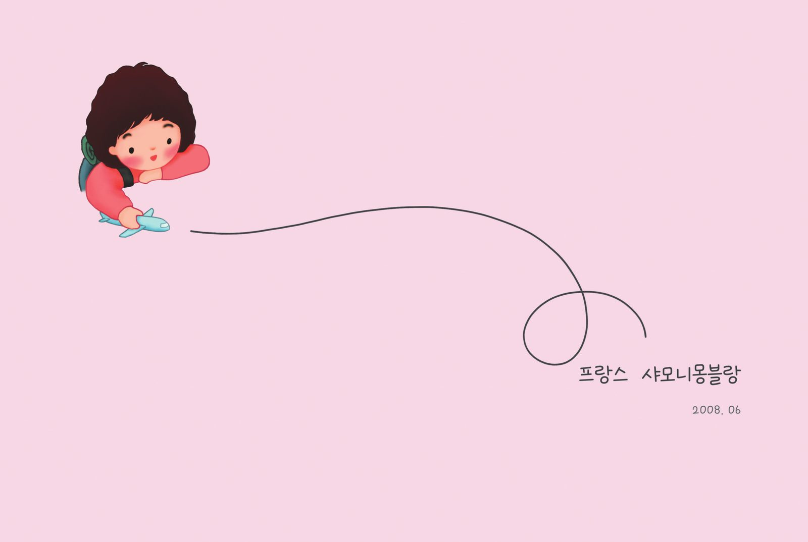

---

## 쌍둥이세요?

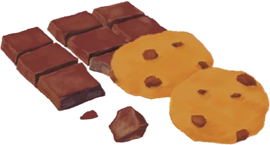

나는 딸부잣집의 막내로 태어났다. 위로 언니가 둘 있고, 나이 차이는 각각 여덟 살, 다섯 살 난다. 그중 둘째 언니는 어릴 때부터 나와 잘 놀아줬다. 우리는 놀이터에 가서 그네를 타거나 바둑판을 꺼내 오목을 두곤 했다. 언니는 내게 인생 선배이자 동시에 둘도 없는 친구였다.

나는 코 묻은 용돈이 차곡차곡 쌓이면 슈퍼로 달려가 언니가 가장 좋아하던 초코칩 쿠키를 샀다. 과자를 건네는 나에게 언니는 퉁명스레 ‘이런 데다 돈 쓰지 마라’고 말하면서도, 과자를 뜯어 내 입에 먼저 넣어주곤 했다.

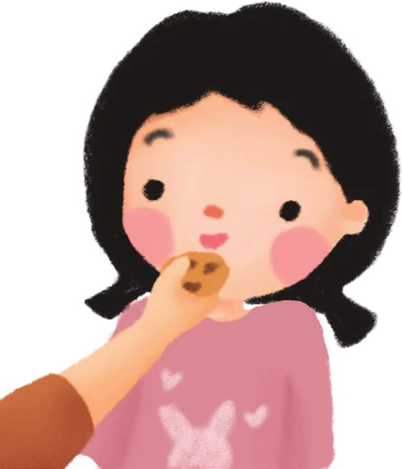

20평 남짓한 좁은 아파트에 할머니와 부모님, 언니들까지 여섯 식구가 살던 시절, 둘째 언니와 나는 ‘내 방’이라 할 만한 곳이 없어 거실과 작은 방을 전전했다. 낮에는 작은 방 책상에 나란히 앉아 숙제했고, 밤에는 거실에 이불을 깔고 잠들었다. 나란히 누운 두 자매는 밤이 깊어지도록 수다를 떨었고, 매번 낄낄대느라 정신이 없었다. 뭐가 그렇게 우스웠는지, 이불로 입을 틀어막으며 웃음을 참다가 결국 엄마에게 혼나고 나서야 간신히 잠이 들었다.

2008년 여름, 나는 언니와 서유럽으로 배낭여행을 떠났다. 당시 언니는 대학교 졸업을 앞두고 있어 취업 전 마음껏 놀 수 있는 최적의 시기였고, 나도 간신히 대학교에 입학해 한 학기를 마친 상태였으므로 시간 여유가 있었다.

엄마는 혼자보단 둘이 의지되고 안전할 거라 생각했는지, 선뜻 우리의 유럽 여행을 허락했다. 여유로운 형편도 아니었는데 말이다. 지금 돌이켜보면, 그때 엄마가 어떤 마음으로 없는 돈을 쥐어짜며 우리를 머나먼 서양 땅으로 보냈을지, 감히 상상조차 어렵다. 그런 엄마를 둔 딸은 그저 감사할 따름이다. 세상을 넓게 보고 오라는 엄마의 열린 마음이 통했을까. 막내딸은 여전히 바깥세상이 궁금하고, 틈만 나면 방랑을 즐기며 살고 있다.

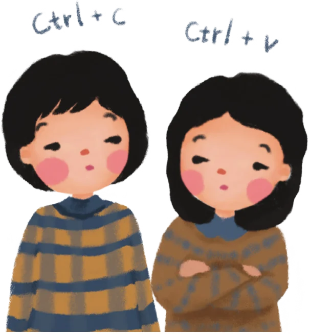

우리가 선택한 여행 패키지는 20~30대 청년들을 대상으로 한 것이었고, 우리 외에도 스무 명 남짓한 또래들이 동행했다. 처음 만난 젊은이들은 서로 이름과 나이를 묻고, 사는 지역을 얘기하며 서먹함을 풀었다. 특히 사람들은 언니와 나를 보며 신기해했는데, 우리가 너무 닮았기 때문이었다. 그들은 토씨 하나 틀리지 않고 같은 질문을 던졌다.

“쌍둥이세요?”

“아니요.”

“아, 그럼 연년생이시구나?”

“아니요. 5살 차이 나는데요.”

“헉!! 그럼 이쪽이 언니?”

여기서 중요한 건 ‘헉!!’ 하고 놀라는 소리에 늘 진심이 담겼다는 것이고, 언니라고 추측한 ‘이쪽’은 항상 날 가리키고 있었다는 것이다. 사람들은 마치 짠 것처럼 똑같은 레퍼토리로 질문을 반복했다. 나는 해탈한 나머지 때때로 “네, 제가 언니예요.”라고 받아치기도 했다.

사실 그들의 반응이 놀랍지는 않았다. 언니와 내가 닮아 벌어지는 해프닝은 종종 있었다. 친구들이 길에서 언니를 보고 ‘야! 성보미!’를 외치는가 하면, 내 SNS에 언니 결혼사진을 올리니 ‘벌써 결혼했냐?’며, 나의 결혼식(?)을 축하하는 지인들도 있었다.

언니의 동안 외모도 한몫했겠지만, 나의 노안 외모도 만만치 않게 영향을 끼쳤겠지.

사람들이 자꾸 쌍둥이냐고 물어서인지 모르겠지만 우린 여행하는 내내 쌍둥이처럼 착 붙어 다녔다. 식성부터 여행 스타일까지 모든 게 잘 맞았다. 우리는 파리와 로마의 오래된 골목을 걷는 걸 좋아했고, 화려한 밀라노보다는 고즈넉한 아시시(이탈리아 움브리아주의 작은 도시)를 좋아했다. 가난한 대학생들인지라 끼니를 거를 때도 있었지만 젤라토만큼은 포기할 수 없었다. 겁이 많아 소매치기나 수상한 사람이 접근한다 싶으면 냅다 뛰어서 도망치는 모습마저도 똑같았다.

우리의 여행은 대체로 순탄했다. 언니가 나를 혼내고 내가 언니에게 혼나는 일만 빼면 말이다. 특히 내 덤벙대는 행동은 언니에게 좋은 먹잇감이 되곤 했다.

나는 종종 키를 방에 두고 나오는 실수를 했는데, 일부 호텔의 경우 문이 자동으로 잠기므로 특히 주의해야 했다. 한두 번은 운 좋게 넘어갔으나 이탈리아에 도착한 날은 그러지 못했다.

사건의 시작은 이랬다. 체크인 후 언니와 나는 짐을 풀었고, 짐 정리를 마친 언니가 먼저 방에서 나갔다. 나도 뒤따라 나갔는데 문이 닫히고서야 침대 위에 올려둔 키가 떠올랐다. 이미 문이 굳게 잠긴 뒤였다. 달려가 호텔 직원에게 자초지종을 설명하자, 직원은 곤란한 표정을 지으며 마스터키는 없다고 했다. 대신 여분의 키가 있다며 나무로 엮은 허술한 바구니 하나를 짤랑거리며 들고나왔다. 바구니 안에는 수십 개의 열쇠가 들어 있었다.

직원과 나는 비장한 얼굴로 방문 앞에 섰다. 나는 직원에게 열쇠를 건네고 그는 하나씩 끼워봤다. 우리는 묘하게 호흡이 척척 맞았다. 그렇게 직원과 내가 열쇠 찾기 작전을 펼치고 있으니, 지나가던 투숙객들도 흥미롭게 지켜보기 시작했다.

맞지 않는 열쇠를 돌려보기를 수십 번째, 마침내 열쇠 하나가 시원하게 돌아갔다. 문이 스윽하고 미끄러지듯 열리자, 직원과 나는 환희에 찬 하이 파이브를 했다. 하지만 기쁨도 잠시, 저 멀리서 누군가의 차가운 시선이 느껴졌다. 다름 아닌 둘째 언니였다.

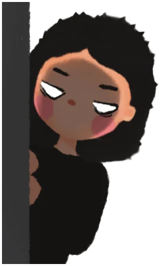

창피함에 숨어 있던 언니는 사람들이 흩어지고 나서야 내게 다가왔다.

“저번에도 그러더니 똑같은 실수를 또 해? 금붕어야?”

언니는 밤새도록 잔소리를 쏟아냈다. 억울했지만 반박할 말이 떠오르지 않았다. 나는 언니에게 등을 돌리고 이를 바득바득 갈며 겨우 잠들었다.

다음 날 아침, 여전히 뾰로통해 있는 내게 언니는 초콜릿 하나를 슬쩍 내밀었다. 언니가 런던에서 사서 애지중지하며 아껴 먹던 그 초콜릿이었다. 초콜릿 한입에 삐친 마음은 이미 녹아내렸지만, 티 내지 않으려고 부단히 신경썼다. 그러면서도 한편으로 어린 시절 내 입에 초코칩 쿠키를 넣어주던 언니가 떠올라 괜히 눈물이 핑 돌았다.

16년이 지난 지금, 언니와 나는 예전만큼 쌍둥이 같지 않다. 사는 모습이 달라져서인지 묘하게 외모도 달라졌다. 언니는 살이 불어났다고는 하지만 두 볼이 움푹 패어 늘 피곤한 얼굴을 하고 있다. 두 아이를 돌보랴 일하랴 정신없는 하루하루를 보내고 있는 탓이다. 그에 비해 나는 두 볼에 살이 보기 좋게 포동포동 올랐다. 주말이면 나란히 소파에 드러누워 연예 프로그램들을 줄줄이 꿰던 언니는 이제 육아 유튜브를 즐겨 본다. 언니의 사진첩에는 언니보다 아이들 사진이 더 많고, 메신저 프로필에는 애들 사진만 한가득이다.

가끔 16년 전 함께했던 유럽 여행을 떠올리며 감상에 젖는 나와 달리, 언니는 “어머, 그때 그랬니?”라며 모래알 사이에 흩어진 구슬을 줍듯이 간신히 기억을 끄집어낸다. 그러다 기억이 전혀 나지 않으면, 언니는 “애 둘을 낳으면서 기억력도 같이 낳은 것 같아.”하고 우스갯소리를 보탠다. 나는 그런 언니를 보며 한바탕 크게 웃다가도 이내 씁쓸한 입맛을 다신다. 언니의 흩어진 기억을 직면할 때면, 나는 되려 우리의 쌍둥이 시절을 그리워한다.

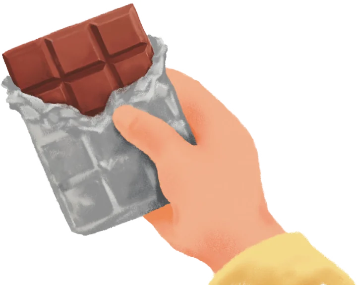

---

## 진짜 퐁듀를 먹으러 왔는데요

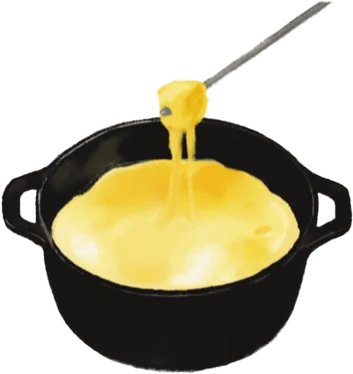

인생 첫 해외 여행지 중 가장 기억에 남는 곳이 어디냐 물으면, 단연 샤모니 몽블랑이었다. 그곳은 31가지 맛 나는 아이스크림을 종이 팩 안에 꽉꽉 눌러 담아낸 듯, 자연의 온갖 아름다움이 공허한 마음을 빈틈없이 채워줬다. 도시를 벗어나니 숨쉬기도 걷기도 편해졌다. 나는 게임에 나오는 동전 먹는 슈퍼마리오처럼 통통 튀며 걸었다. 발이 제멋대로 춤추듯 움직였다.

전망대에 오르기 위해 케이블카를 탔다. 땅에서 멀어질수록 주변이 점차 환해지더니, 꼭대기에 이르자 사방이 온통 흰 눈이었다. 산 위에 쌓인 눈은 빵 위에 뿌려진 슈거파우더처럼 새하얬다. 한여름에 크리스마스를 맞이하는 기분이었다.

이제는 입도 즐거울 차례였다. 이 지역에서 치즈퐁뒤는 꼭 먹어야 한다고 했으므로, 우리는 퐁뒤 식당을 찾아 나섰다.

‘퐁뒤(Fondue)’. 그 이름만 들어도 나는 턱 밑이 찌릿해지는 걸 느꼈다. 그 시절 퐁뒤는 어디서도 흔히 볼 수 없는 미지의 요리였으니, 그 요리를 먹겠다는 열망은 더욱 커졌다. 직접 본 적도 먹어본 적도 없었지만, 무조건 먹어야 했고 분명 맛도 있을 거라 생각했다.

하지만 요란한 마음과 별개로 식당들은 굳게 문이 닫혀있었다. 어리둥절해하는 우리에게 가이드는 보통 유럽 가게는 일요일이면 영업하지 않는다고 설명했다. 주말이면 식당가에 사람이 바글바글한 우리나라와는 달리, 유럽은 장사를 접고 가족들과 시간을 보낸다고 했다. 역시나 사랑이 넘치는 동네다.

관광지에서 벗어나 골목으로 들어서니 나무로 지어진 한적한 식당 하나가 눈에 들어왔다. 조금 낡았지만, 내부가 깔끔했고 알프스 분위기에 어울리는 아담한 식당이었다. 점심시간임에도 손님이 한 명도 없어 잠시 멈칫했으나 선택의 여지는 없었다. 식당 밖에도 사람이 없는 건 피차일반이었다. 종말이 닥친 지구에 유일하게 살아남은 여행자가 된 기분이랄까.

“크흠, 흠, 음.. 익스큐즈미??”

아무 기척이 없었다. 우리는 불길한 마음을 가다듬으며 적당한 곳에 자리를 잡고 앉아 무작정 기다렸다. 조금 지나자 직원 한 명이 터덜터덜 걸어 나왔다. 40대 정도로 보이는 동양인 여성이었는데, 웃음기 하나 없는 건조한 얼굴로 등장했다. 드디어 사람이 나타나자 우리는 반가움에 활짝 웃으며 손을 번쩍 들어 올렸다. 반면 그녀는 우리에게 눈길 한번 주지 않고 메뉴판을 테이블 위에 던지듯 올려놨다. 불길했던 예감이 서서히 확신으로 기울고 있었다.

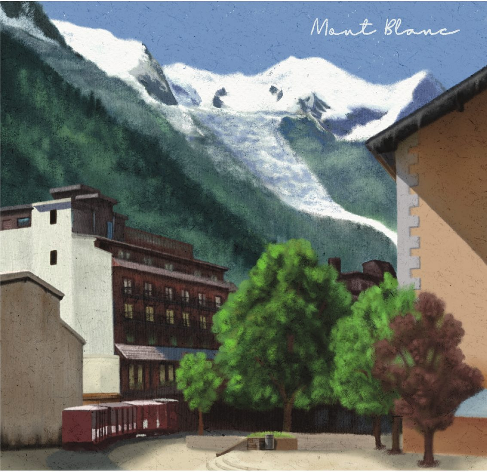

종업원은 휙 돌아서더니 한쪽 구석에 팔짱을 끼고 서서 멍하니 허공을 바라봤다. 무표정한 얼굴에 삐쭉 올라온 눈썹은 그녀의 인상을 더욱 신경질적으로 보이게 했다. 어떤 말도 하지 않았지만 어딘지 화나고 우울해 보였다. 우리는 그녀가 내뿜는 싸늘한 분위기에 제대로 압도당했다. 메뉴판을 넘기는 손길마저 조심스러워졌다.

메뉴판에는 꼬부랑글씨가 수수께끼처럼 길게 적혀있었는데, 몽블랑이 프랑스 영토이므로 아마 불어였을 것이다. 꼬부랑글씨는 아무리 들여다봐도 어떤 음식을 말하는 건지 알 수 없었다. 특히 퐁뒤가 뭔지 당최 알 수가 없었다. ‘Fondue’라고 적힌 메뉴들은 여기저기 사방에 흩어져 있었다. 이 수많은 메뉴 중 어떤 것이 내 환상에 답해줄 것인가. 나는 종업원과 눈을 마주치기 위해 고개를 빼 밀었다.

“익스큐즈미!”

종업원은 불량하게 꼬고 있던 다리를 풀고 천천히 우리 테이블로 다가왔다. 무기력하게 걸어오는 모습을 보고 있자니, 절로 힘이 빠졌다. 그녀는 코로 숨을 크게 내뿜으며 뒷주머니에 차고 있던 빈 수첩과 펜을 꺼내 들고 우릴 비스듬히 바라봤다.

“음.. 나는 퐁듀를 원한다.. 이거 퐁듀? 엄.. 이게 퐁듀입니까?”

메뉴판에 적힌 퐁뒤 중 가장 크게 적힌 메뉴를 가리키며 재차 물었다. 종업원은 무안할 정도로 나를 뚫어지게 보더니 고개를 위아래로 까딱했다. 고개는 위아래로 움직였지만 어쩐지 믿음이 가지 않았다. 그래도 뭐 어쩌겠나. 그녀가 퐁뒤라면 퐁뒤겠지.

“이거 하나 주세요”

종업원은 삐쭉 올라간 눈썹을 한껏 더 치켜세우면서 뭔가를 휘갈기더니 뒷주머니에 수첩을 찔러넣었다. 이어 홱 하니 메뉴판을 낚아채고는 무기력한 걸음새로 사라졌다. 화가 난 건지 기운이 없는 건지 도통 알 수 없었다. 테이블에는 더 이상 어떤 말도 오가지 않았다.

곧이어 종업원은 한층 더 어두워진 낯빛으로 두 손 가득 뭔가를 들고 나타났다. 그녀는 테이블에 지저분하고 낯익은 버너를 올렸다. 버너 위에는 여기저기 그을리고 찌그러진 스테인리스 냄비가 올라갔고, 그 안에 누렇고 투명한 액체가 채워졌다. 깍뚝 썰린 고기들도 꼬챙이에 끼워진 채 한 아름 따라 나왔다.

전두엽이 울렸다. 뭔가 잘못된 게 분명했다. 양푼 냄비와 버너라니. 상상했던 퐁뒤의 모습과는 정반대였다. 눈 앞에 펼쳐진 상차림에 이름을 붙인다면 ‘즉석 튀김 요리’ 같은 게 어울려 보였다. 예상치 못한 전개에 우리는 모두 일시 정지 상태로 멈췄다. 퐁뒤를 먹어본 적은 없었지만, 적어도 그게 치즈를 곁들여 먹는 요리라는 것 정도는 알았다.

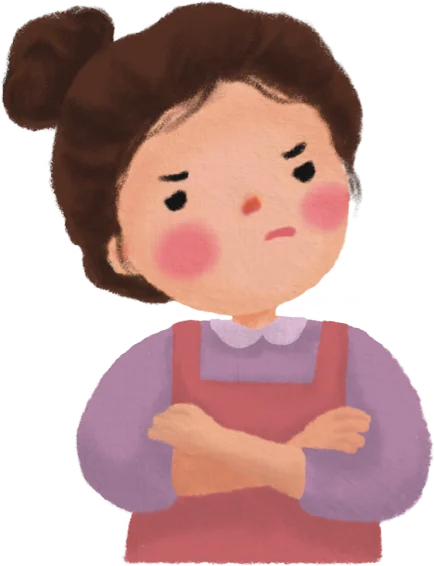

우리는 종업원에게 “치즈는 없나요? 치즈를 추가해야 하나요?”, “이거 퐁듀 맞죠?”하고 질문을 퍼부었다. 그러자 그녀는 매서운 눈초리로 쏘아보며 말했다.

“이거 퐁듀 맞아. 치즈는 없어”

싸늘한 답변에 우리는 바람 빠진 풍선처럼 쪼그라들었다. 일단 먹어 보는 수밖에 없겠지. 하나둘 앞에 놓인 꼬치를 집어 들었다. 생고기와 야채들이 오밀조밀 꽂힌 꼬치를 냄비에 푹 밀어 넣자, 냄비 위로 보골 보골 기포가 올라오더니 이내 파르르하고 튀겨졌다. 냄비가 크지 않았으므로 한 명씩 돌아가며 꼬치를 튀겨야 했다. 식탁에 둘러앉은 사람들은 한 손에 생고기를 들고 일제히 냄비를 노려보며 자신의 차례를 기다렸다. 그 모습이 흡사 사냥에 성공한 원주민들의 저녁 식사 같았다.

맛은 있었다. 튀김은 신발을 튀겨도 맛있다는 말도 있지 않은가. 간이 세긴 했지만, 좀 짜게 먹는다고 생각하면 참을 만했다. 부디 이 요리가 퐁뒤이길 바라는 마음으로 한 면 한 면 정성스럽게 튀겼다. 갑자기 영화 ‘집으로’에서 시골 할머니에게 치킨 먹고 싶다 했다가, 한 솥 끓여진 닭백숙을 보고 오열하던 유승호가 떠올랐다.

정신없이 먹다 보니 냄비에 가득 차 있던 기름이 바닥을 보였다. 이윽고 꼬치를 냄비 바닥에 바짝 붙여야 간신히 익는 상황에 이르렀다.

“오일..? 오일 플리즈??”

“!@#!@$@~!@*&%”

기름 리필 요청에 종업원은 도통 알아들을 수 없는 말들을 쏟아냈다. 우리가 고개를 갸웃거리자, 종업원은 어깨를 으쓱하더니 자리를 피했다. 머릿속이 하얘졌다. 과연 그녀는 무슨 말을 한 것일까. 기름은 왜 리필될 수 없는 것일까.

마침, 그때 종업원과 똑 닮은 또 다른 동양인 여성이 식당 안으로 들어왔다. 두 사람은 만나자마자 중국어로 쉴 새 없이 대화를 나눴다. 나는 너무 놀랐다. 종업원이 웃고 있었기 때문이었다. 저런 표정도 지을 수 있는 사람이었다니. 그녀의 반전 모습이 놀랍기도 했지만, 그보다 중요한 건 ‘중국어가 들렸다’는 거였다. 중국어가 귀에 꽂히는 순간, 내 시선은 한 곳을 향했다. 시선의 끝에는 나의 둘째 언니가 있었다. 언니의 얼굴은 이미 하얗게 질려 있었다. 중국어가 들리는 순간, 본인도 자신의 운명을 눈치챈 것 같았다.

“언니, 언니가 가서 말해봐”

언니는 중국어 전공자인 데다가 회화도 곧잘 했다. 말이 통하지 않는 종업원에게 궁금한 걸 묻고 뭔가를 요청하려면 언니의 도움이 절실했다. 다만 낯을 많이 가리고 사람들 앞에서 주목받는 걸 극도로 싫어하는 언니가 쉽사리 나설지는 미지수였다. 나도 언니의 성격을 아는 이상 더는 강요할 수 없었다. 이제 남은 건 언니의 선택이었다. 언니는 아랫입술을 잘근잘근 씹으며 기름이 바닥난 냄비를 물끄러미 보더니 결심했다는 듯 벌떡 일어났다. 그러곤 종업원에게 다가가 현란한 중국어를 토해냈다. 종업원의 두 눈동자가 커지는 게 느껴졌다. 언니의 눈빛은 당당했고 목소리엔 힘이 실려있었다.

내 허벅지 위로 닭살이 돋는 게 느껴졌다. 옆에서 지켜보던 일행들도 놀라는 기색이었다. 그들은 언니를 바라보며 중국어를 어떻게 저렇게 잘하냐며 한마디씩 거들었다. 일행들의 반응에 괜히 내 어깨가 으쓱여졌다. 나는 언니를 대신해, 중국어를 전공했고, 중국이랑 대만에서 교환학생을 다녀왔었노라고 설명했다. 암울하게 고기 튀기는 소리만 들리던 테이블에는 순식간에 흥분한 목소리로 가득 찼다.

언니와 종업원은 꽤 오랜 시간 대화를 나눴고, 우린 그 모습을 흐뭇하게 바라봤다. 종업원의 표정은 놀라움에서 호기심으로, 호기심에서 온화함으로 변해갔다. 얼굴이 어찌나 폈는지 주문받을 때보다 한 열 살은 어려 보였다. 이윽고 대화가 끝났는지 언니는 테이블로, 종업원은 주방으로 돌아갔다. 곧이어 언니의 통역이 시작됐다.

“기름을 리필하려면 고기를 더 시켜야 한대. 지금은 고기를 거의 다 먹은 상태여서 기름이 필요 없지 않냐고 하시네. 추가하려면 돈이 많이 드니까 일단 내가 괜찮다고 했어. 혹시 더 주문해야 할까?”

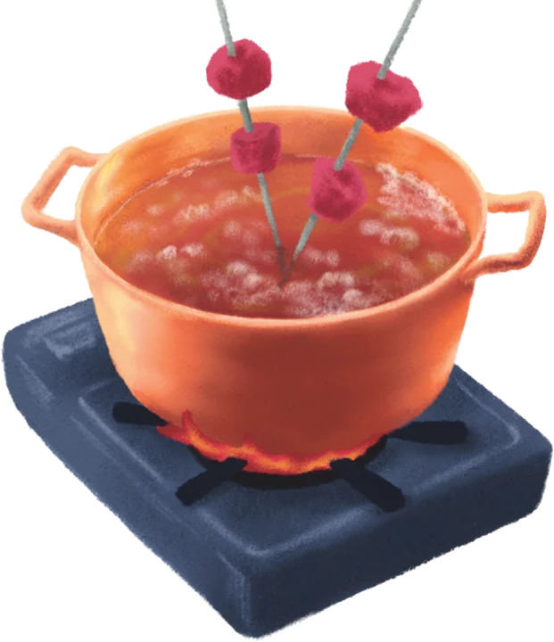

언니가 입을 열 때마다 식탁에는 “아아” 또는 “오오”의 감탄사가 터져 나왔다. 우리는 언니 말대로 추가 주문을 포기했다. 배가 아직 덜 찼지만, 물가가 비싼 동네라 그런지 음식값이 꽤 나갔기 때문이다. 텅 빈 냄비 바닥을 긁으며 마른침만 삼켜야 했다.

“그리고 우리가 알던 퐁뒤는 치즈를 중탕해서 빵이나 고기를 찍어 먹는 건데, 그건 여기서 안 판대. 다른 식당에 가야 했대.”

언니는 종업원의 말을 하나하나 전하며 자신이 할 수 있는 일을 침착하게 해냈다. 바로 그때 놀라운 일이 일어났다. 종업원이 기름통을 들고 다시 나타난 것이다. 곧이어 가져온 기름을 냄비 안에 잔뜩 부어 넣었고, 심지어 서비스로 꼬치도 한 그릇 더 얹어줬다. 물가가 비싸기로 소문난 동네에서 고기 한 접시 서비스라니. 천사가 분명했다. 우리는 종업원에게 땡큐와 씨에씨에를 섞어가며 감사 인사를 외쳤다.

우리가 다시 식사에 몰두하자 종업원 두 명은 언니 곁에 슬그머니 다가와 말을 걸기 시작했다. 나중에 들어보니, 그들은 언니에게 ‘어디에서 왔냐?’, ‘중국어는 어디서 배웠냐?’, ‘여행 왔냐?’, ‘이제 어디로 가냐?’ 등의 질문을 했다고 했다. 언니는 그들의 질문에 성실이 답했고 세 사람은 한참을 깔깔거리며 대화를 나눴다.

알고 보니 두 사람은 자매인데, 중국에서부터 몽블랑으로 같이 시집왔다고 했다. 두 사람은 함께 식당을 차렸고, 주방에는 두 사람의 남편이 요리를 도맡아 하고 있었다. 자매는 고향을 떠난 지 오래됐고, 가족들도 친구들도 못 본 지 십여 년은 더 됐다고 했다. 그나마 서로가 곁에 있어 위안이 된다고도 덧붙였다. 불어를 조금 배우긴 했지만 소통하는 데 어려움이 있었고 이런 관광지에선 영어도 쓰게 돼 있으니, 영어도 불어도 쉽지 않은 하루하루를 보내고 있었다.

속사정을 듣고 보니 쌀쌀맞았던 식당 주인의 행동도 어느 정도는 이해가 갔다. 고향이 그리웠고 타지 생활은 팍팍했을 것이다. 게다가 언어까지 안 통하니 얼마나 답답하고 괴로웠을까. 그러던 차에 고향의 말을 할 줄 아는 손님을 만났으니 반가웠을 것이다.

마지막으로 자매는 우리에게 콜라 2병까지 덤으로 얹어줬다. 기름에 절여지던 속을 콜라로 쓸어내리니, 마치 해장하는 느낌이 들었다.

나중에 한국으로 돌아와 검색해 보니, 우리가 먹은 가짜(?) 퐁뒤는 실제로 퐁뒤가 맞았다. 내가 먹은 건 약간의 중국 스타일이 곁들여지긴 했지만, 고기와 야채를 기름에 튀겨먹는 일명 오일 퐁뒤, ‘퐁뒤 부르기뇽(Fondue bourguinonne)’이었다. 프랑스 부르고뉴 지방의 포도 농장에서 간편하게 새참으로 해 먹던 게 시초가 됐단다.

나는 가끔 여행이 뜻대로 풀려, 그때 ‘진짜’ 아니, ‘그냥 치즈퐁뒤’를 먹었다면 어땠을까 상상한다. 궁금했던 퐁뒤를 맛봐서 기뻤을 수는 있겠지만 중국인 자매 사이에 껴서 온갖 서비스와 환대를 받는 경험은 절대 겪지 못했을 것이다.

식사를 마치고 떠날 때, 자매는 우리를 향해 손을 흔들어 보였다. 우리가 그 골목에서 보이지 않는 점이 될 때까지 그들의 손은 연신 흔들리고 있었다. 좌우로 힘차게 흔들리던 그들의 손이 힘없이 떨궈질 생각을 하니 코끝이 아려왔다.

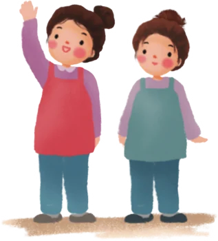

---

# 대만 | 타이페이

> 2장 · 2014. 03

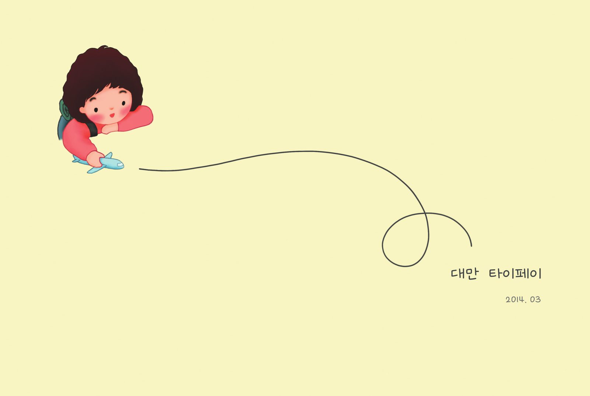

---

## 혼자 여행, 그거 어떻게 하는 건데

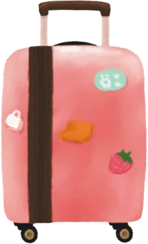

가끔 나는 내 인생이 드라마나 영화처럼 으레껏 잘 풀릴 거라 착각한다. 특히 여행을 떠날 때면 그런 헛된 믿음은 더욱 커진다. 매번 변수에 뒤통수를 맞으면서도 사람 마음이라는 게 쉽게 고쳐지질 않는다. 스물넷의 나 역시 그랬다. 친구와 타이베이 여행을 계획하면서, 그 여행이 당연히 순탄할 거라 믿었다. 그런 내가 나 홀로 쓸쓸히 타이베이로 떠나게 됐다. 친구가 출국 일주일을 앞두고 불참 선언한 탓이었다.

친구는 H 기업 서류 전형에 합격했고, 면접 날짜가 여행 일정과 겹치는 바람에 부득이하게 여행을 취소했다. 한창 취업 준비에 열 올리던 졸업 시즌이었으니, 어찌 보면 당연한 선택이었다. 친구의 면접 소식에 부러움과 걱정이 동시에 몰려왔다. 취업이 시급했던 마지막 방학이었기에 나도 여행을 취소해야 하나 싶었다. 게다가 혼자 여행은 내게 너무나 낯선 경험이었다. 지금이야 혼자서도 별 고민 없이 훌쩍 떠나지만, 당시의 나는 아니었다. 혼자 밥 먹고 커피 마시는 건 아무렇지 않았으면서 혼자 여행은 어색했다. 여행이란 것은 우르르 몰려가서 왁자지껄 떠들다가 녹초가 되어 돌아오는 거라고 생각했다.

이대로 떠나는 것이 맞나? 잠시 고민했지만 결국 예정대로 대만행을 택했다. 여행을 취소한다고 안 되던 취업이 기적처럼 이루어질 리도 없었고, 이번 기회에 혼자 여행을 경험해 보고 싶었다. 결심하고 나니 이번엔 부모님의 걱정 섞인 잔소리가 시작됐다.

“친구는 면접보러 간다는데 너도 이제 취업 준비해야지”

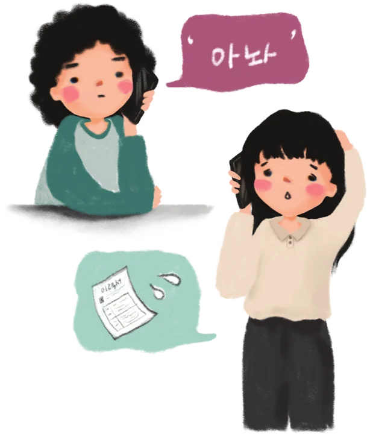

“혼자 말도 안 통하는 타지에 가서 어쩌게? 겁도 안 나?”

나는 해가 지면 혼자 돌아다니지 않겠다, 사람 많은 안전한 길로만 다니겠다, 대만이 치안이 그렇게 좋다더라 같은 말들로 부모님을 안심시켰다. 큰 소리 떵떵 치긴 했지만 사실 불안한 건 나도 마찬가지였다. 타이베이행 비행기 안에서 무거운 공기만 말없이 삼켰다. 걱정하는 부모님을 떠올리면서, 그리고 불안에 떨고 있는 나를 보면서, 아직 어른이 되지 못했음을 깨달았다. 나는 나를 감싸고 있는 껍질을 벗어던지지 못한 못난 성충이었다.

대만에 도착한 지 불과 몇 시간 만에 불안은 현실이 됐다. 숙소를 찾지 못해 같은 곳만 한 시간째 빙빙 돌고 있었던 것이다. 접근성 좋은 타이베이 메인스테이션 역 근처 호스텔을 예약한 것까진 좋았으나, 이 역은 이름에 걸맞게 상당히 크고 복잡한 곳이어서 길 잃기 십상이었다. 설상가상으로 골목에 들어서니 길 물어볼 사람 하나 보이지 않았다. 한참 캐리어를 끌며 헤매고 있는데 젊은 언니 한 명이 보였다.

“엇, 어! 헬프! 아, 아니지. 캐, 캔 유 헬프 미??!”

언니를 놓칠세라 두 팔을 있는 대로 휘저으며 헬프미를 외쳤다. 그녀는 두 눈을 가늘게 뜨며 나를 바라보더니, 천천히 다가왔다.

“엄.. 아임 룩킹 포.. 엄..디스 호스텔”

허접한 영어 실력과 함께 손때 묻은 종이 한 장을 건넸다. 종이는 해질 대로 해져 있었고, 그 안에는 숙소 위치가 표시된 지도가 프린트돼 있었다. 유심도 데이터 로밍도 흔치 않았던, 이른바 ‘라떼 시절’의 여행이었다. 지도를 유심히 보던 그녀는 두리번거리더니 바로 앞 철물점으로 뛰어 들어갔다. 잠시 후 언니는 철물점에서 낯선 아저씨와 함께 나왔다. 두 사람은 내 지도를 양쪽에서 나눠 들고 진지한 얼굴로 대화하고 있었다.

“아저씨, 여기 호스텔 알아요?”

“글쎄.. 이 근처 같긴 한데.. 지도로 봐선 잘 모르겠네?”

전혀 알아듣지 못했지만, 느낌상 둘의 대화는 이런 내용이었을 것이다. 고민하던 대만 아저씨는 주변에 지나가던 행인을 하나둘 불러세우며 너덜너덜한 종이를 보여주었다. 조금 전까지만 해도 아무도 없던 골목에서 순식간에 대여섯 명이 모였다. 이름도 몰라요. 성도 몰라, 어디서 왔는지 전혀 알 길이 없는 시민들이 삼삼오오 모여 심각한 표정으로 회의를 시작했다.

“너 여기 알아? 우리 지금 저 외국인 숙소 찾아주는 중인데”

“저 건너편 건물 아냐?”

“아냐 내 생각엔 저기 뒷골목 같아.”

“아아, 여기!”

마지막에 합류한 젊은 남성 하나가 확신에 찬 듯 손가락으로 허공을 가리켰다. 그러더니 내게 다가와 속사포로 위치를 설명했다. 내가 맹한 표정으로 두 눈만 껌뻑이자, 남자는 안 되겠다 싶던지 따라오라 손짓하고는 앞장서서 걸었다. 그러고는 내 캐리어를 낚아채 마치 자신의 것처럼 끌고 갔다. 그렇게 남성을 선두로 나와 대만 언니, 철물점 아저씨 그리고 서너 명의 대만 사람들이 뒤따랐다. 분명 갈 길이 서로 다르던, 일면식도 없던 사람들이었다. 나는 당황스러우면서 웃음이 났고 어떤 표정을 지어야 할지 난감했다. 그때의 감정은 어렴풋하지만 낯익은 것이었다. 어린 시절 언니를 앞장세워 날 괴롭히는 친구를 혼내주러 갈 때 느꼈던, 바로 그 은근한 우쭐함이었다.

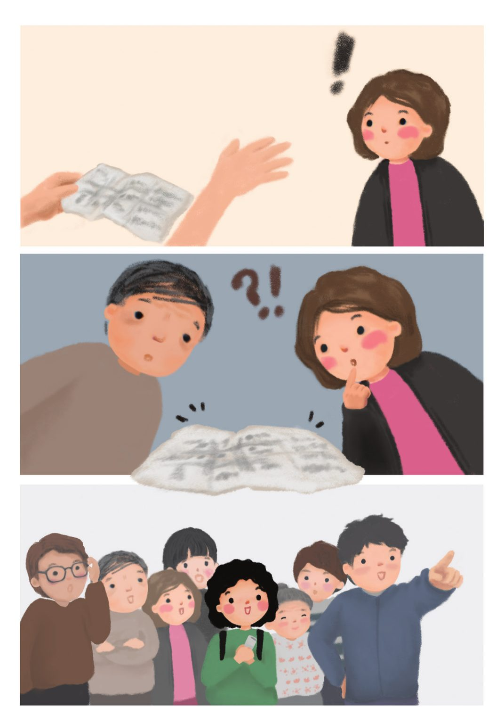

좁은 골목을 지나 얼마 후, 앞장서던 남성이 한 건물의 정문을 가리켰다. 문 한쪽에 작은 글씨로 ‘OOO 호스텔’이라 적혀 있었다. 내가 찾던 바로 그 숙소였다.

“와아! 씨에씨에!!”

나는 연신 90도로 고개를 숙이며 감사 인사를 전했다. 그들은 내게 손을 가볍게 흔들며 ‘아..저런 데가 있었네?’, ‘나도 처음 봐 저런 곳은’ 등의 대화를 주고받더니 (물론 내 추측일 뿐이지만) 각자 다른 길로 흩어졌다. 나는 시야에서 나의 타이베이 영웅들이 사라질 때까지 그들이 떠난 자리를 멍하니 바라봤다. 어쩐지 여행의 출발이 좋았다. 혼자 여행, 이렇게 하는 거구나.

---

## 한밤중에 사찰에 가면 생기는 일

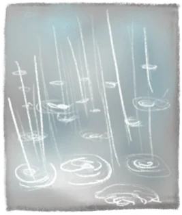

나의 첫 타이베이는 온종일 구슬프게 비가 내렸다. 다음 날에도 또 그다음 날에도 비는 멈추지 않고 계속 내렸다. 일정에 없던 생리까지 터져 온천에 가려던 계획도 취소됐다. 어두침침한 호스텔 다인실에 홀로 침대 하나 차지하고 누워있으니 우울함이 미친 듯이 몰려왔다. 왜 나는 혼자 말도 안 통하는 타지에 나와 청승맞게 누워 있는 걸까. 그렇게 하루를 한탄 속에 흘려보내고 있었다. 친구들에게 메신저로 한참 투덜대고 있는데 한 친구에게서 답장이 왔다.

“그래도 난 지금 대만에 있는 네가 부럽다! 친구야, 즐겨!”

‘즐겨!’ 이 한마디에 머리가 띵하고 울렸다. 그래, 그냥 이 순간을 즐기면 되는 거였어. 정말 간단한 거였는데. 왜 미처 몰랐지? 가방에 처박아둔 여행 가이드북을 다시 꺼냈다. 시계는 오후 5시를 가리키고 있었다. 야경 볼 수 있는 곳을 찾아 책을 빠르게 넘기다 한 페이지가 손에 잡혔다.

‘즈난궁’

타이베이에서 꽤 큰 사찰 중 하나로, 산자락에 위치해 야경 보기에 딱 좋아 보였다. 퇴장 시간이 오후 9시라니 아직 여유가 있었다. 우산과 여행 책자, 지갑을 가방에 구겨 넣고 곧장 숙소 밖으로 나갔다.

“즈난꿍? 즤난..꿍?”

버스 기사 아저씨에게 엉성한 중국어로 목적지를 물었다. 한국 개그 프로그램에서 어설프게 한국말 하는 외국인을 흉내 내던 코미디언이 떠올랐다. 이제 그런 개그에 더는 웃을 수 없을 것 같았다. 다행히 아저씨는 내 말을 알아들은 듯 고개를 끄덕이며 타라고 손짓했다.

버스는 부슬부슬 내리는 비를 뚫고 한참을 달렸다. 즈난궁은 타이베이 메인스테이션에서 꽤 먼 곳에 있는 데다 종점이었으므로, 맘 놓고 드라이브를 즐겼다. 차창은 실선과 점선을 수없이 그으며 낙하하는 빗방울들로 얼룩졌다. 버스는 멈췄다 달리기를 반복했고, 어느 순간부터는 타고 내리는 승객도 거의 없었다. 버스 안에는 어린아이를 둔 가족과 나이 지긋해 보이는 할아버지, 그리고 나뿐이었다. 창밖의 현란하게 빛나던 네온사인도 점차 흐려졌고, 길 위의 인파도 서서히 사라졌다. 어둠이 깊어질수록 버스 안은 더욱 고요해졌다.

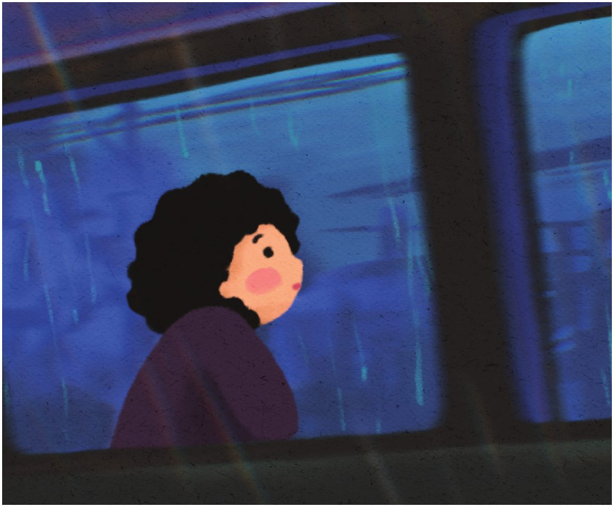

어느새 종점에 다다랐다. 정거장은 공터 한가운데에 있었는데, 그곳엔 주변만 간신히 밝히는 가로등뿐이었다. 다행히 비는 그쳐있었다. 나와 일가족, 할아버지 이렇게 세 팀이 버스에서 내렸고, 텅 빈 버스는 제자리에서 한 바퀴 돌아왔던 길로 나갔다. 팔을 뻗어 떠나는 버스를 붙잡아볼까 싶었지만, 이미 저만치 멀어지고 있었다. 함께 내린 승객들도 순식간에 시야에서 사라졌다.

주변을 둘러보니 표지판도 보이지 않을 정도로 어두웠다. 이래서야 야경 감상은커녕 즈난궁을 찾아가지도 못할 판국이었다. 어디로 가야 하지? 문득 주변의 작고 낡은 집들이 음산해 보였고, 갑자기 온몸에 털이 뻣뻣하게 섰다. 휘몰아치는 바람은 나뭇가지에 매달려있던 빗방울을 사방에 흩뿌렸다. 물을 머금은 시린 바람이 뺨을 스치자, 온몸이 움츠러들었다. 마치 적의 위협을 감지한 한 마리의 고슴도치처럼.

정신을 가다듬으며 여행책에서 읽었던 내용들을 떠올렸다. 즈난궁까지 가려면 정거장에서 산길을 한참 걸어 올라야 한다고 했었다. 과연, 지금까지 한 걸음도 못 떼고 있는 내가 저 머나먼 산길을 뚫고 올라갈 수 있을까? 차마 용기가 생기지 않았다.

“!@$!@#!@#?”

“히익!!”

바로 그때, 돌연 눈앞에 백발의 할아버지가 나타났다.

놀라는 내 모습에 할아버지도 당황했는지 눈을 동그랗게 뜨고 움찔하더니, 이내 껄껄 웃었다. 자세히 보니 방금 전 같은 버스에서 내렸던 할아버지였다. 웃는 할아버지 얼굴에 주름이 접혔는데, 원래 제자리를 찾은 듯 자연스럽게 깊어졌다. 하얗게 물든 눈썹은 길게 늘어져 있었고 웃을 때마다 위아래로 흔들렸다.

“!~$!*#@#!”

할아버지는 계속해서 중국어로 말을 걸었다.

“오우..쏘리. 아이 캔트 스픽 차이니즈..”

나는 손을 좌우로 흔들어가며 온몸으로 중국어를 못한다는 걸 표현했다. 할아버지는 어깨를 으쓱하며 난감한 표정을 지어 보이더니, 이내 허허 웃고는 다시 중국말을 이어갔다.

“!@#^&........지난꿍....&#..?”

참 지독하게 고집스러운 할아버지였다. 아님 내 말을 못 알아들으셨나? 영문은 모르겠지만, 와중에 할아버지의 문장 속에서 유일하게 아는 단어 ‘즈난궁’을 들었다. 혹시 ‘즈난궁에 가냐’는 질문인가 싶어, “즈난궁 즈난궁 예쓰예쓰”하고 답했다. 그러자 할아버지가 ‘호오’하고 고개를 끄덕이더니 더 길고 더 유창한 중국말들을 내뱉었다. 그러곤 손가락으로 한 방향을 가리켰다. 어쩐지 즈난궁 가는 방향이 저쪽이라는 것 같았다.

“즈난궁? 저기가 즈난궁?”

할아버지는 고개를 끄덕이며 ‘허허’하고 웃었다. 할아버지가 가리킨 곳에는 위로 향하는 돌계단 길이 보였다. 나는 그 방향을 향해 무작정 걸었다. 할아버지도 내 보폭에 맞춰 발을 옮겼다.

오르다 보니 계단 양옆으로 굳게 닫힌 집들이 다닥다닥 붙어있었다. 주변에서 음식 냄새도 은은하게 났다. 한낮에 그 집들은 문을 활짝 열고 가스불을 연결해 온갖 맛 좋은 간식을 만들고, 가판대에 기념품들을 잔뜩 내놓고 팔았을 것이다. 그러면 오가는 관광객들이 뭐 하나 사볼까 싶어 기웃거렸겠지.
