# 차례

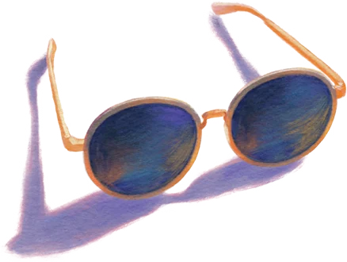

별 하나가 우리에게 왔다

**01 지우가 달라졌어요** — 첫 비행기 여행, 제주
비행기 · 안녕하세요 · 목말 · 데칼코마니 · 5월의 물놀이 · 지우가 달라졌어요 · 꿈

**02 응급실에서 시작된 여행** — 두 번째 제주
응급실 · 내 거야 · 나중에 커서 · 함께 걷는 속도

**03 아무 계획 없이** — 여수
뚜벅이 엄마 · 아무 계획 없이 · 온수풀 · 나는 이런 거 잘해

**04 이모들** — 청도
이모 최고야 · 신호산 · 라이트쇼

**05 매년 같은 곳** — 강원도
허름한 리조트 · 우리 집에 왜 왔니 · 검게 그을린 풍경 · 컵라면

**06 우리 셋** — 코타키나발루
설렘 반, 걱정 반 · 물 만난 고기들 · 마사지 · 고생 끝에 낙 · 여름의 크리스마스 · 눈물의 밤 산책

**07 두려움을 깨고** — 나트랑
수영 · 안 봐도 알겠다 · 하, 힘들어 · 고집쟁이 · 스노클링 · 이번 마사지는

책을 마치며

---

# 별 하나가 우리에게 왔다

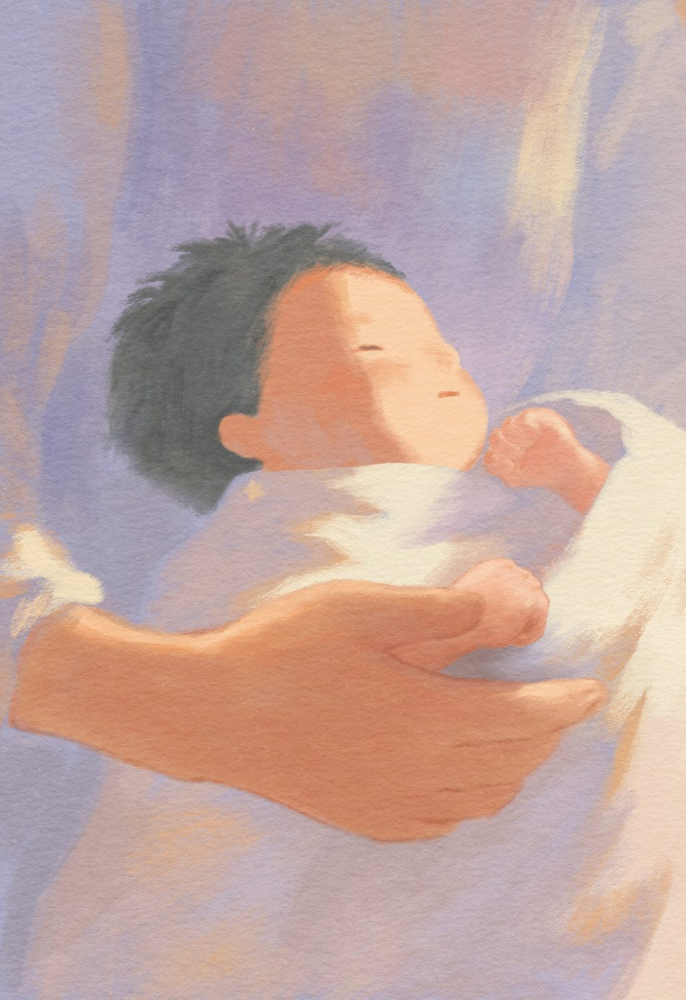

지우를 가졌을 때, 반짝이는 별이 나오는 꿈을 꿨다. 무슨 내용이었는지는 이제 가물가물한데, 눈이 부시게 반짝였다는 것만은 또렷하다. 태명은 고민할 것도 없이 ‘별이’가 되었다.

별이는 결혼하자마자 찾아온 허니문 베이비였다. 뱃속에서부터 유난히 작았던 아이라, 내가 할 수 있는 건 잘 먹는 것뿐이라며 부지런히 먹었다. 그런데도 별이는 38주에 2.17kg으로 태어났다. 톡 하고 건드리면 부러질 것 같은 작은 몸에, 이상하리만큼 무성한 머리카락을 가진 아이였다.

태어난 지 하루 만에 지우는 세브란스 병원으로 옮겨졌다. 심장에 문제가 있었고, 정밀 검사 끝에 염색체 이상이라는 말을 들었다. 검색창에 진단명을 넣는 순간, 화면에는 내가 감당할 수 없는 말들이 쏟아졌다.

두 돌이 지나도 8kg을 넘기기 힘들었다. 수유는 늘 오래 걸렸다. 한 입이라도 더 먹이려고 씨름하다 보면 한 시간이 훌쩍 지나 있었다. 어쩌다 잘 먹고 기분 좋게 노는 날도 있었지만, 금방 또 탈이 나 병원 신세를 졌다. 한 달에 두어 번 입퇴원을 반복하다 보니, 병원 침대가 집보다 익숙하게 느껴지는 밤도 있었다.

얼마 지나지 않아 지우는 심장 수술을 받았다. 품에 안으면 한 줌도 안 될 것 같은 아기를 수술대에 홀로 두고 나오면서 나는 조용히 눈물을 훔쳤다. 수술과 시술은 그 뒤로도 이어졌다. 의사 선생님은 지우가 걷기도 말하기도 힘들 수 있다고 했다. 병원에서는 늘 최악을 먼저 말한다는 걸 알면서도, 그날은 아무 말도 나오지 않았다.

나는 욕심을 줄여 나갔다. 처음엔 잘 먹기를 바랐고, 그다음엔 아프지만 말자고 되뇌었다. 그러다 어느 순간부터는 오늘 하루만 무사히 지나가기를 빌었다.

그런데 지우는 생각보다 단단했다. 기는 것도 힘들면서 자꾸 잡고 일어서려 하더니, 결국 입원 중에 걷기를 배웠다. 어설픈 걸음으로 병원 복도를 누비던 날, 병동에서 함께 지내던 분들 모두 제 일처럼 기뻐하며 박수를 쳐줬다. 아이는 넘어졌다가도 툭툭 털고 일어나 또 걸었다. ‘안 된다’고 했던 일들이 서서히 ‘된다’로 기울었다.

걷기 시작한 지우에겐 달려야 할 길이 필요했고, 말문이 트인 뒤로는 나눠야 할 이야기가 필요했다. 병원 밖의 세상이 얼마나 넓은지 지우에게 보여주고 싶었다. 그래서 우리는 떠나기 시작했다.

꼭 뭔가를 보거나 배우기 위한 여행은 아니었다. 그냥 집을 벗어나 낯선 곳에서 잠들고, 낯선 공기를 마시고, 낯선 것들 앞에서 지우가 어떤 표정을 짓는지 보고 싶었다.

그렇게 조금씩, 지우의 세계는 넓어지고 있었다.

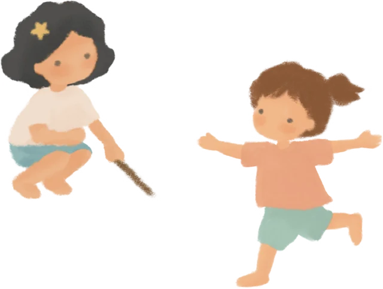

---

# 지우가 달라졌어요

> 01 · 첫 비행기 여행, 제주

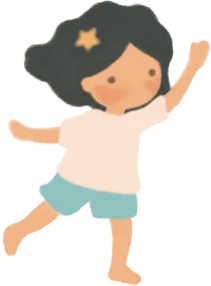

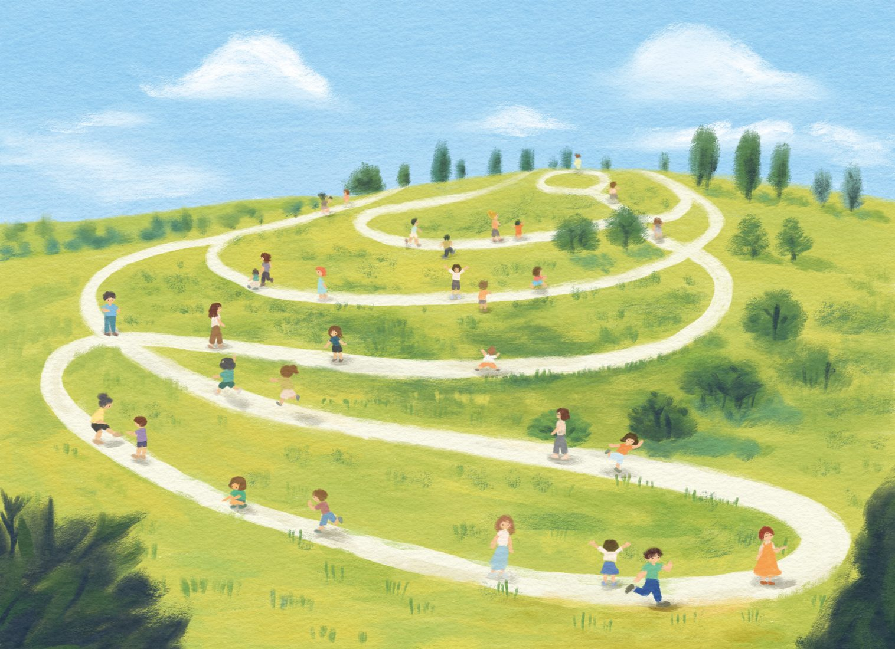

---

## 비행기

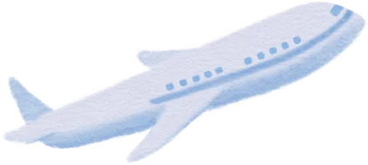

“언니, 이번 여행은 제주도 갈래요?”

시누이의 제안에 우리 가족은 제주 여행을 떠나게 됐다. 시부모님까지 포함해 삼대가 함께하는 여행이었다. 지우에게는 생애 첫 비행이기도 했다. 감각이 예민한 지우가 비행기를 타면 어떤 반응을 보일지 걱정이 됐다.

그 무렵, 지우가 언어치료를 받고 있는 복지관에서 영우 엄마를 만났다. 영우는 자폐 스펙트럼 장애가 있었고 지우와 인지 그룹 수업을 함께 듣고 있었다. 얼마 전 영우는 외가에 비행기를 타고 다녀왔다고 했다.

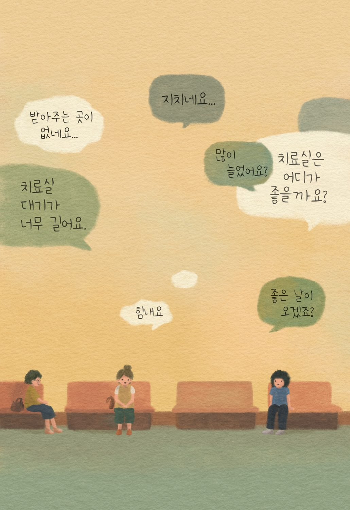

“잘 앉아 있다가 갑자기 소리 지르고 난리도 아니었어. 휴… 그래도 주변에서 이해를 해줘서 망정이지.”

영우 엄마는 그날 비행기에서 있었던 일이 떠올랐는지 속상한 얼굴을 하며 말했다. 남 일 같지 않았다. 나는 말없이 고개를 끄덕였다. 부모 대기실에 있던 다른 엄마들도 저마다 비슷한 경험을 털어놓기 시작했다.

이야기를 듣고 있자니 머릿속에 최악의 장면들이 차례로 펼쳐졌다. 좁은 좌석에서 몸을 비트는 지우, 울음을 터뜨리는 지우, 그리고 우리를 향해 쏟아지는 사람들의 시선. 비행기를 타기도 전에 진이 빠지는 기분이었다.

불안한 마음을 안고 우리는 마침내 비행기에 올랐다.

“오아아 이거, 이거.”

지우가 가늘고 얇은 소리를 내며 주변을 손가락으로 가리켰다. 이리저리 몸을 움직여 보고 창문 밖을 내다보며 호기심을 드러내던 지우는, 비행기가 천천히 활주로를 달리기 시작하자 갑자기 조용해졌다.

곧이어 기체가 굉음을 내며 속도를 높이자, 가녀린 어깨는 잔뜩 움츠러들었고, 작은 몸은 순간 굳어 버린 듯 꼼짝하지 못했다. 놀란 토끼 눈으로 앞을 바라보던 지우는 긴장한 기색을 감추려는 듯 입꼬리를 살짝 올려 보였다. 하지만 올망졸망한 작은 손가락은 마음을 들킨 것처럼 팔걸이를 꼭 움켜쥐고 있었다. 금방이라도 놓칠세라 힘껏 매달린 그 손에서 설렘과 두려움이 함께 느껴졌다.

나는 숨을 죽이고 지우를 바라봤다. 비행기가 붕 뜨자 지우가 작게 말했다.

“어… 어…”

지우 얼굴이 점점 굳어갔다.

“어…”

5.
4.
3.
2.
1.

지우의 머리가 옆으로 스르르 기울었다.

“지우…야?”

남편이 지우를 조심스럽게 부르자, 지우는 잠깐 실눈을 뜨더니 슬쩍 웃어 보이고는 천천히 몸을 반대편으로 돌렸다. 남편이 나를 보며 말했다.

“진짜 자려나 본데?”

온갖 최악의 상황을 머릿속에 그리며 단단히 각오했는데 그 순간 완전히 허탈해졌다. 비행기가 뜬 지 5분 만에 내 걱정은 쓸모없는 것이 되었다. 세상 모르고 잠든 지우의 얼굴을 보니 가슴 한편을 짓누르던 불안이 눈 녹듯 사라졌다.

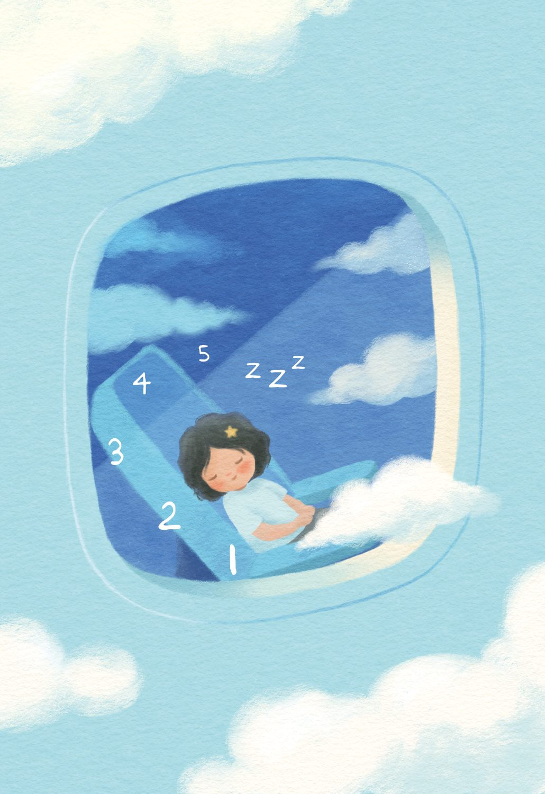

착륙 5분 전, 아쉬운 마음에 지우를 흔들어 깨웠다.

“지우야, 이제 곧 도착해. 밖에 한번 봐봐.”

길지 않은 비행이었지만 지우는 한 번도 깨지 않고 푹 잤다. 내가 깨우니 마지못해 “응?” 하고 작은 소리를 내뱉곤 기지개를 켰다. 잠결에 얼떨떨해하던 지우는 눈을 비비며 창밖을 바라보았다.

“엄마, 뱅기 이제 이제 추바해?”

나는 웃음을 터뜨렸다.

“지우야. 우리 지금 제주도 도착했어.”

---

## 안녕하세요

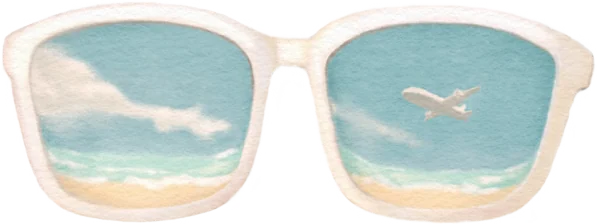

제주에서 우리는 일상에서 누리기 힘든 여유 속에 종일 걷고 쉬며 시간을 보냈다.

하루는 에코랜드에서 여유롭게 산책을 하고 있는데, 지나가던 아주머니 한 분에게 지우가 넉살 좋게 말을 걸었다.

“안녀하세어!”

아주머니는 잠깐 놀란 듯했지만 다시 방긋 웃으며 대답했다.

“어?! 나 말이니? 응, 안녕?”

지우가 길에서 지나가는 사람에게 말을 걸 때마다 나는 심장이 철렁 내려앉곤 했다.

몇 개월 전 일이었다.

지우는 낯선 사람에게 아는 척하며 다가가는 걸 좋아했고, 그날도 마트에 따라온 지우는 여기저기 돌아다니며 인사를 하고 다녔다. 유모차를 발견한 지우는 우리가 말릴 새도 없이 달려가 유모차 안을 들여다봤다.

“아가, 아가 예뻐요.”

해맑은 얼굴로 아기를 보러 다가온 아이를 어른들은 흐뭇하게 웃으며 바라봤다. 그때 갑자기 지우가 아기 손을 잡더니 입으로 가져가 덥석 물어버렸다. 눈 깜짝할 사이에 벌어진 일이었다. 아기가 크게 울음을 터뜨렸고, 옆에 있던 아기 엄마가 깜짝 놀라며 급하게 아기를 안아 올렸다. 유모차를 밀던 할머니도 놀란 듯 화가 난 얼굴로 나를 쏘아봤다.

“아니, 애가 왜 이래요?”

나는 당황한 채 무슨 일이 벌어진 건지 살폈다.

“애 관리 똑바로 안 해요? 우리 애기 흉지면 어떻게 할 거예요!?”

지우가 사람을 좋아해 쫓아다니기는 했어도, 해를 입힌 건 처음이었다. 게다가 다친 아기가 숨이 넘어가도록 우는 바람에 무슨 말을 해야 할지 몰랐다. 그저 연신 고개를 숙이며 사과드릴 수밖에 없었다.

“죄송합니다. 죄송합니다. 정말 죄송합니다…”

우리는 아기 가족과 함께 마트 안에 있는 병원으로 달려갔다. 소아과 선생님은 다행히 큰 상처는 아니니 걱정 말라고 했다. 간단한 치료를 끝내고 병원을 나오면서 나는 아기 엄마에게 번호를 건넸다. 아기가 많이 놀란 것 같으니 밤새 상태를 살펴보고, 조금이라도 이상하면 꼭 연락 달라고 했다. 내내 언짢은 표정을 풀지 못하던 아기 할머니는 내게 다가와 말했다.

“애가 이상한 것 같은데 검사 같은 거 받아봐요.”

푸욱.

그 말 한마디에 심장이 어디에 찔린 듯 아렸다.

나는 집에 돌아와 지우를 크게 혼냈다. 다른 사람을 아프게 하는 행동은 어떤 이유건 안 된다고 했다. 이 정도면 알아들었을까 싶으면서도 혼내는 걸 멈출 수가 없었다. 앞으로 또 같은 일이 벌어질까 두려운 마음도 있었다. 제발, 다시는, 그런 행동을 해선 안 돼, 지우야! 나의 호통에 지우는 울기만 했다.

잠시 후 울다 지친 지우가 그대로 잠이 들었다. 눈가에 눈물이 고여 있는 아이의 얼굴을 보니 안쓰러운 마음이 들었다. 눈물 자국을 슬쩍 닦아주며 생각했다. 지우는 내 말을 어디까지 알아들었을까. 이런 내 마음을 이해하는 날이 오긴 할까. 가슴 한편에 꾹꾹 묻어뒀던 억울함이 불쑥 튀어 올랐다. 나는 조용히 화장실로 들어가 문을 잠갔다. 거울 앞에 멍하니 서 있다가 그 자리에 주저앉았다. 솔직히 말하면, 그날 지우가 너무 미웠다. 도대체 귀엽다는 마음을 왜 무는 걸로 표현했을까. 이해가 가지 않았다. 지우가 그런 행동을 한 건 내 잘못도, 내가 시킨 것도 아니었다. 그럼에도 나는 모르는 사람 앞에서 머리 숙여 사과하고 그들의 말을 다 받아내야 했다. 엄마니까. 지우의 엄마니까 그렇게 했어야 했다. 풀리지 않는 억울한 마음들이 쌓여 눈물로 터져 나왔다. 나는 화장실 바닥에 쪼그려 앉아 엉엉 울었다.

그날 밤 문자가 왔다. 아기는 괜찮으니 신경 쓰지 말라는 내용이었다. 별 탈이 없다니 정말 다행이었고 감사할 일이었다. 아기의 가족들이 보인 반응은 너무 당연한 거였다. 얼마나 놀라고 속상했을지 나도 아이를 키우는 엄마이기에 너무나 잘 안다. 그렇지만 이런 일이 있을 때마다 나는 어디에 가서 하소연을 해야 할지, 이 답답한 마음을 어떻게 털어내야 할지, 알 수가 없다.

마트 사건 외에도 지우는 낯선 사람에게 불쑥 다가가 스스럼없이 말을 걸곤 했다. 때로는 악의 없는 엉뚱한 말로 사람들을 당황하게 만들었다.

“언니, 배가 왜 나왔어요? 뱃속에 아기 있어요?”

그다음에는 어김없이 내가 쫓아가 죄송하다고 싹싹 빌어야 했다. 길을 걷다가도, 엘리베이터 안에서도, 병원 대기실에서도 눈이 마주치기만 하면 말을 걸었다. 대부분은 귀엽다는 듯 웃으며 받아주었지만 모두가 그런 것은 아니었다. 가끔은 당황해하며 도망치듯 자리를 피했고, 때론 화가 난 듯 위아래로 훑으며 지나가기도 했다. 그런 일들이 반복되다 보니 사람들과 마주치는 게 두려워졌다. 혹시라도 지우가 실수를 하지는 않을까, 또 엉뚱한 말로 불편하게 하지 않을까 걱정했다. 지우가 누군가에게 관심을 보이면 먼저 긴장했고, 키즈카페나 놀이터에서 지우 뒤를 졸졸 따라다니며 살펴봤다. 에코랜드에서 지우가 아주머니에게 말을 걸며 다가갈 때도, 슬그머니 지우 쪽으로 한 발 다가서 있었다.

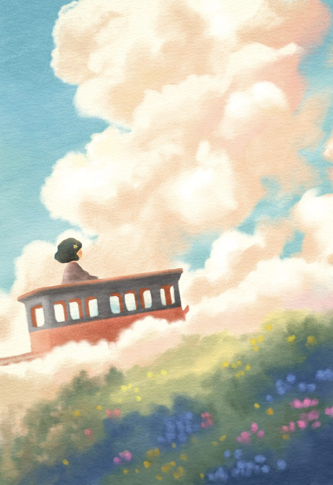

“어디 가여?”

“응 여기 기차 탈 거야.”

“기차 조아여?”

“그럼 좋지.”

“엄마! 기차 좋대! 기차 좋대!”

지우는 확인이라도 받듯이 내게 안기며 아주머니의 말을 전달했다. 나는 얼굴이 붉어지면서도 한편으론 안도했다.

“죄송해요. 모르는 분들한테 자꾸 말을 걸어요.”

“아니에요. 아이가 너무 귀엽네요.”

나는 감사하다고 고개를 숙이고는 서둘러 지우의 손을 잡고 걸음을 옮겼다. 몇 걸음 가다 말고 지우가 뒤를 돌아봤다. 그러고는 아주머니를 향해 크게 손을 흔들었다. 아주머니도 웃으며 손을 흔들어 주었다.

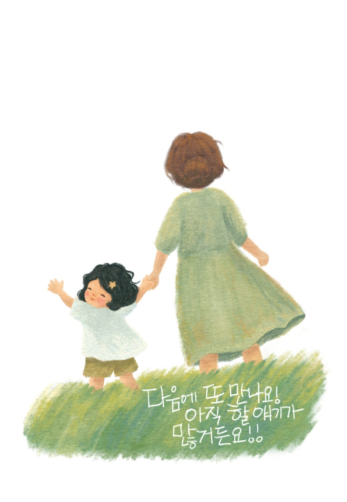

---

## 목말

지우와 도윤이는 제주의 푸른 들판을 자기 집 안방인 양 누비고 다녔다.

도윤이는 시누이의 딸이다. 지우보다 한 살 어린 동생인데, 하루 종일 뛰어도 지치지 않는 활기찬 아이였다. 둘은 제주 여행 내내 자매처럼 붙어 다녔다. 달리다 넘어지면 그대로 잔디밭 위를 뒹굴었고, 쉴 새 없이 재잘거렸다.

한참 시끌시끌하던 아이들이 조용해서 돌아보니, 나란히 쪼그려 앉아 있었다. 어디서 주웠는지 나뭇가지를 하나씩 들고 열심히 땅을 파는 중이었다. 무슨 보물이라도 묻혀 있는지, 머리를 맞댄 채 일어날 줄을 몰랐다.

그러고 보니 나란히 앉은 두 아이의 체구가 비슷했다. 뒷모습만 보면 누가 언니인지 모를 정도였다. 태어날 때부터 유난히 작아 평생 이대로 작으면 어쩌나 걱정하던 지우가, 어느새 도윤이만큼 자라 있었다. 도윤이가 한 살 어리긴 해도, 지우가 이만큼 자랐다는 게 그저 대견했다.

흐뭇하게 두 아이의 뒷모습을 바라보다가, 불현듯 몇 년 뒤에도 과연 그럴까 하는 생각이 들었다.

도윤이는 키도 생각도 여느 아이들처럼 쑥쑥 자랄 것이다. 지우는 그보다 조금씩 격차를 벌리며, 더디게 커갈 것이다.

제주에 갈 짐을 챙기면서 제일 먼저 넣은 것은 지우의 기계 주사기였다. 파우치에 넣고도 마음이 놓이지 않아 몇 번을 다시 열어 확인했다. 진단을 받던 날, 병원에서는 지우가 성인이 되어도 키가 130센티미터를 넘지 못할 수도 있다고 했다. 그날부터 하루도 거르지 않고 병원에서 처방해 준 호르몬 주사를 맞았다.

저녁이 되자 들판을 뛰어다니느라 노곤해진 지우를 앉혀 놓고 주사기를 꺼냈다. 지우가 기다렸다는 듯 거실에 있던 가족들을 불러 모았다.

“이리이리. 나 주사 맞는 거 봐요.”

지우가 익숙하게 팔을 내밀었다. 버튼을 누르자 딸깍, 짧은 소리가 났다. 지우는 눈을 질끈 감았다가 이내 아무렇지 않은 얼굴로 돌아왔다. 옆에서 지켜보던 도윤이의 눈이 동그래졌다.

“안 아파?”

“아픈데, 나는 잘 참아.”

가족들이 잘한다고 박수를 쳐 주니 지우의 어깨가 한껏 올라갔다.

주사를 정리하는데 지우가 물었다.

“엄마, 나도 엄마처럼 이만~큼 키 클 수 있지?”

“그럼. 우리 지우도 크지.”

한 박자 늦은 대답을 지우는 알아차리지 못한 것 같았다.

그때 옆에서 듣고 있던 남편이 지우를 불렀다.

“지우야, 이리 와 봐. 키 커지게 해 줄게.”

남편이 지우를 번쩍 들어 올려 목말을 태웠다. 지우의 머리끝이 남편의 키를 넘어섰다. 지우는 아빠 얼굴을 꼭 끌어안고 좋아서 어쩔 줄 몰라 했다.

조금 전까지 나를 붙들고 있던 생각들이 그 웃음소리에 잠시 밀려났다.

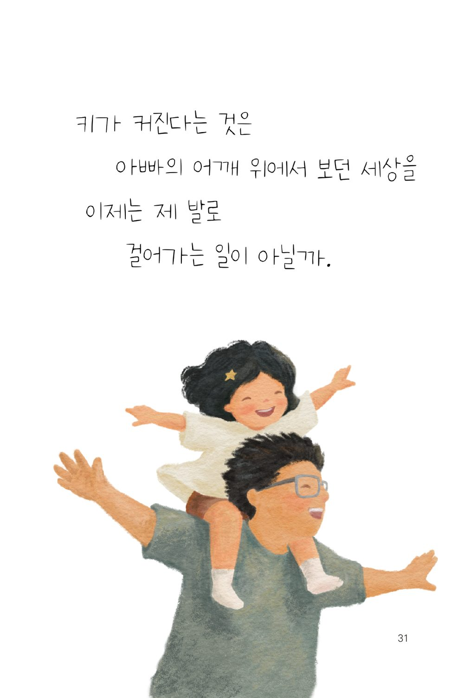

---

## 데칼코마니

수족관에서 지우는 유난히 조용했다. 수조 속 물고기들의 움직임 하나하나 놓치지 않으려는 듯 눈을 떼지 못했다. 물속에서 유유히 헤엄치는 녀석들을 보고 있으니 세상도 같이 느리게 흘러가는 듯했다. 지우의 작은 손이 공중에 멈췄다가 유리 쪽으로 천천히 올라갔다. 어느새 물고기들이 지우의 손 주변으로 모여들었다.

“물고기들이 지우를 좋아하나 봐.”

할머니가 지우에게 조용히 속삭였다. 지우는 신이 나서 물고기들을 향해 손을 흔들었다.

시어머니는 평소에도 지우를 자주 안아주었다. 세상 진귀한 것들을 더 가까이에서 보라는 할머니의 마음이었을 것이다. 수족관에서도 그랬다. 어머니는 힘든 기색 하나 없이 내내 지우를 안고 있었다. 꼭 붙어서 해맑게 웃고 있는 두 사람의 얼굴이 똑 닮아 있었다. 그 모습을 보고 있으니 병원에서의 일이 떠올랐다.

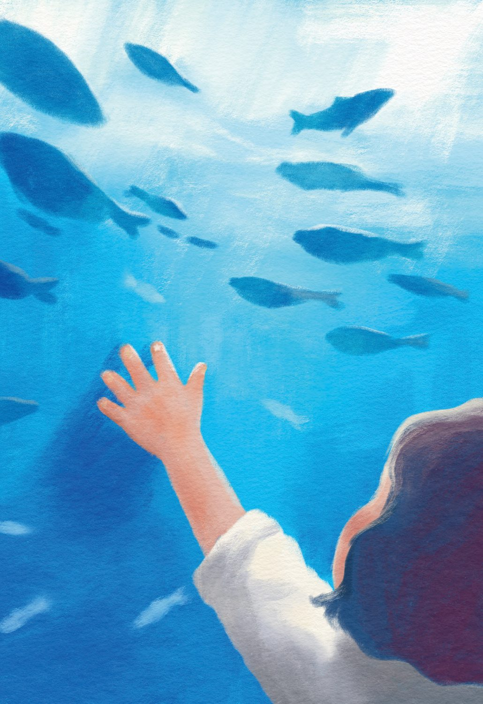

잦은 입원으로 병동을 드나들던 시절이었다. 지우는 워낙 혈관이 눈에 잘 띄지 않았다. 겨우 찾았다 싶으면 터지기 일쑤였고, 그럴 때마다 처치실에서 처음부터 다시 시작해야 했다. 그날도 응급실에서 겨우 잡아뒀던 혈관이 터졌다. 우리는 곧장 처치실로 갔다.

선생님들이 이 팔 저 팔을 살피는 동안 지우는 울고 또 울었다. 어찌나 울었는지 탈수가 올까 걱정할 정도였다. 작은 팔에 주삿바늘 자국이 여기저기 남았다. 겨우 혈관을 잡고 녹초가 되어 병실로 돌아오니 시어머니와 시누이가 필요한 것들을 챙겨 와서 기다리고 있었다. 너무 반가웠다.

“어, 생각보다 일찍 오셨네요.”

내가 안고 있던 지우를 어머니가 받아 안고, 시누이가 들고 있던 커피를 내게 건넸다.

“언니, 여기 커피 사 왔어요.”

나는 아이스라떼를 받아 들고 한 모금을 쭉 들이켰다.

“허유… 진짜 살 것 같네요.”

그제야 정신이 좀 돌아왔는지 문득 궁금해졌다.

“그런데 병실은 어떻게 알고 오셨어요?”

내가 처치실에서 씨름하는 동안 전화를 받지 않아 일단 병동으로 올라왔다고 했다. 그때 시누이가 웃으며 말했다.

“언니, 아까 병동 입구에서 선생님이 엄마를 보자마자 놀란 표정으로 그러는 거 있죠. ‘혹시 지우 할머니 아니세요?’”

간호사 선생님은 조금의 망설임도 없었다고 했다. 그 이야기에 우리는 한참 웃었다. 생각해 보니 이상한 일도 아니었다. 지우를 오래 본 사람이라면 시어머니를 금방 알아봤을지도 모른다. 웃을 때 접히는 눈매가 특히 그랬다. 이목구비를 하나하나 따지기 전에, 그냥 풍기는 느낌이 둘은 꼭 닮아 있었다.

할머니 품에 안긴 지우가 물고기에게 손을 흔들었다. 할머니는 지우가 떨어질세라 아이를 더 꼭 끌어안았다. 유리 너머로 은빛 물고기들이 조용히 지나갔다.

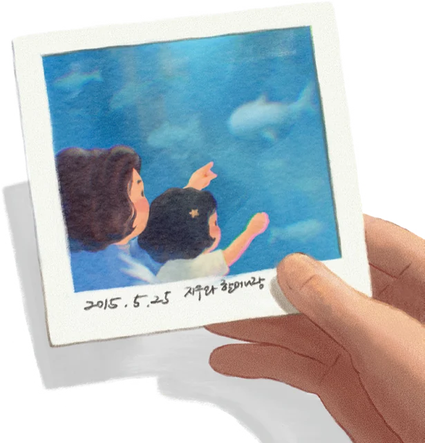

---

## 5월의 물놀이

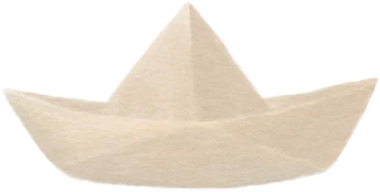

5월의 제주는 부드럽고 따뜻했다.

“우리, 애들 발이라도 담그러 갈까요?”

해안도로를 달리던 우리는 결국 참지 못하고 차를 멈춰 세웠다. 차창 밖 푸른 바다가 가까이 와 보라는 듯 반짝이고 있었다.

바다를 향해 걸어가면서도 지우를 걱정하지 않을 수 없었다. 선천성 내반족인 지우는 중심 잡기가 쉽지 않아 평지에서도 잘 걷지 못했다. 모래사장 위를 걷는다는 건 지우에게 엄청난 모험이었다. 하지만 오늘은 달랐다. 할머니는 지우의 오른손을, 할아버지는 왼손을 잡고 아주 조심조심 걸어갔다. 마치 작은 배 한 척을 양쪽에서 끌어주는 것처럼.

물이 발목까지 차오르는 순간, 지우는 기다렸다는 듯 꺄악 하고 행복한 비명을 지르며 장난스럽게 두 다리를 앞으로 뻗었다. 갑자기 손에 지우의 무게가 실리자 당황한 할머니 할아버지는 중심을 잃고 잠시 기우뚱했다가 이내 허허 웃음을 터뜨렸다.

“이 녀석, 장난은!”

그날의 바다는 유난히 짙은 쪽빛으로 물들어 있었다. 나는 볕이 따가워 양산을 들었다. 파도는 자꾸 발을 간질이며 밀려왔다가 물러갔고, 발밑의 모래는 잠깐씩 무너졌다가 다시 단단해졌다.

지우는 할머니의 집게손가락을 꼭 잡고 물에 잠긴 모래 위를 천천히 걸었다.

저 작은 아이가 이 바다까지 왔다. 수술대에 홀로 눕혀 두고 나오던 날도 있었는데, 지금은 제주 바다에 발을 담그고 서 있다.

잔잔한 파도가 또 밀려왔다가 물러갔다.

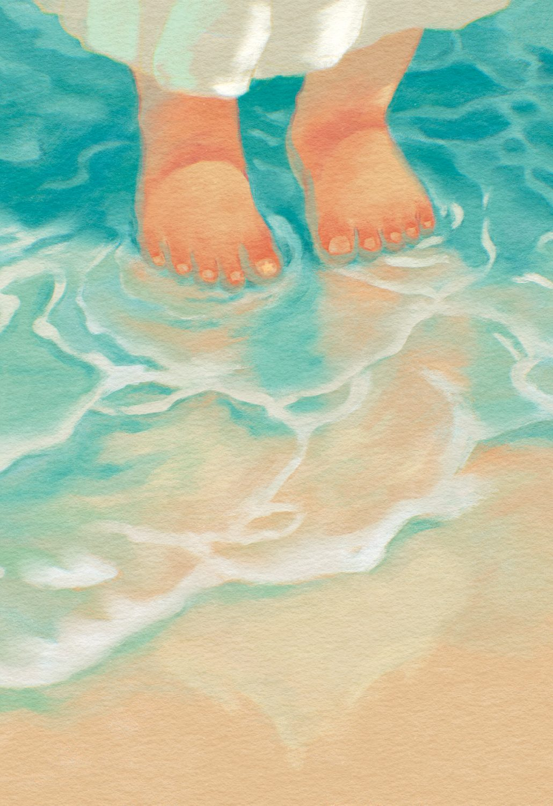

---

## 지우가 달라졌어요

그날도 지우는 복지관에서 언어치료 수업을 받았다. 수업이 끝나면 늘 선생님과 짧은 상담을 하기에, 나는 치료실 앞에서 기다리고 있었다. 그런데 선생님이 밝은 얼굴로 서둘러 나오더니 말했다.

“어머님, 최근에 지우한테 무슨 특별한 일이 있었나요?”

“특별한 일이요? 음… 가족들이랑 제주도 여행을 다녀오긴 했는데요.”

“아, 그래요? 오늘 지우가 느낌이 좀 달라요.”

선생님은 말을 이었다.

“시키면 잘 안 하려던 걸 오늘은 어떻게든 해보려고 하고요. 평소엔 말이 먼저 튀어나오는 편이었는데, 오늘은 한 번 고민 하고 자기 생각을 말하려 하더라고요. 수업 내내 정말 집중했어요.”

선생님 말을 들으면서 나는 가슴이 두근 거렸다. 그러고 보니 집에서도 말이 조금 선명해진 것 같았다. 어눌하긴 해도 뭔가 이전과는 다른 느낌. 내가 착각한 건가 싶었는데 선생님도 같은 걸 느끼고 있었던 것이다.

“여행이 효과가 있었나 봐요.”

“그런 것 같아요, 정말.”

우리는 조그만 대기실 입구에서 두 손을 맞잡고 호들갑을 떨었다.

집으로 돌아오는 길에도 선생님 말이 계속 머릿속을 맴돌았다. 제주에서 뛰어다니던 들판. 할머니 할아버지 손을 잡고 걷던 모래사장. 물고기 앞에서 한참을 서 있던 작은 손. 가족들과 웃고 떠들던 시간들.

그 모든 것이 지우 안에서 뭔가를 건드린 것만 같았다.

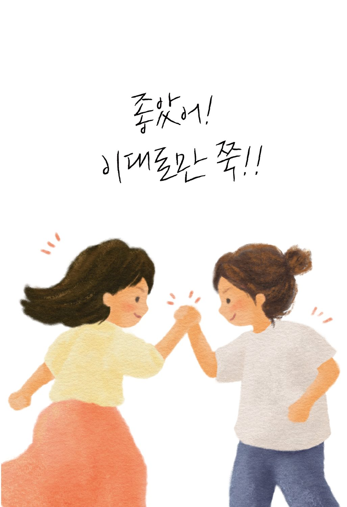

---

## 꿈

> 지우가 다른 아이들과 같은 속도로 달려 나간다. 두 발이 땅을 차는 소리가 경쾌하다.
> 힘차게 달리고 또 달리다, 문득 엄마 얼굴이 떠올랐는지 내가 있는 쪽을 돌아보며 활짝 웃는다. 나도 함께 웃으며 손을 흔든다.

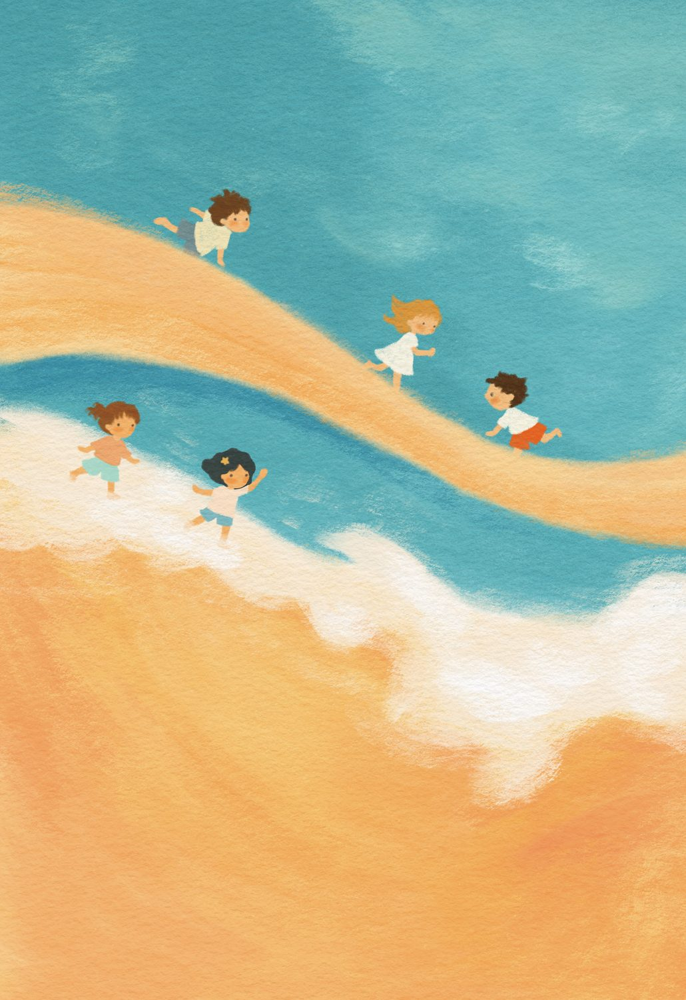

나는 병원 대기 의자에 앉아 있다가 “김지우” 부르는 소리에 진료실로 들어갔다.

주치의 선생님에게 인사를 하고 앞에 놓여 있는 의자에 앉았다.

지우가 태어나 병원 생활을 시작할 때부터 늘 함께해 준 분이다. 풍채가 좋고 인자한 선생님이라 지우도 무척 좋아했다. 다만 말할 때마다 발음이 조금 뭉개져 알아듣기 힘들 때가 있었다.

그날도 선생님은 어김없이 무언가를 설명하고 있었다.

선생님 특유의 발음 때문에 한마디 한마디를 또렷하게 알아듣지는 못했지만, 이상하게도 귀에 쏙쏙 들어왔다.

지우 예후가 너무 좋다고, 이대로라면 다른 아이들을 따라잡을 수 있을 거라고.

너무 기쁜 나머지 부끄러운 줄도 모르고 펄쩍펄쩍 뛰었다.

그때 머리에 ‘콩’ 하고 뭔가 부딪히는 느낌이 들었다. 눈을 떠보니 눈앞에는 천장이 보였고, 침대 프레임에 머리를 박고 있었다. 옆에는 남편이 코를 골며 자고 있고 집 안은 고요했다.

꿈이었다. 멍하니 천장을 바라보다 이내 다시 눈을 꼭 감았다. 이불을 끌어당겨 얼굴까지 덮고 잠들기 위해 노력했다. 다시 잠이 들면 방금 꿨던 꿈속으로 돌아갈 수 있을 것 같았지만, 아쉽게도 더 이상 잠은 오지 않았다.

지우가 태어나 병원 신세를 지기 시작하면서부터 비슷한 꿈을 꾸곤 했다. 물론 꿈에서 일어나던 간절한 바람들은 현실이 되지 않았다. 그래도 괜찮았다. 어쩌면 현실에서 무너지지 않기 위해 꿈이 필요했는지도 모른다. 괜찮아질 수도 있다는 가능성 하나만으로도 줄곧 잘 버텨왔으니까. 제주 여행을 마치고 돌아온 뒤, 나는 처음으로 그런 생각을 했다.

꿈이라고만 여겼던 일이, 어쩌면 이루어질지도 모른다고.

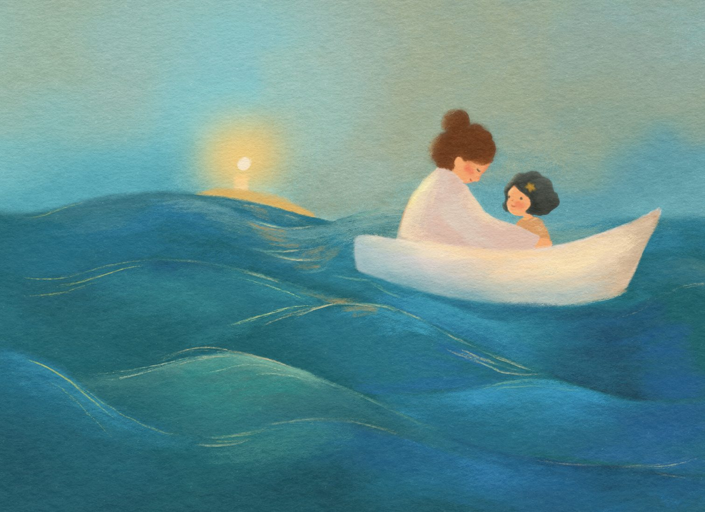
