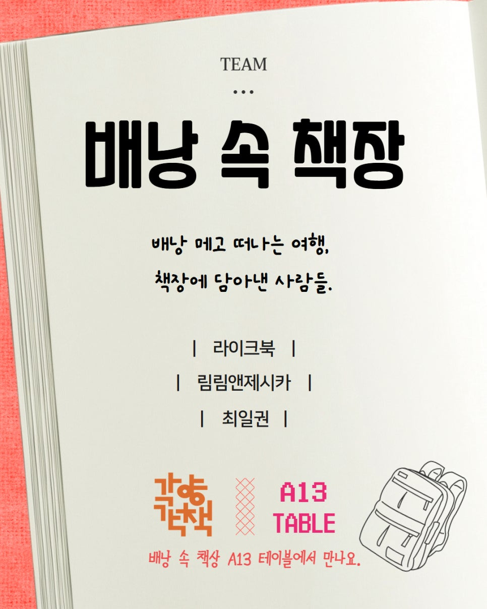
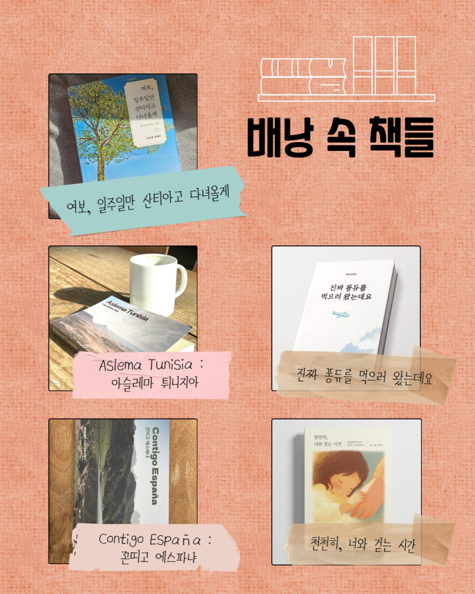
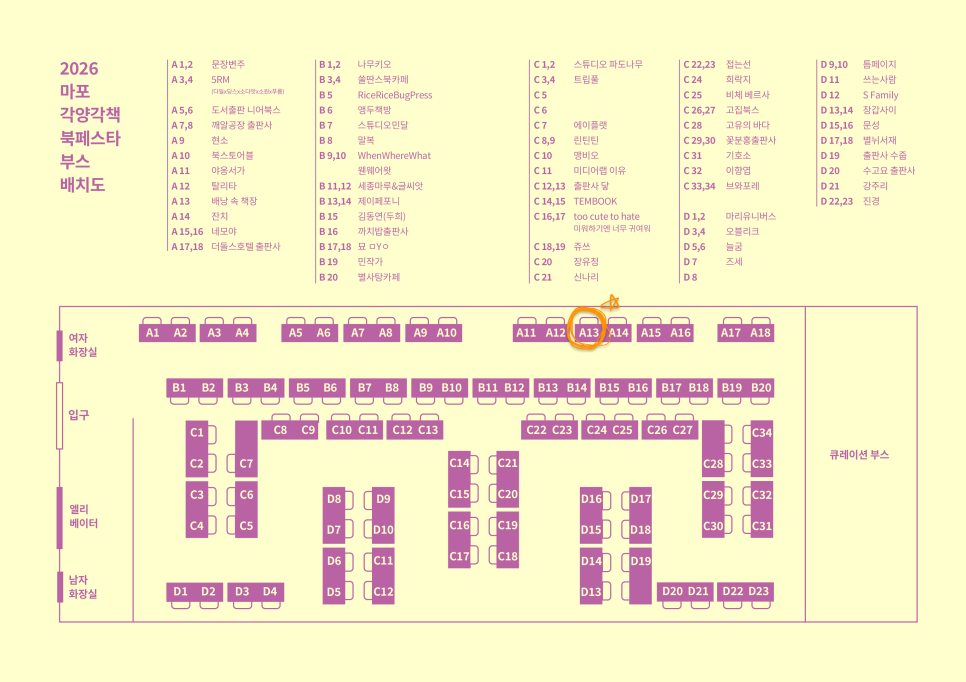

안녕하세요! 블로그 개설하고 출판사 소식을 알리기는 처음이네요.
이번 2026 각양각책에 라이크북도 참여하게 되어 행사 소개 할 겸 소식 전하러 와봤어요!
라이크북도 이제 좀 컸다고(?) 동료들과 팀을 꾸려 북페어에 나가게 됐답니다. 그 팀명도 찬란한, '배낭 속 책장' 이랍니다.
이름만 들어도 막 엉덩이가 들썩들썩 하지 않으신가요? (아니라면 죄송)

여행 에세이를 주로 만드는 저희와 림림앤제시카, 그리고 여행 작가 최일권 님이 함께 하게 됐습니다.

항상 테이블 위에 저희 책 '퐁듀'만 쓸쓸하게 있다가, 다른 동료의 책들도 나란히 놓이게 된다고 생각하니 마음이 무척 푸근해집니다.
이런게 팀전의 묘미가 아닌가 싶어요. 존재만으로도 아주 든든해서 기냥 이대로 쭉 기대고 싶어...ㅎ
게다가 퐁듀에 이은 저희 신작이 처음으로 선보일 예정이랍니다! 개보옹박두!!
북페어 일정에 맞춰서 찍어내려고 몇 날 며칠 밤잠 줄여가며 고생 끝에 인쇄를 마쳤어요.
책에 대한 소개도 곧 올려볼게요! 이번엔 디지털 인쇄로 소량으로 뽑았는데, 언박싱 영상도 편집해서 올릴예정-! 두근두근

끝으로 2026 각양각책 북페어에 대한 간략한 설명 남기고 이만 물러갈게요.

행사장은 홍대입구역에서 아주아주 가까운 청년문화공간 JU 에요.

이런 핫플에서 행사를 진행하다니, 왠지 가심이 막 두근거리고 쿵쾅거리고 막 그렇습니다.
동생이 여기서 일요일날 북토크 데뷔도 한답니다 여러분. 북토크 홍보글도 조만간 올릴게요 (찡긋)
행사는 2025.4.4(토) ~ 4.5(일) 진행됩니다.
토요일은 11시부터 19시까지.
일요일은 11시부터 18시까지.

날씨도 좋은데 코에 바람도 쐴 겸 많이들 놀러 오세요!!

부커 배치도도 첨부합니다.

저희는 A13 부스에 있어요! 헤헤
저희 말고도 정말 재미난 책들이 많이 있어서 구경만 해요 구경만~~~(와서 책 좀 사줘..)

그럼 따뜻한 4월에 만나요 다들!
