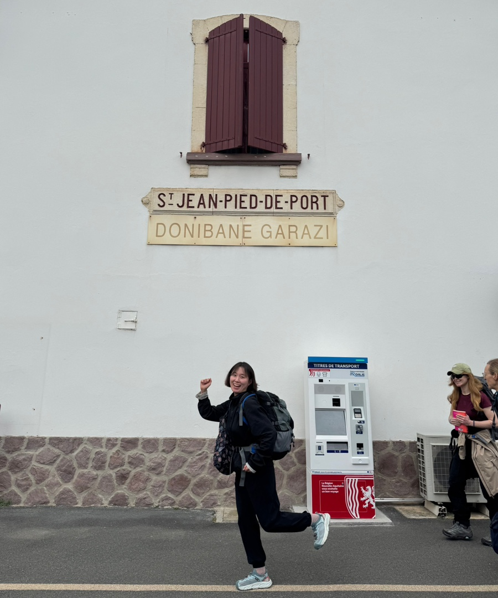

생장에 도착했다. 드디어 내일은 엄마와 나의 첫 순례길이 시작될 예정이다.
아침에 눈 떴을 때는 괜히 들떠있었고, 오후에 몸뚱이만한 가방을 짊어지고 기차에 오를 때는 후회했다. 잘 할 수 있을까? 분명 엄청 바라고 바라서 달려온 길이었는데, 지금은 불투명한 완주와 아픈 나의 미래만 보인다. 아프겠지. 몸도 마음도 만신창이가 되겠지. 엄마한테 싫은 소리를 하고 말겠지. 뒤돌아서서 후회하겠지. 이런 약한 소리만 끝도 없이 하겠지.

생장에서 첫 알베르게에 입성했는데 한 방에 싱글 침대가 셋 들어있다. 엄마와 나 그리고 처음 보는 호주 아저씨가 한 방에 들어갔다. 여럿도 아닌 셋. 게다가 낯선 백인 아저씨라니. 엄마도 나도 당혹감을 떨칠 수가 없었다. 그러던지 말던지 아저씨는 초저녁부터 코를 골며 잠이 들었다. 코를 내뱉지는 않고 들이마시기만 한다. 신경이 곤두설 정도로 거슬리는 소리가 반복된다. 출발하기 전에 귀마개 같은건 필요없다던 엄마가 나한테 귀마개 어딨냐고 묻는다. 엄마는 노란색 나는 파란색. 모녀는 나란히 귀마개를 꽂고 누웠다.
우리, 오늘 잘 잠들 수 있겠지?
