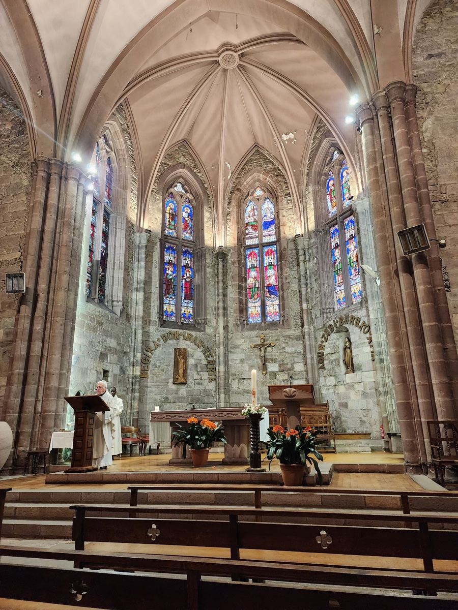
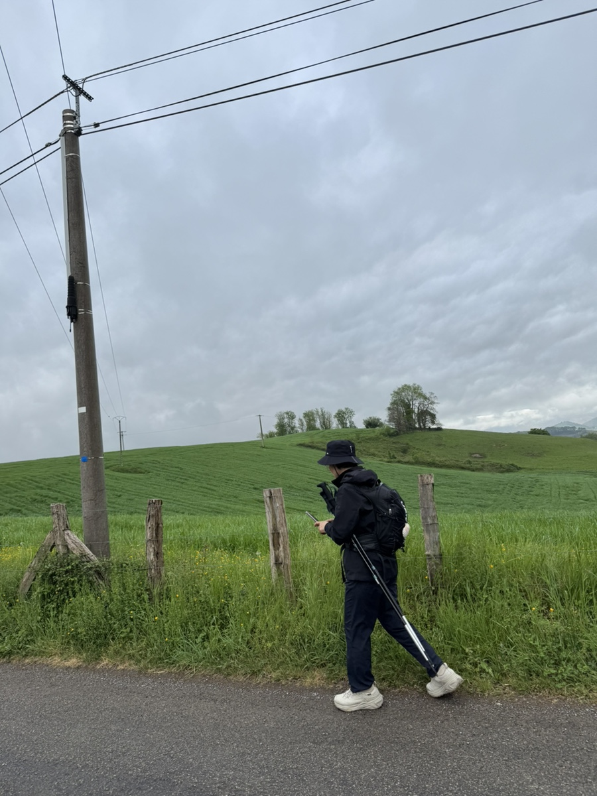
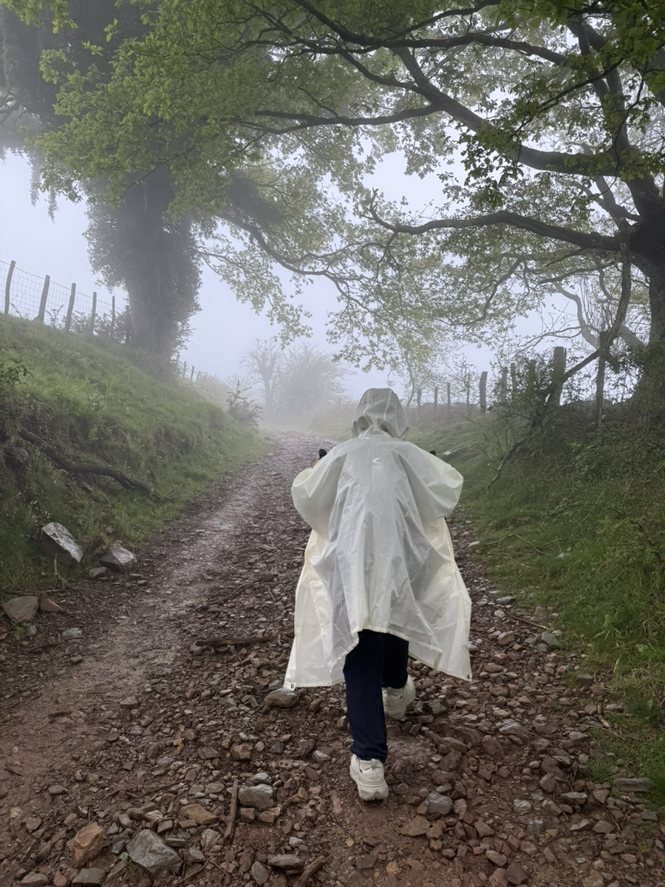
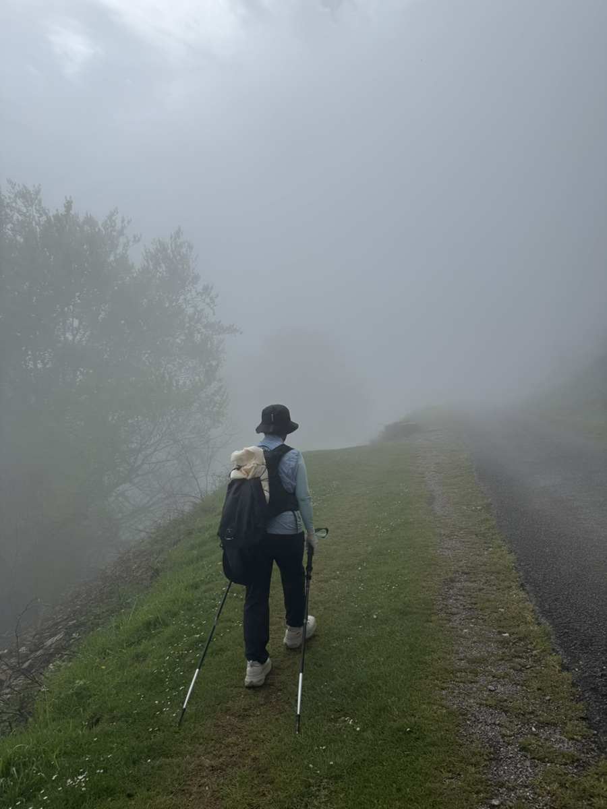
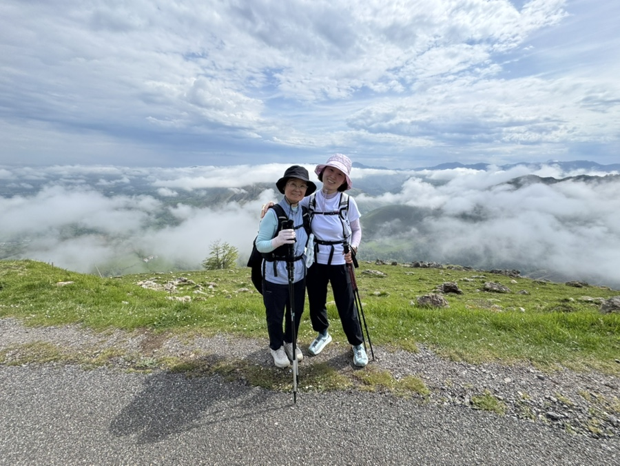
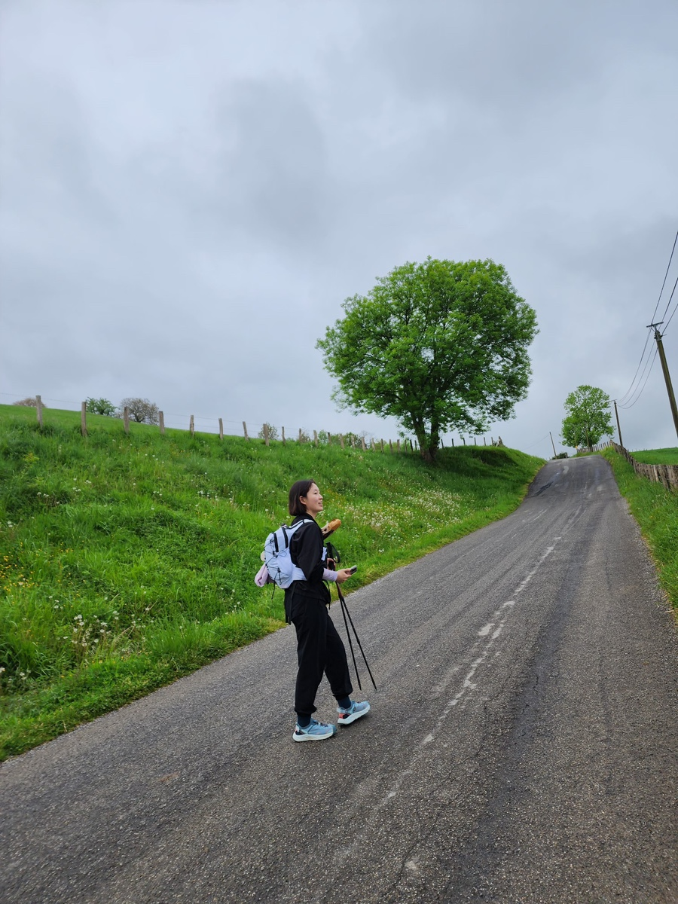
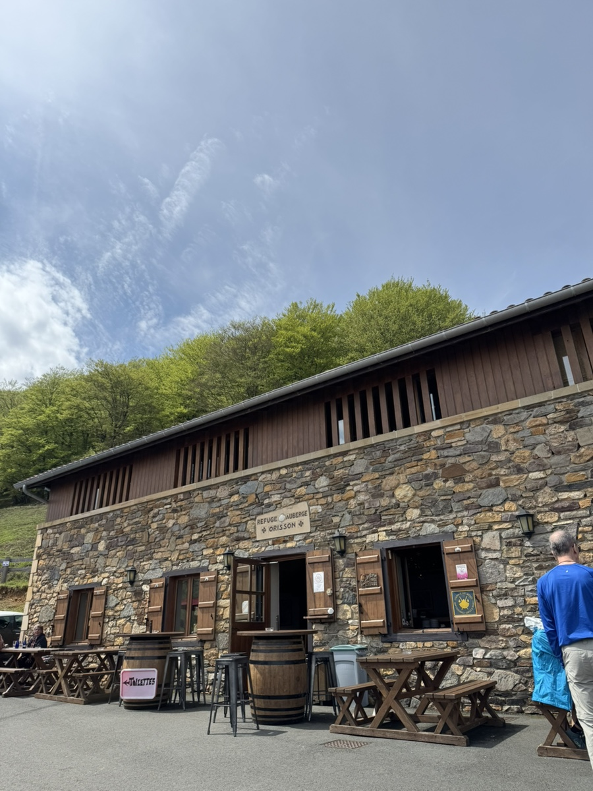

오전 6시. 나갈 채비를 하는데 천둥번개와 폭우가 쏟아진다. 엄마와 나는 아침을 먹으며 걱정스럽게 창밖을 바라봤다. 프랑스인 아주머니 네 분과 호주 아저씨 한 분. 테이블에는 우리까지 7명이 둘러앉아 도란도란 수다를 떨었다.
그중 우리만 오늘 순례길을 떠나고 나머지는 숙소에서 여독을 푼다했다. 다들 우리의 첫 여정길을 걱정해줬다.
오전 8시. 짐을 챙겨 밖을 나와보니 언제 그랬냐는듯 하늘이 맑게 개어있다. 생장 노틀담뒤퐁 성당에서 8시반 미사를 보고 곧바로 순례길에 올랐다.

발걸음이 가볍다. 엄마도 나도 컨디션 최상이다. 참말로 다행이다.

비가 부슬부슬 내린다. 중간중간 쉬어준 덕분에 힘겹지 않게 올랐다.

안개가 자욱하다. 앞이 잘 보이지 않아 얼마나 올랐는지 감도 안 온다.

가파른 언덕을 오르고 나니 또 거짓말처럼 해가 뜬다. 오르면서 만나는 작은 인연들이 너무나 소중하다. 미국에서 온 언니들과 대화를 나눴다. 나는 보미라고 소개하고 엄마는 엄마라고 소개했더니, 미국 언니들이 울엄마를 엄마엄마하며 부른다. 우리 엄만데..?

점심으로 먹을 바게트를 넣을 곳이 없어 옆구리에 쑤셕넣고 걸었다. 나중엔 내 겨드랑이 열기로 떠껀하게 익어 있었다.

오늘 우리의 피로를 풀어줄 소중한 산장이다. 오늘은 여기 오리손까지 걷는다. 총 8키로 걸었다. 아마 전체 순례길 중 가장 적게 걷는 날이 오늘이 될 것이다.. 무섭다.

여기 산장 직원들이 다들 친절하고 분위기가 좋다. 특히 막내아덜이 귀요미다. 집에 혼자 남아 엉덩이나 긁적거리고 있을 바깥양반을 생각해서 이만 말을 줄이겠다.
