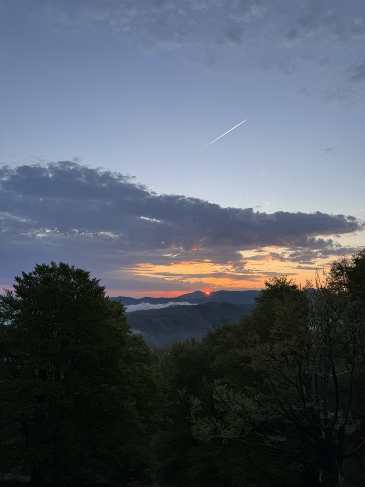
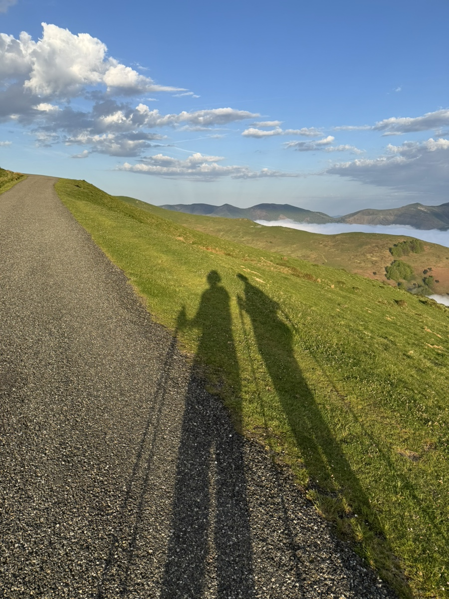
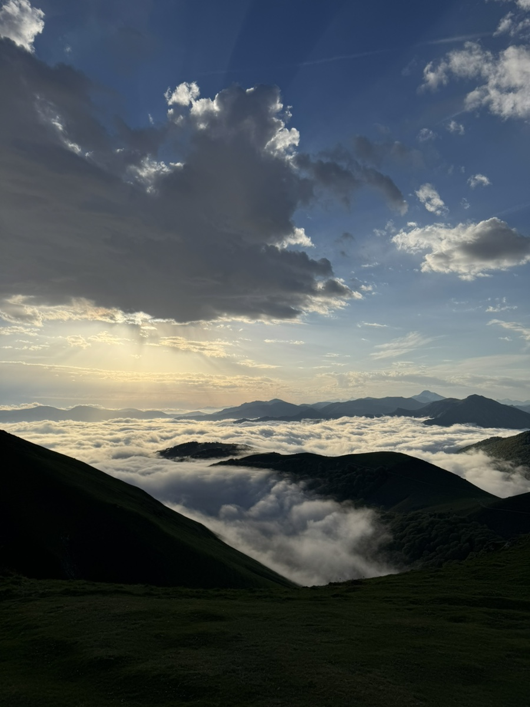
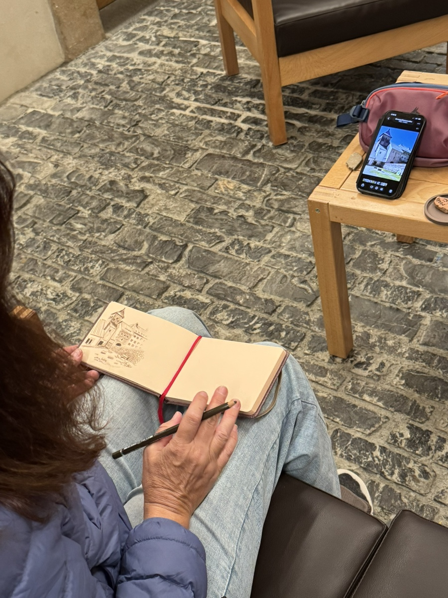

오리손에는 일출이 유명하다지요.
7시에 아침을 흡입하고 론세스바예스로 향하며 강제 일출을 감상했다. 듣던대로 장관이었다.

엄마랑은 아직까지 싸우지않고 잘 걷고있다.
다만 오늘은 광기의 업힐과 공포의 다운힐이 난무하는 피레네 산맥을 지나는 루트라, 서로 굉장히 피곤하고 예민해졌다. 다행히 인상 찌푸릴 일은 없었다.

피레네 산맥 어디메에 오르다보면 구름 위에 떠있는 듯한 착각을 불러 일으킨다.

전날 오리손에서 다같이 저녁을 먹고 돌아가며 자기소개를 했다. 미국에서 온 언니가 자기는 작가고 누구든 원하면 당신을 위한 시를 써주겠다고 했다.

그 언니 소개를 듣는데 입이 근질거려 참을 수가 없었다. 결국 나도 작간데 원하면 내가 너의 이야기를 써주마 하고 농담 반 진담 반으로 패러디를 했다. 내 소개가 서양언니오빠들 맘에 쏙 들었던지 다들 그 자리에서 환호와 박수가 쏟아졌다.

그 이후로 오리손 동기 친구들은 나를 볼때마다 작가양반이라며 좋아한다.
오늘 도착한 론세스바예스 호스텔에서도 한쪽에서 조용히 노트에 뭔갈 끄적이고 있었는데, 오리손 동기들이 나를 알아보고 다가와 말을 걸었다. 뭘 쓰냐, 뭘 썼냐 고 묻기에 내 책에 대해 소개했다.
영어가 고갈 될 무렵, 옆에 앉아 있던 언니도 색연필과 노트를 꺼내더니 그림을 그리기 시작했다.

우리는 한동안 나란히 앉아 창작 활동을 즐겼다. 우스갯소리로 우리가 모인 공간을 아티스트 룸이라 불렀는데 묘하게 허세를 자극해 기분이 나쁘지 않았다. 오흐려 조금 우쭐해졌는지도?
