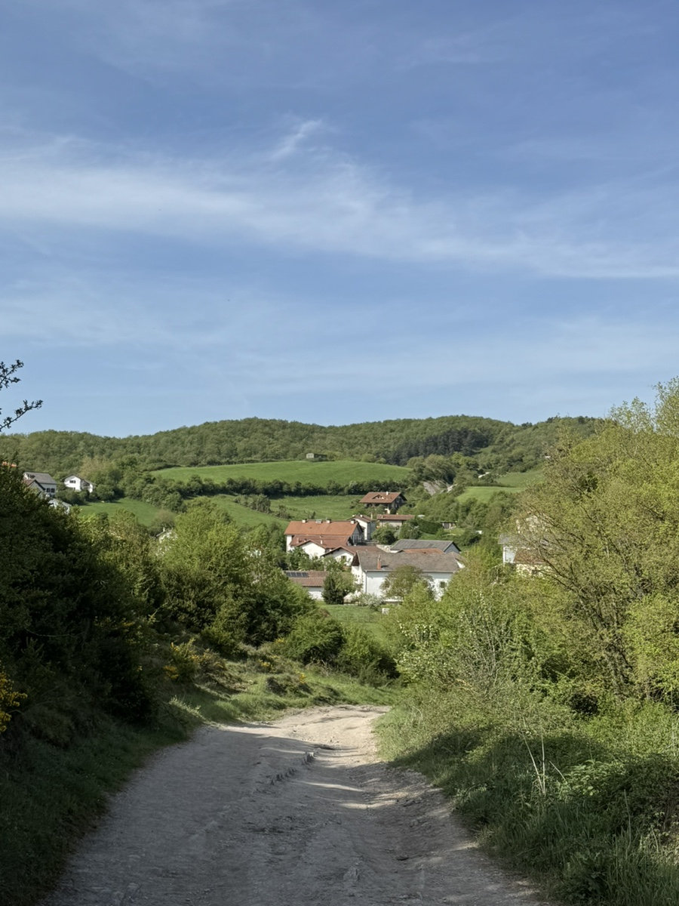
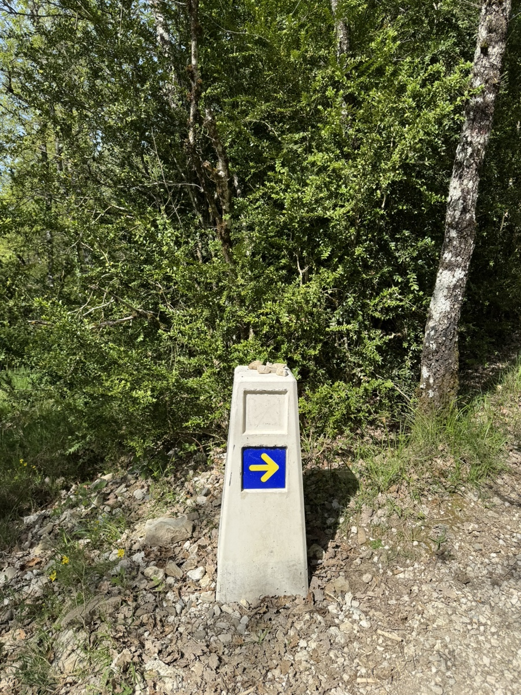
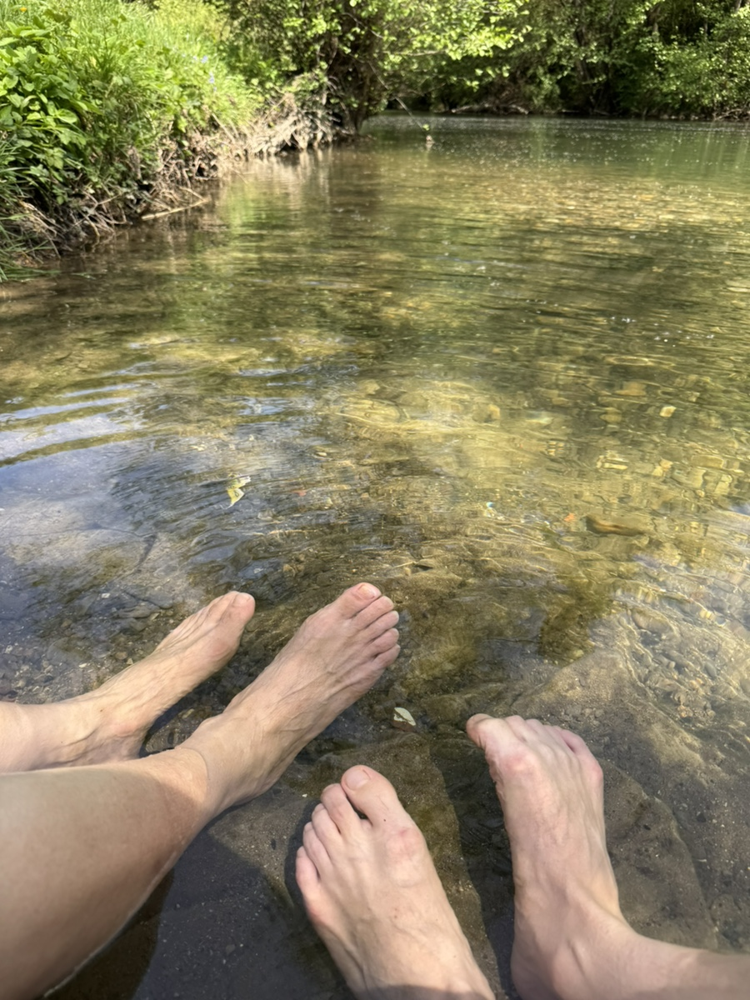
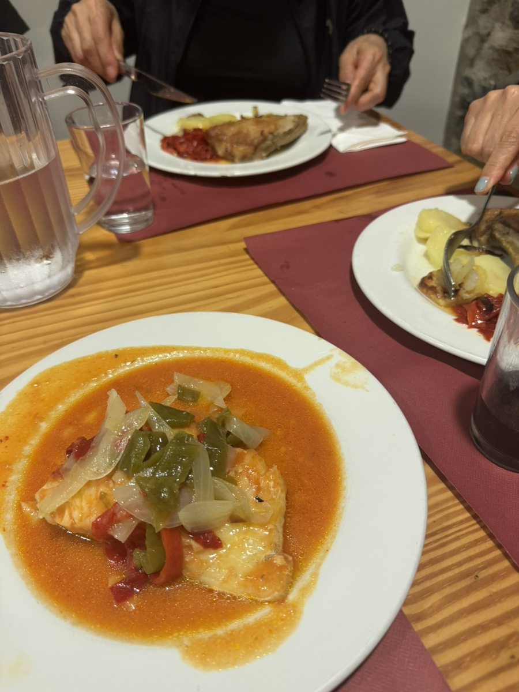

마라톤도 10키로 20키로씩 뛰는데 하루 20키로를 못 걷겠어? 했는데.
못 걸을 뻔 했다. 결국 걸어지긴 걸어진다는 말이 딱 맞다. 어떻게 주비리에 도착했는지 잘 기억도 안 난다.

론세스바예스까지는 굽이굽이 피레네 산맥이라 어쩔수 없다 이를 악물고 버텼는데. 그 다음날도 오르락 내리락하는 산길이 이어지니 유지하던 페이스는 박살이 나고 다리늗 욱신거리고 마음도 비뚫어지기 시작했다.

그래도 가던 길이니까 가야지.
옆에서 펄펄 날라다니는 엄마를 봐서라도 기운을 내야했다. 엄마는 왜 기운이 나는거야..? 칠순 넘긴 할매맞나?

우여곡절 끝에 우리는 주비리에 도착했다.
정말 귀엽고 아기자기한 작은 마을이다.
도착하자마자 양말벗고 동네 시냇가에 발을 담갔다.
얼음장처럼 차디찬 물 속에 발을 넣으며 정화되는 중이라고 최면을 걸었다.

저녁은 간만에 제대로 된 식사를 한 것 같았다.
생선요리가 특히 최고였다. 또 먹고파..츄릅
