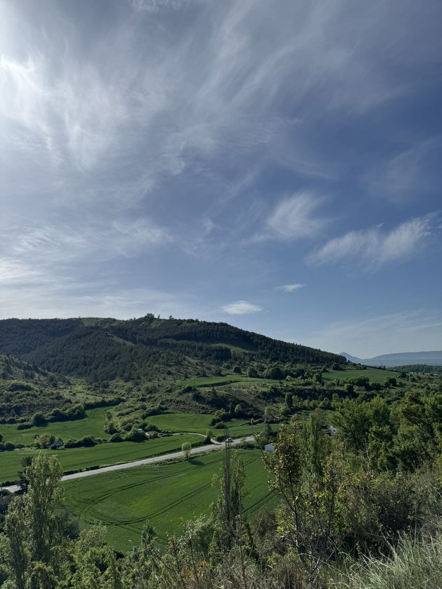
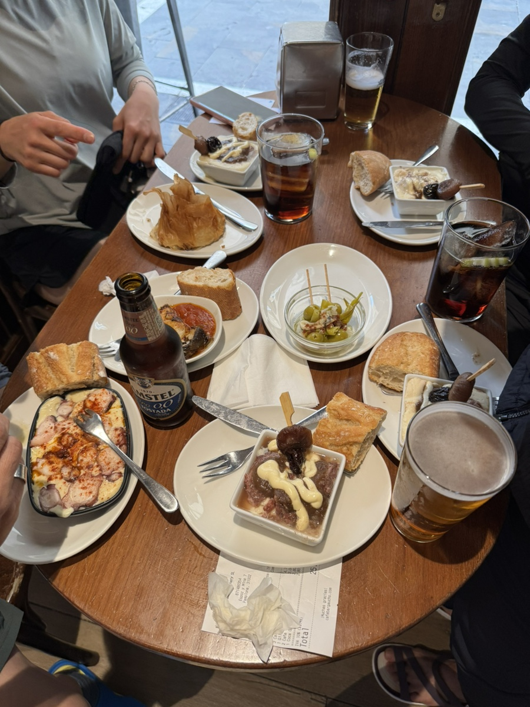
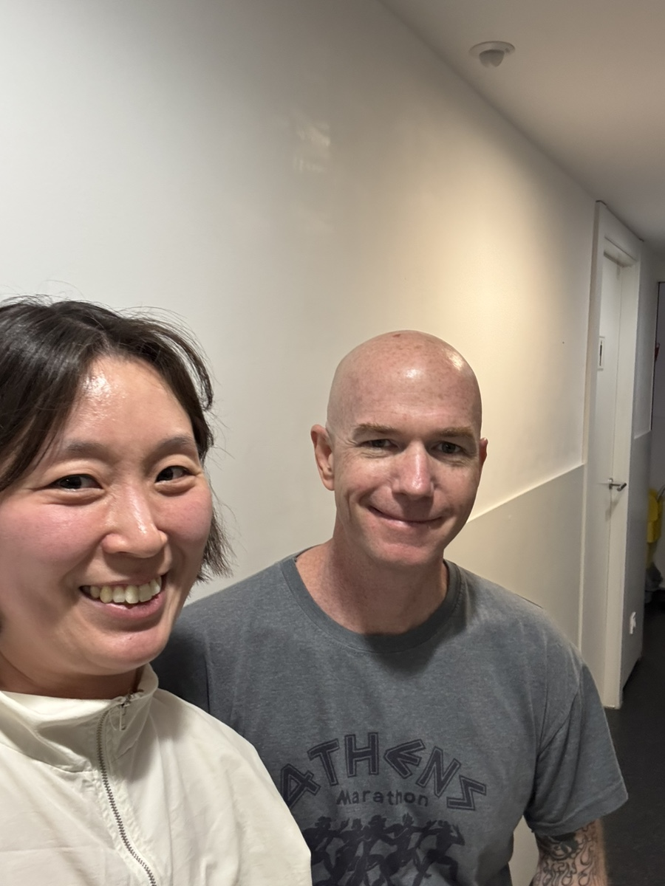

주비리에서 팜플로냐로 이동하는 날.
벌써 오리손에서 만난 친구들이 그리워진다.
신기하게도 첫 정이라는게 순례길에서도 통했다.
처음 커뮤니티 디너 시간에 만나 수다떨고 통성명 했던 친구들. 나만 보면 오 작가양반 하고 외치던 서양 언니 오빠들이 그리웠다. 같이 아침을 먹었던 한국 어머님 아버님과 소피와 그녀의 어머니까지도.
신기하게도 작년에 한 해 동안 같은 반을 지낸 친구들처럼 생각났다.

팜플로나까지 가는 길은 어쩐지 험난하게 느껴졌다. 마음이 허전해서인가.
엄마 없이 나 혼자 걸었다면 어땠을까를 수도없이 머리속에 그려본다. 어땠을까. 포기하진 않았을것 같은데. 아주 빠르게 도망치듯 걸었거나, 아니면 아주 천천히 거북이처럼 걸었겠지.
가끔 엄마의 속도에 헉헉거리다, 괜히 울컥하고 짜증도 났다가, 그래도 이정도 속도는 내야겠지 싶다가. 왔다갔다 한다.

오르락 내리락 산길을 탐험하다 마을에 진입했다.
팜플로나에 도착하고보니 꽤 큰 도시라는 사실을 깨달았다.

우연히 토니와 롸이언과 같은 숙소에 묵게 됐는데,
마침 은선언니와 토니 그리고 데레사 언니까지 다같이 저녁을 먹기로 해서 엄마와 나도 합류하기로 했다.
모두 순례길에서 만난 인연들이다.

숙소에 돌아오니 롸이언이 내일도 팜플로나에서 연박할거라 했다. 보통 팜플로나, 레온 같은 좀 규모있는 도시에서 연박을 한다. 그럼 아마도 롸이언은 나보다 하루씩 늦게 이동하게 될거고 오늘이면 작별이다. 갑자기 이별이라니 슬퍼서 마지막에 급하게 셀카를 찍었다.
작가 양반, 순례길 걸으면서 쓴거 책으로 나오면 알려줘유. 하면서 메일 주소도 쓰윽 넘겨주고 갔다.
소셜미디어 안 하는 순딩이 미쿡오빠..잘가요..

새 인연을 만나는 것도 어려운데 작별은 더 어려워~
