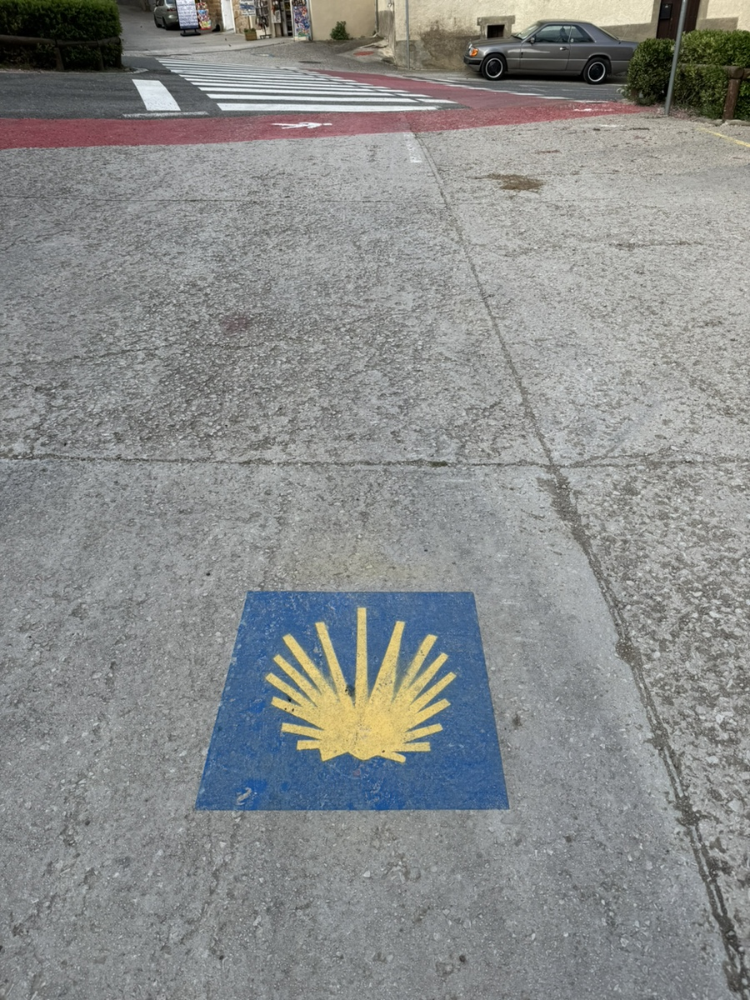
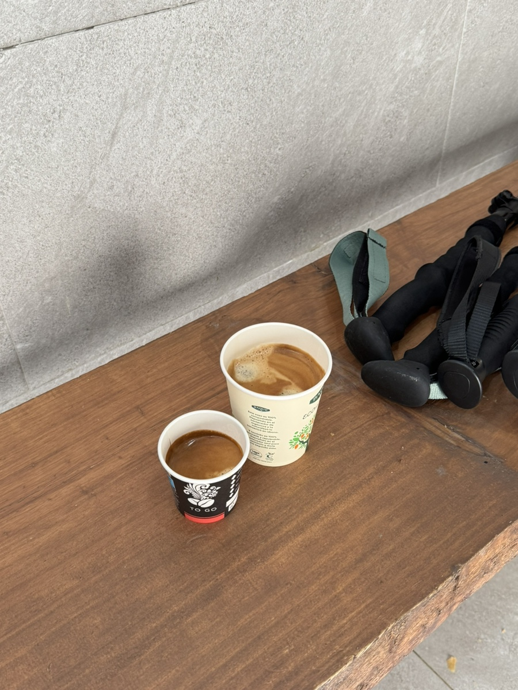
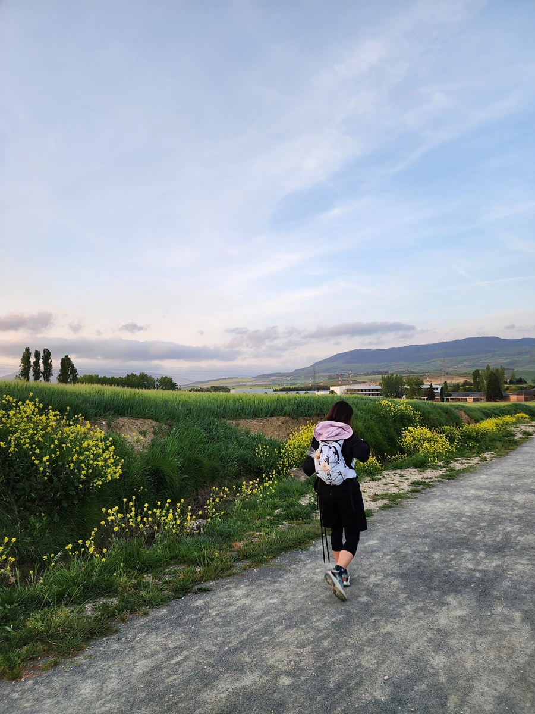
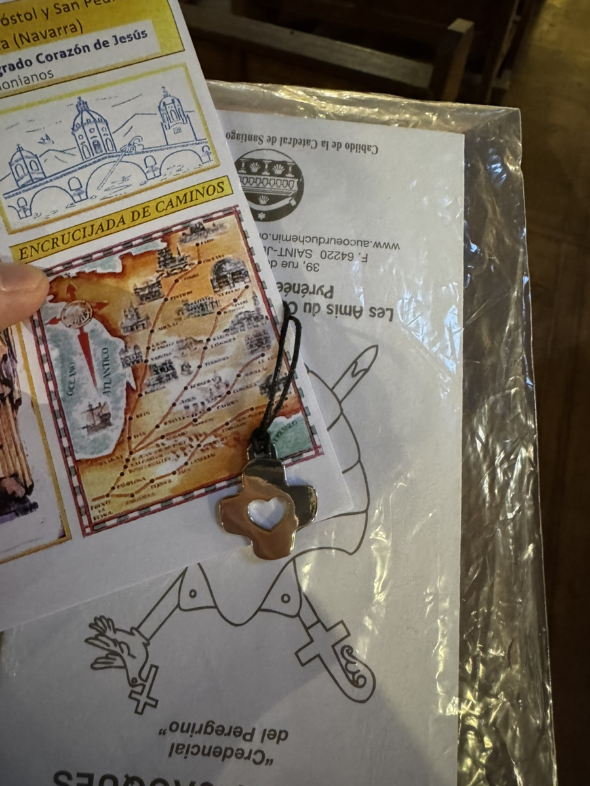

순식간에 5일이 지났다. 오늘은 팜플로나에서 푸엔테라레이나로 이동하는 날이다.

바닥과 건물 벽면 곳곳에 순례 표시를 잘 따라가야한다.
산길은 갈림길이 자주 나오지 않아 비교적 따라가기에 어려움이 없지만, 마을에 들어서면 가끔 길을 잘못 들어서기도 한다.
그럼 마을 주민들은 가던 길도 멈추고 달려와서 길을 안내해준다. 잘못 길을 들어서던 내게 한 할아버지가 버럭 소리를 질렀는데, 그의 얼굴에 전혀 나쁜 의도를 읽을 수 없었다. 정말 내가 옳은 길로 가기를 바라는 간절함만 있었다.

서울 북촌길에 관광객이 많아지면서 소음 때문에 고통을 호소하던 주민들이 떠올랐다. 순례길에 살고 있는 현지인도 비슷한 불편함이 있지않을까 궁금했다.
그들의 속사정까지는 알 수 없지만, 길에서 마주친 현지인들은 늘 우리를 보며 "올라!"하고 눈웃음을 보낸다. "부엔까미노!" 혹은 알아들을 수 없는 스페인어 인사를 보내는데 어쩐지 신의 가호가 함께하기를. 같은 인삿말처럼 들린다. 스페인어를 배워서 그들과 짧은 소통을 하고 싶단 생각을 한다.

산길 중간중간에 아주 작은 마을을 만날 때는 눈에 불을 켜고 카페를 찾는다. 언제 다시 이런 쉼터를 만날 수 있을지 아무도 모른다.
커피 한 잔에는 달콤한 휴식과 카페인 충전이 되면서 동시에 오줌값으로도 치러진다. 순례길 중에는 커피만큼이나 화장실도 귀하다.

주민들의 따뜻한 환대. 오가는 순례자들의 응원을 받으면서. 나는 걷기만 해도 칭찬받는게 이 순례길이 아닌가 생각한다.
숙박하는 마을에서는 늘 미사를 드리고 있는데, 대부분 신부님이 순례자들을 축복해주신다. 심지어 순례자를 위한 미사를 따로 주시기도 한다.

뿌엔테라레이나에서 드렸던 미사에서는 뜻밖의 선물도 받았다. 신부님이 순례자들을 전부 앞으로 나오게 해서 목걸이를 하나씩 전달하며 이름을 호명하며 축복을 내려주셨다. 과분한 선물에 끝없는 축복에 몸둘 바를 모르겠는 하루를 보냈다.
