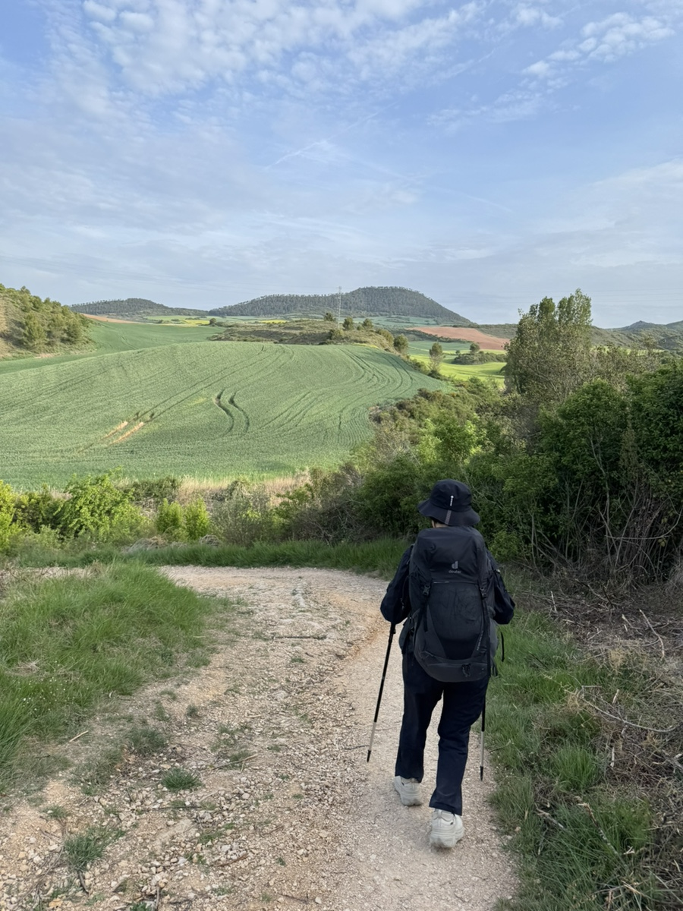
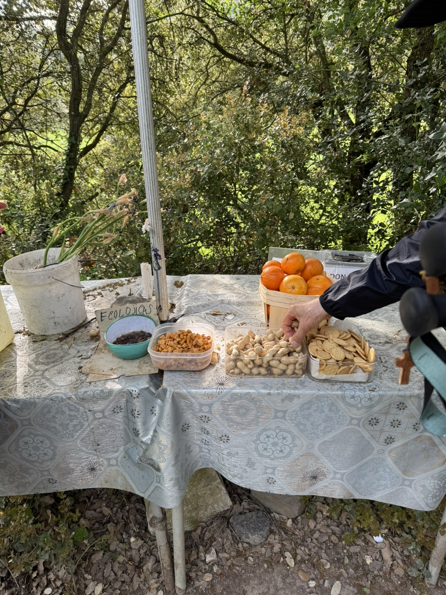
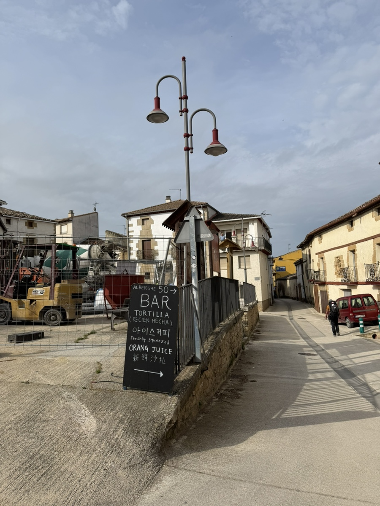
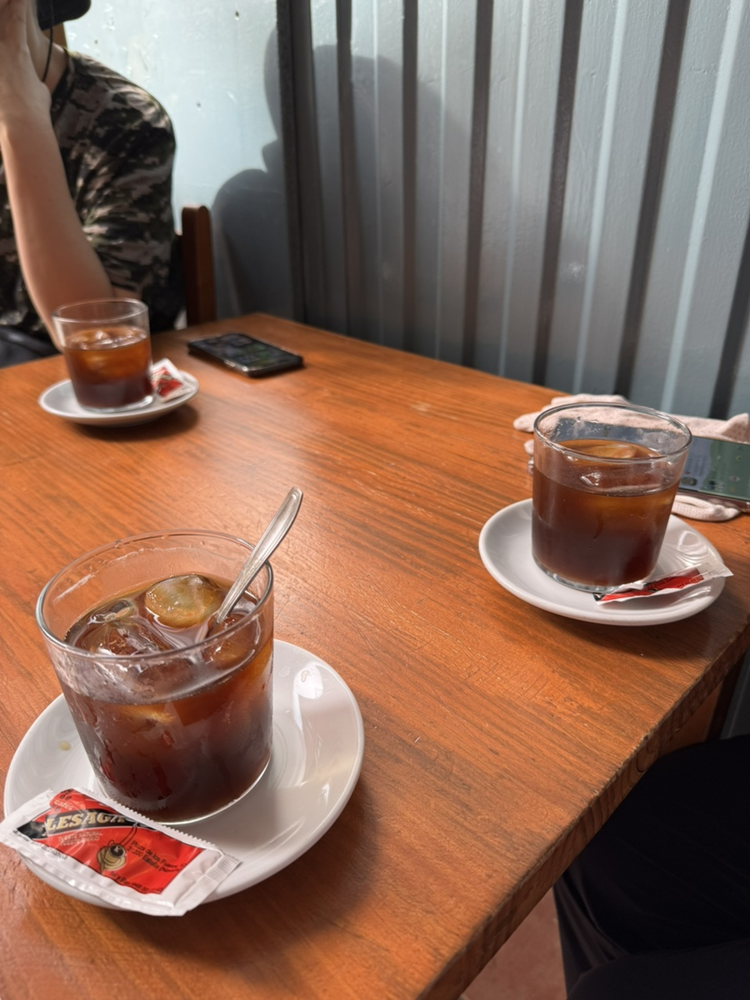
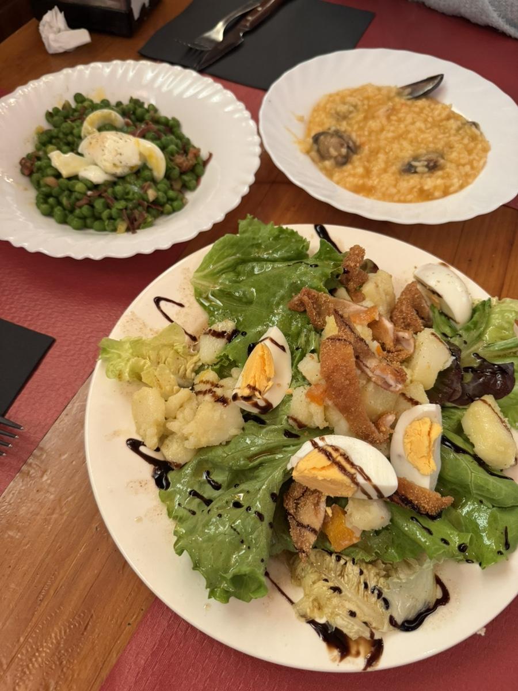
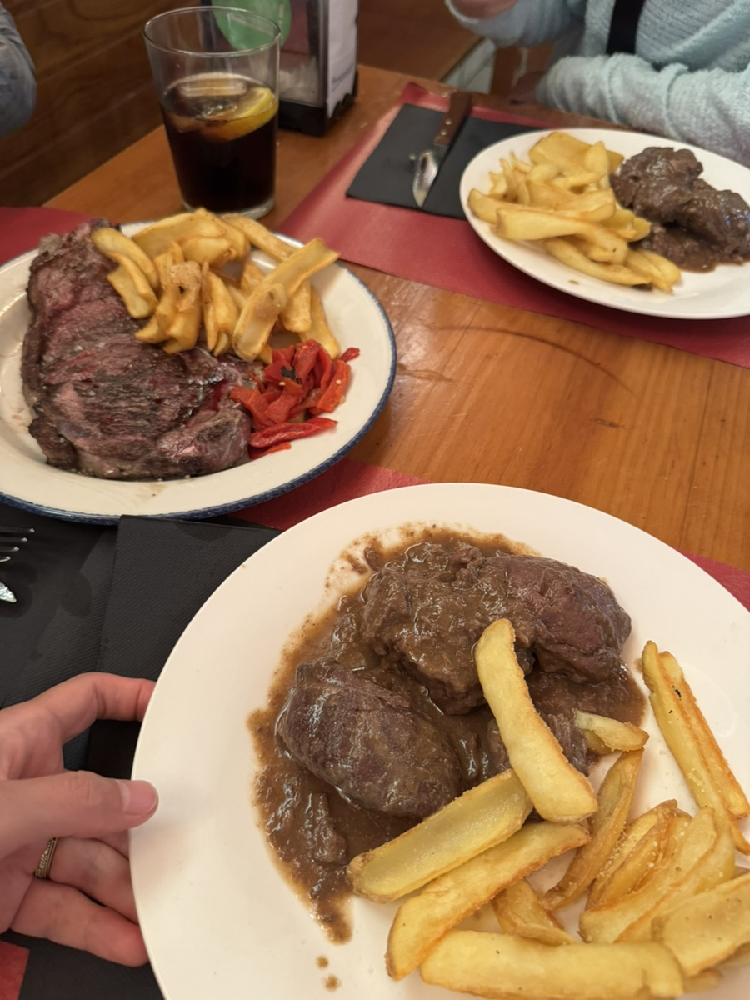
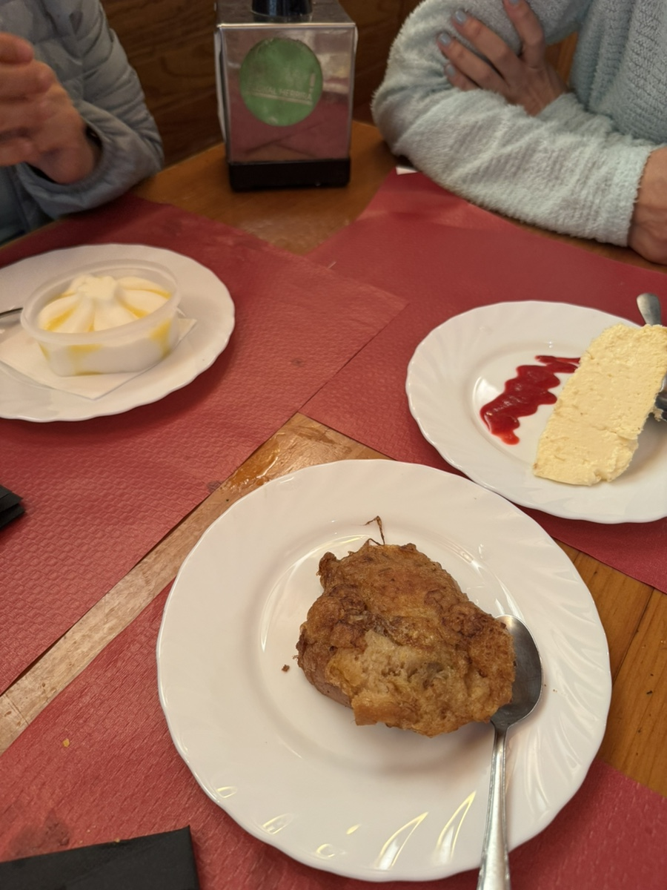

뿌엔떼라레이나에서 에스떼야로 가는 길.
아직도 시차 적응은 무리인지 새벽 3시만 돼도 눈이 떠지고, 걸으면 걸을 수록 몸은 무거워 진다.

이제 동키 서비스 없이 가방 하나에 짐을 다 털어넣고 다닌다. 아마도 7키로 정도 되는 무게. 다리만 아픈게 아니라 어깨랑 허리랑 고관절까지 욱신거린다.

걷다보니 산 길 한 모퉁이에 주인없는 상점이 놓여있다. 순례자들을 위해 주민들이 꾸려놓은 공간이다. 기부금 모금함에 작은 성의를 보탰다. 이때 주워먹은 땅콩맛이 아직도 생각난다. 진짜 맛이 좋았다!

에스떼야 가기전 들린 lorca 마을에서 익숙한 한글을 발견했다. 아이스커피 글자에 이끌려 가보니 한국인 여사장님이 계셨다.

아이스 커피 세 잔을 시켜놓고 사장님의 러브스토리와 20년째 이어오고 있는 알베르게 일에 대한 이야기를 들었다. 일 년에 알베르게는 7개월만 열고 나머지는 한국에서 생활하신다 했다. 내가 정말 꿈꾸는 삶이라 너무너무너무 놀랐고 또 여러모로? 귀감이 됐다. 새로운 꿈을 꿀 수 있을 것 같다.

에스떼야에서는 공립 알베르게에 묵었다. 완전 기부제라 신기했다. 내는 만큼 내면 되는 식이다. 근처 식당에서 처음으로 순례자 메뉴를 먹어봤는데, 전식에 메인에 디저트까지 알차다. 알차다 못해 배가 터질 것 같아 무례를 무릅쓰고 죄금 남겼다ㅠㅠ

길을 걸을 때나 쉴 때나 마찬가지로, 이곳 사람들은 순례자를 대접하고 있구나 하는 느낌을 받는다.
