오늘은 에스떼야에서 로스아르코스로 이동하는 날이다. 간밤에 창문이 열려있었는지 엄마가 기침을 하고 콧물을 줄줄 흘린다. 그래도 순례길을 따라 걷는다. 걷는 내내 엄마의 컨디션을 살피느라 정신이 없다.

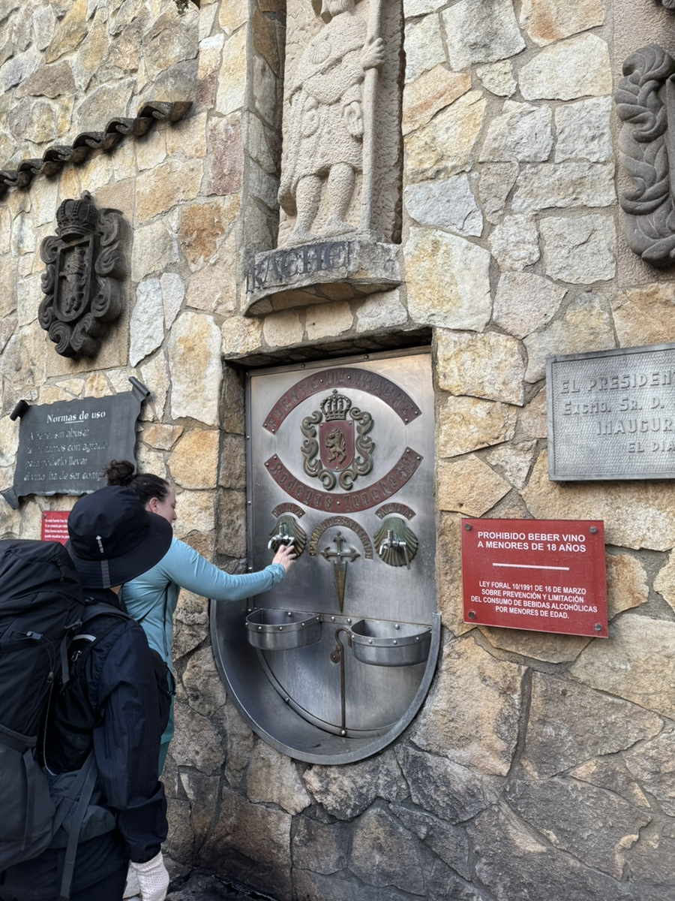

에쓰떼야를 떠나는 길에 만나는 공짜 와인인데
오전 8시인가부터 새로 채워진다고 한다. 우리가 갔을 때는 너무 이른 시간이라 그런가 아무것도 나오지 않았다.

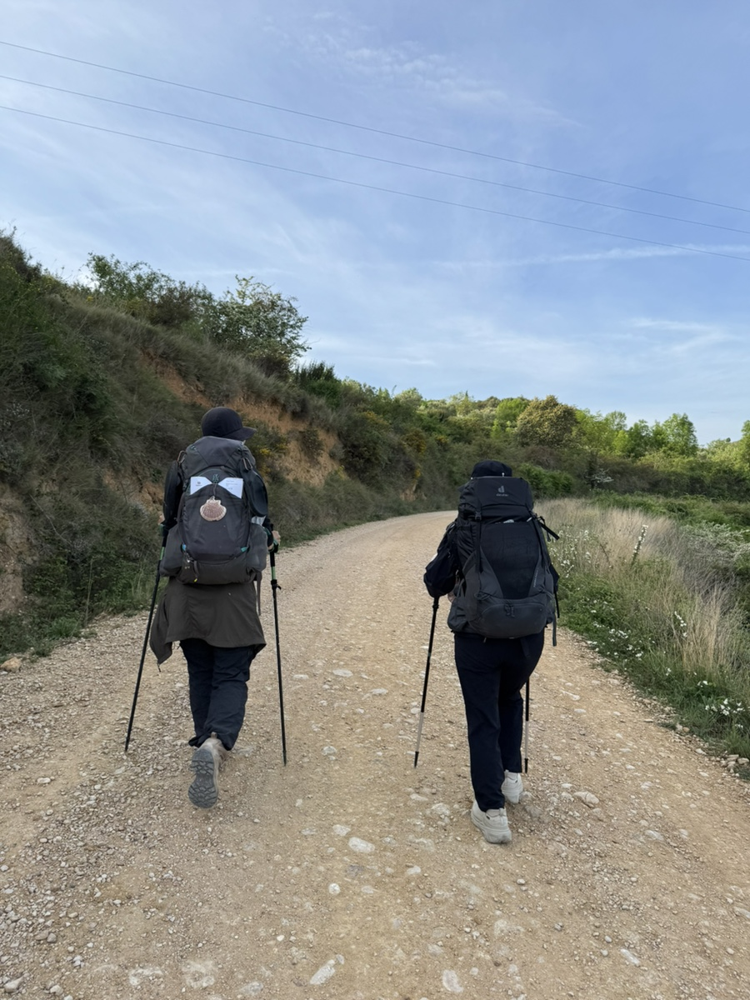

공립알베에서 함께 했던 데레사 언니와 또 같이 발을 맞추었다.

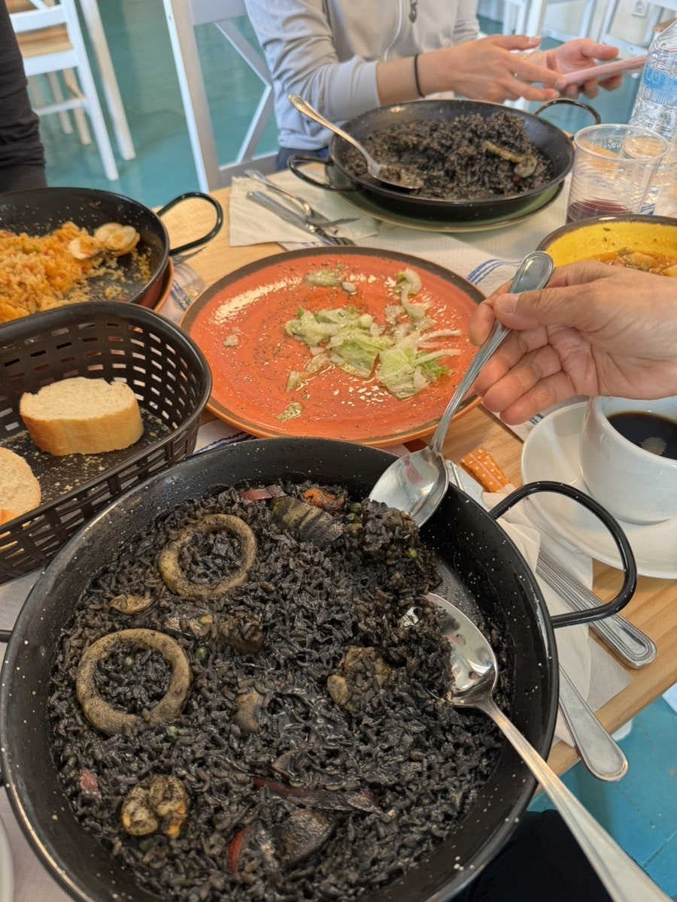

좀 걷다가 어떤 식당의 열렬한 홍보 방식에 이끌려 들어가서 홀린듯 식사를 했는데, 론세스에서 친해진 써니 언니도 식당으로 들어오는게 아닌가. 서로 얼굴을 보고 빵터져서 한참을 웃었다.

식사를 하고 있는데 우리처럼 호갱당한 무수히 많은 순례자들이 들어왔고, 론세스에서부터 함께 미사를 드리고 있는 신부님 무리도 또 만났다 (앞으로 쭉 더 만난다..ㅋㅋㅋ)

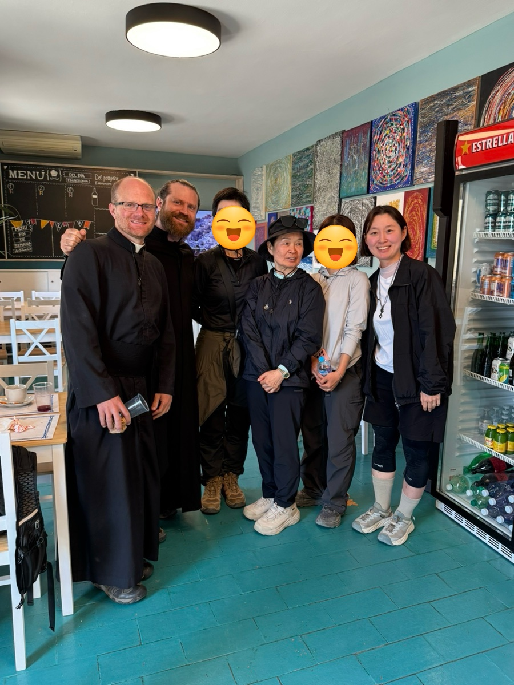

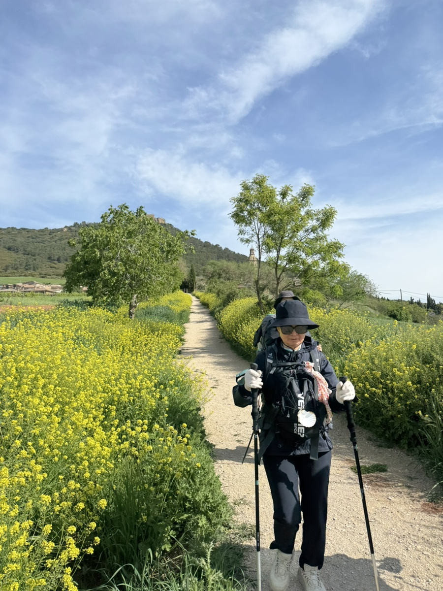

든든히 밥도 먹었겠다. 신나게 걷는다. 엄마도 잠시나마 컨디션이 회복된듯 보였다.

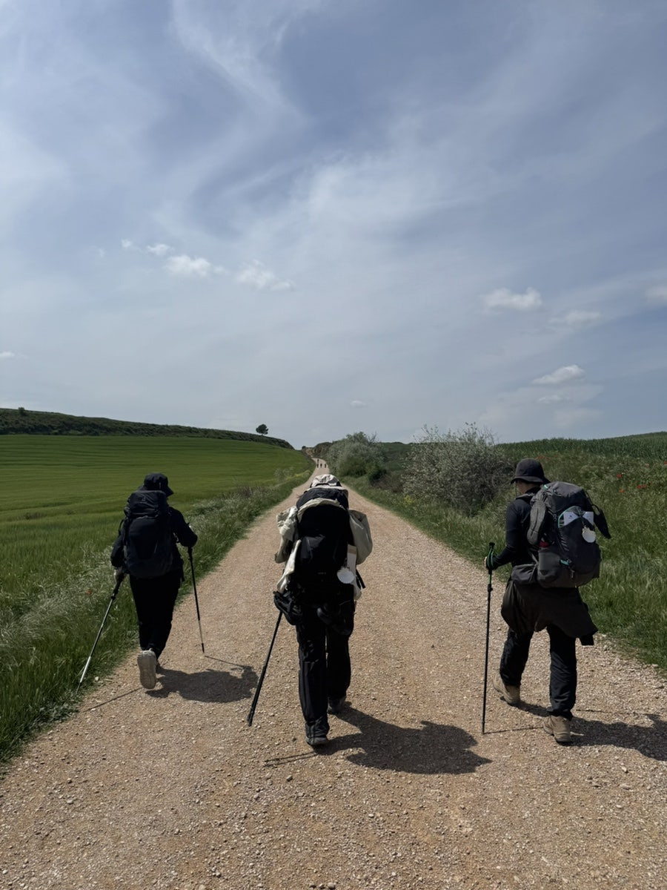

둘보단 셋이. 셋보단 넷이. 많으면 많을 수록 좋은게 순례길이다.

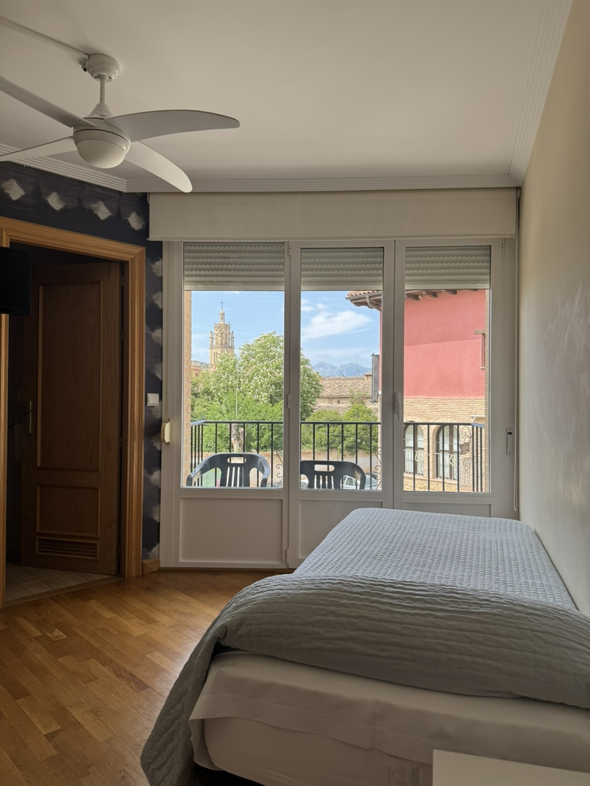

초반에 엄마의 기력을 위해 예약해뒀던 트윈룸이 이렇게 유용하게 쓰일 줄이야.. 밤새 추위도 그렇지만 그간 쉬지 않고 걸었고, 사람들의 뽀시락 소리와 코고는 소리에 제대로 잠들지 못했었다. 잠귀가 어두운 편인 엄마도 낯선 환경에 쉽게 적응하지 못한 듯 했다. 오늘만큼은 편히 주무실 수 있을 거 같아 다행이다.

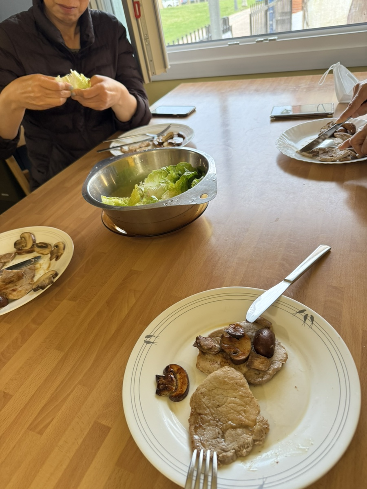

시에스타 때문에 모든 식당이 7시 이후에나 저녁을 먹을 수 있었다. 우린 점심도 못 먹은 상태여서, 급히 써니 언니와 데레사 언니가 있는 공립 알베에서 고기를 궈먹었다.
근데 숙박객이 아니면 들어올 수 없다는걸 나중에야 알았.. 먹는 도중에 봉사자가 와서 나가라고 소리치는 바람에 고기를 입에 막 우겨넣고 도망치듯 빠져나왔다.

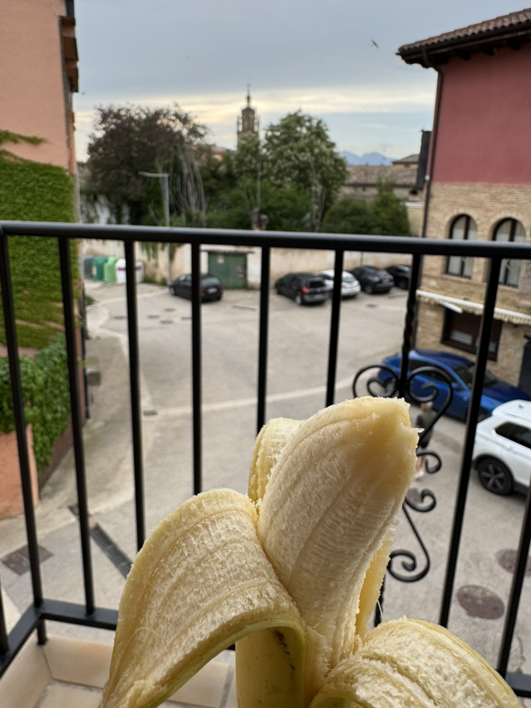

약간 체할 것 같은 기분이 들어 숙소로 돌아와 바나나로 마무리..

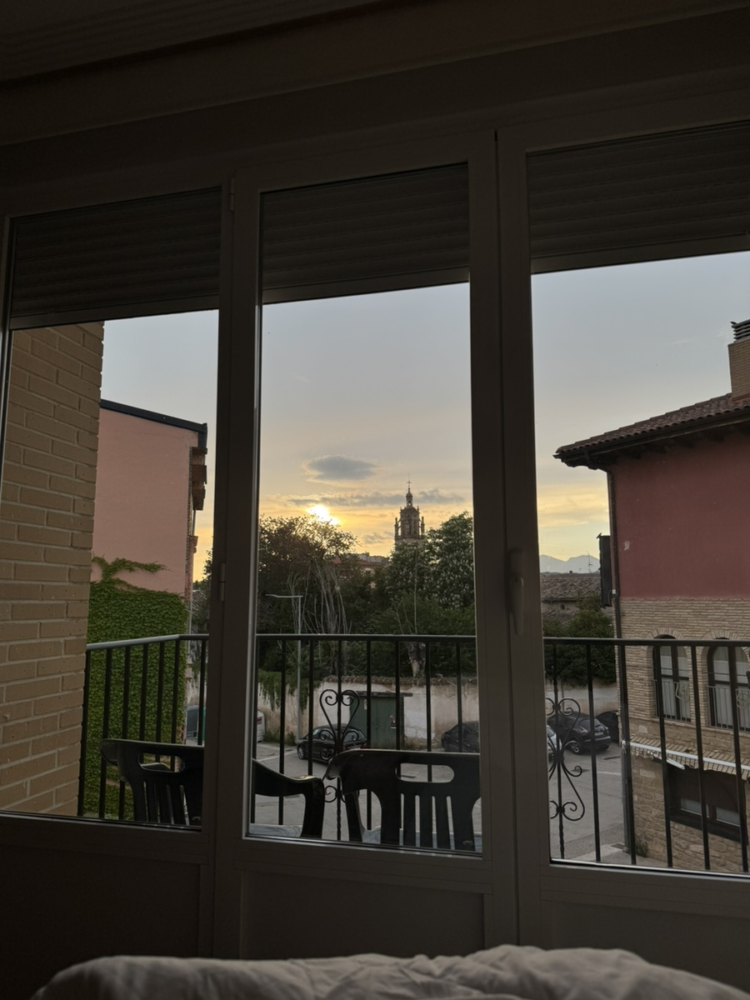

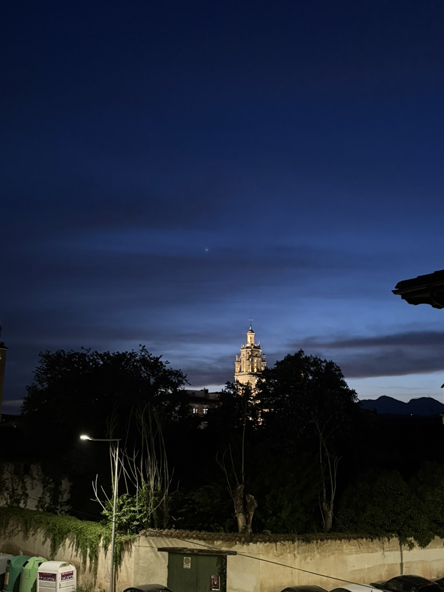

우여곡절이 많은 하루여서 이 마을이 싫어질 것 같았지만, 숙소에서 보이는 성당 뷰에 혼이 쏙 빠졌다.

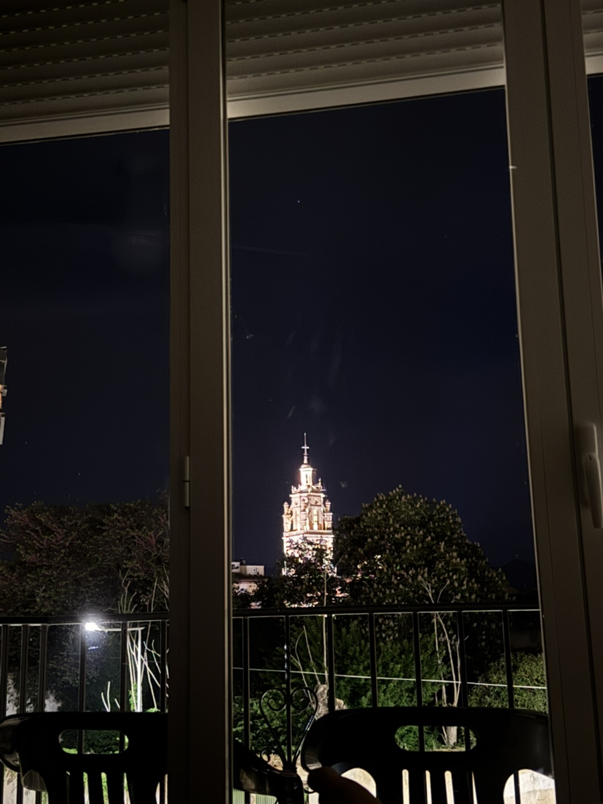

누운 상태로도 발 아래에 반짝이는 성당을 보며 아주 흡족한 밤을 보냈다.
