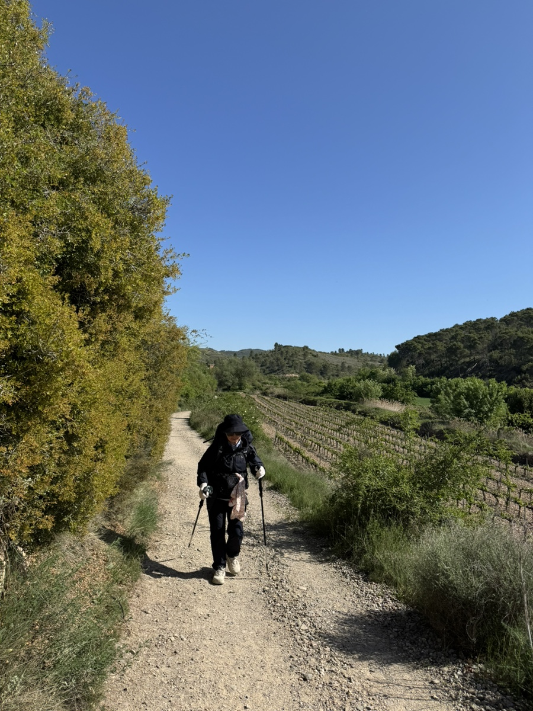
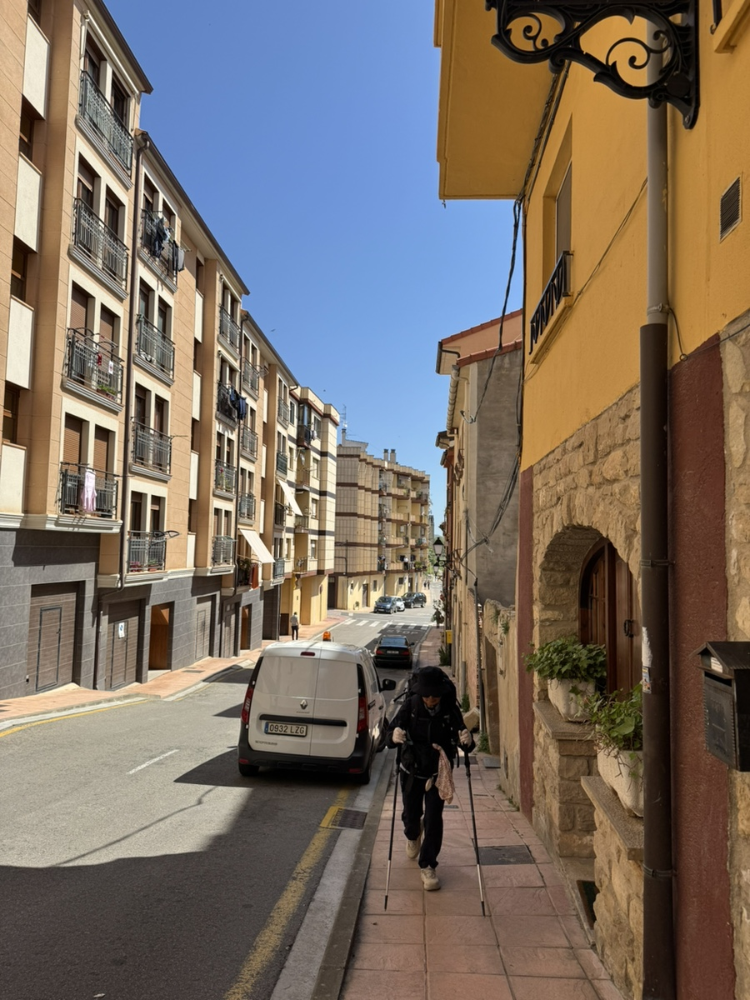
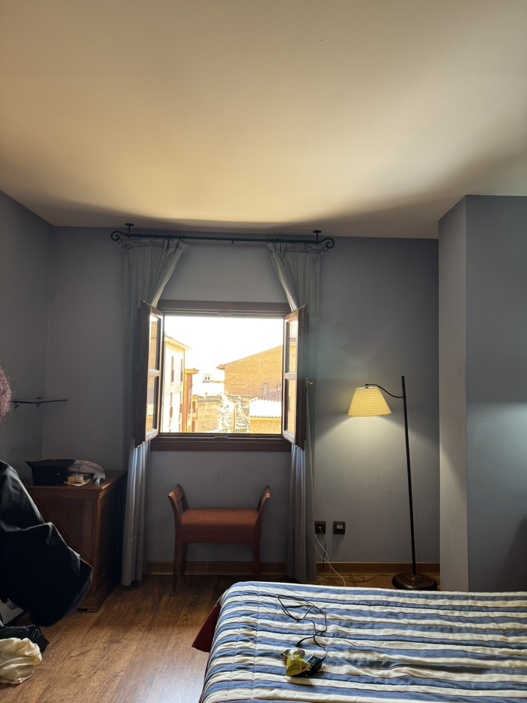
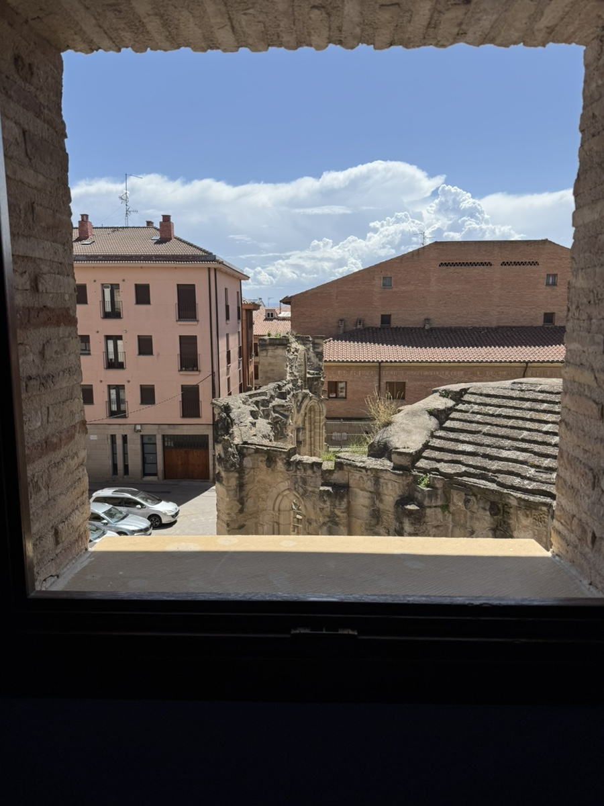
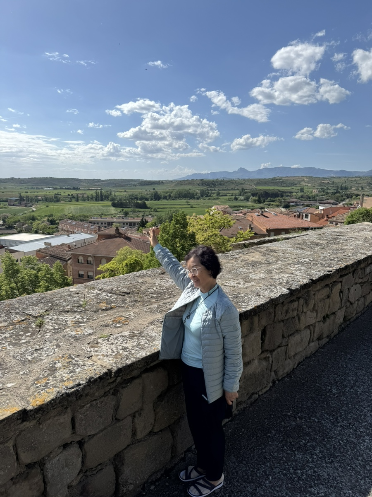

좀처럼 엄마 컨디션이 나아지는 것 같지 않아, 공립 알베를 가려던 계획을 취소하고 전날밤 급히 트윈룸을 잡았다. 악연같았던 로스아르코스를 떠나 비아나로 향했다.

근데 언제까지 이렇게 오르막을 걸어야 하나요..
벌써 일주일이 지났는데도 걷는 게 벅차고 또 벅차다..

공립알베에서 바로 코앞에 있는 호텔인데 연식에 비해 고급진 느낌이 좋았다. 1층 식당에서 순례자 메뉴도 팔고 조식도 준다고 해서 더 좋았다.

뷰도 베리굿.

아픈 엄마를 방에 모셔놓고 장도 보고 빨래도 하고 쏘다니고 있는데, 호주 신부님 무리를 또 만났다. 엄마가 편찮으시다 했더니 기도를 해주시겠단다. 이런 표현 해도 될지 모르겠지만, 신을 빽으로 삼은 기분이 들었다.

그리고 숙소 바로 앞에서 미국 샌디에이고에서 온 에미 언니와 마주쳤다. 오리손에서 만나 금방 친해진 성격 좋은 미쿡언니다. 우리는 반가움에 창피함도 모르고 길에서 꺅 소리를 지르며 인사했다. 나는 곧바로 엄마가 감기로 고생이라 했더니 에미가 진지한 얼굴로 증상을 이것저것 묻고 몇가지 약을 줬다. 생각해보니 에미가 미국에서 간호사라고 했던듯..?
이외에도 메일 주소를 주고받으며 혹시 도움이 필요하면 언제든 연락 달라했다. 나는 에미의 약을 움켜쥐고 땡큐베리머치를 수없이 외쳤다. 에미는 우리가 이렇게 마주친게 얼마나 신의 뜻이냐며... 그 말을 듣는데 나도 모르게 팔에 소름이 돋아서 그걸 보고 둘이 한참을 또 웃었다.

마지막으로 에미가 준 약 먹고 씻은듯이 나은 마미.. 에미야 약발이 엄청나다.
