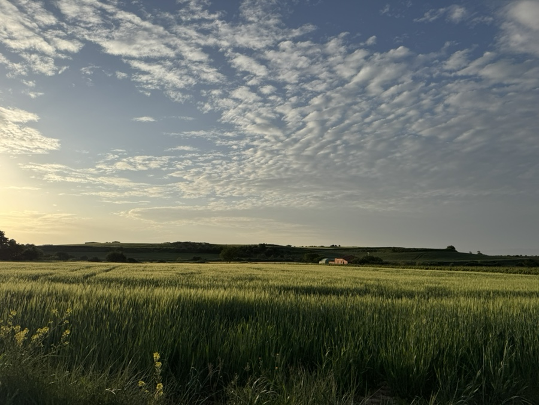
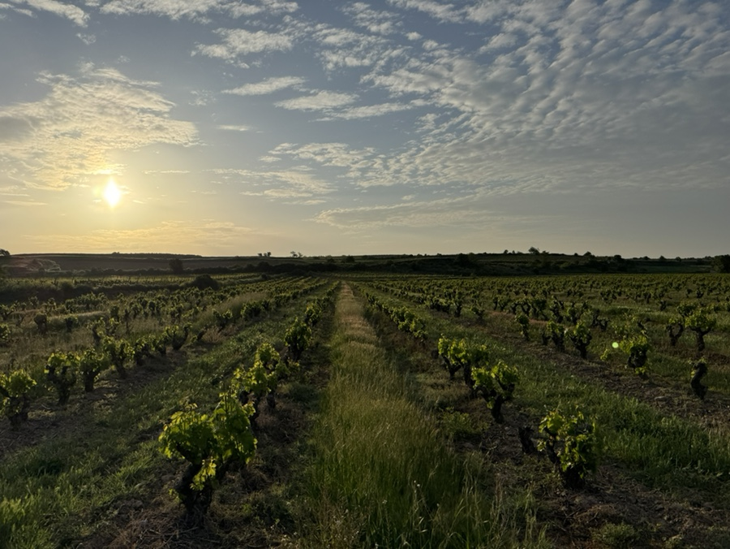
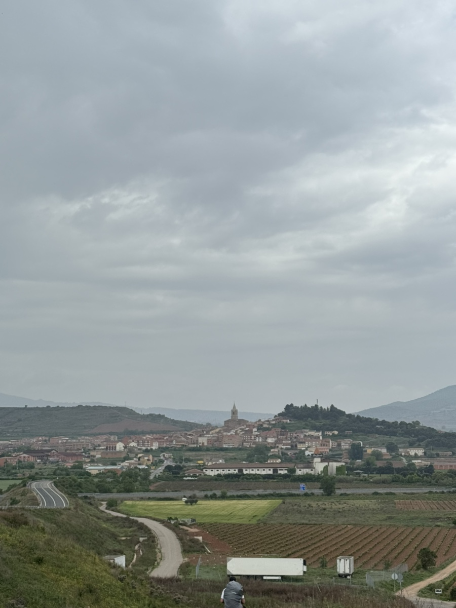
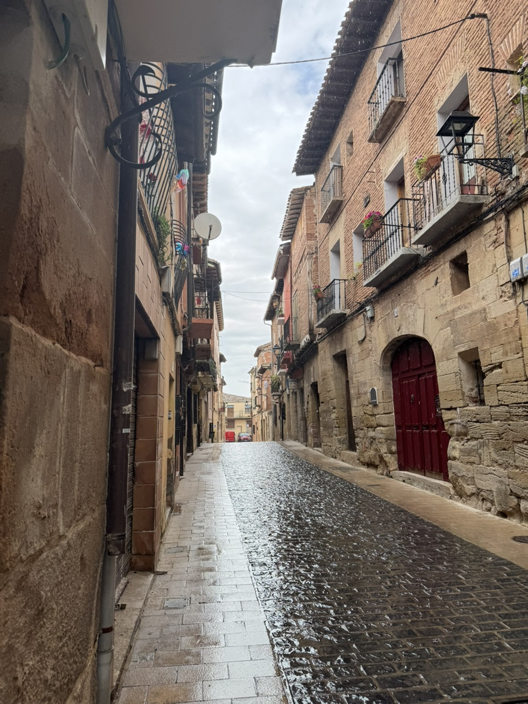
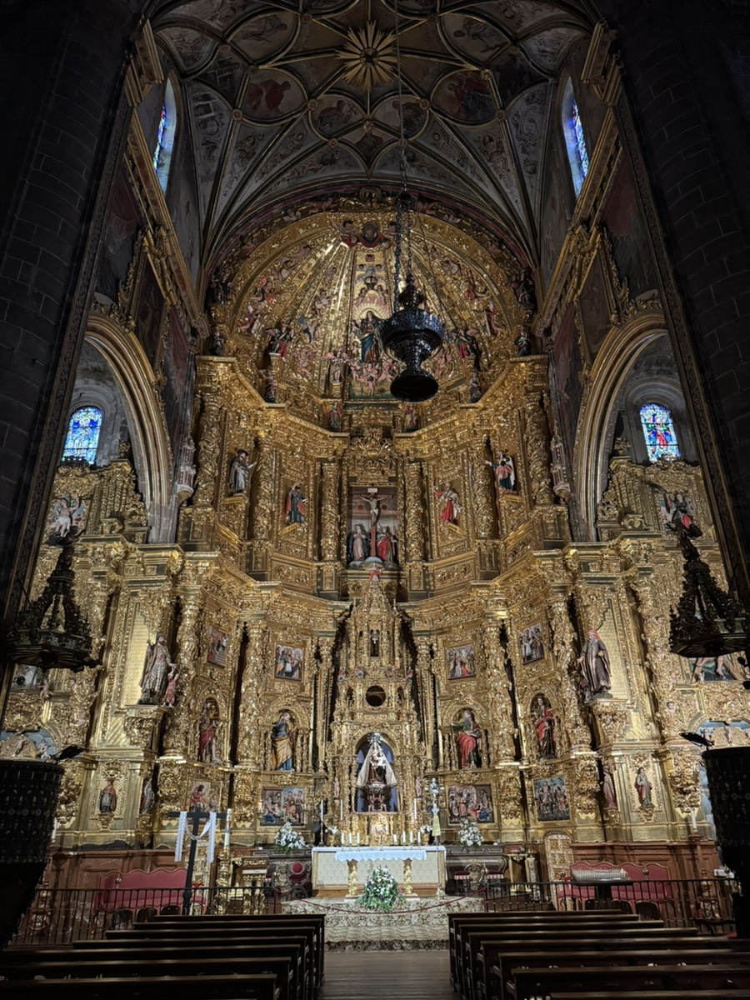
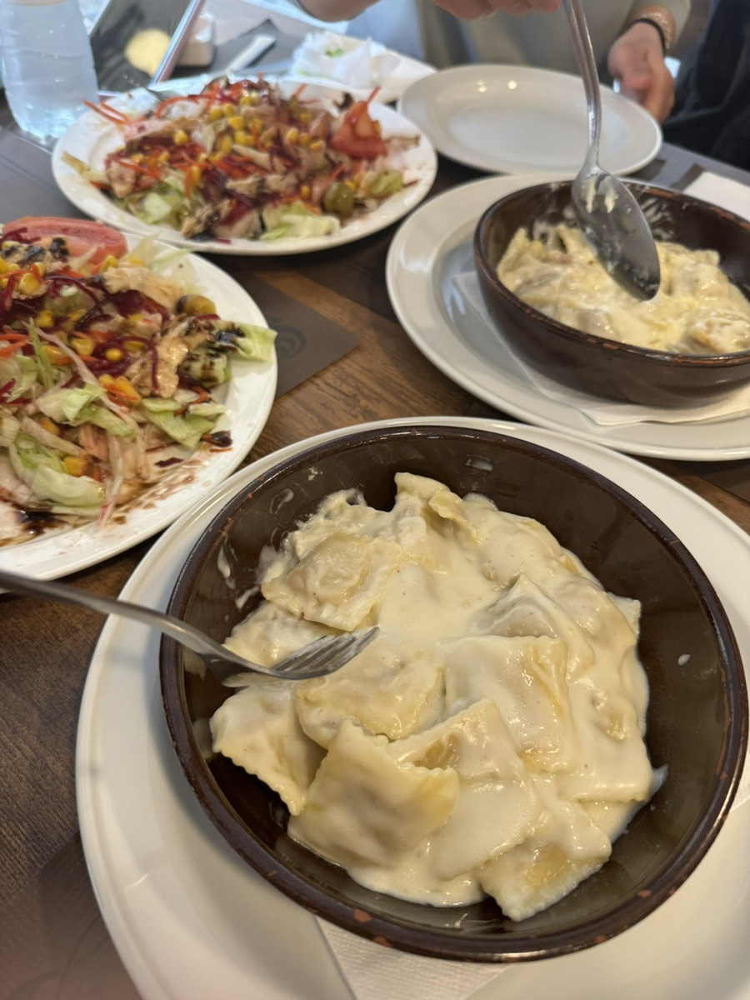
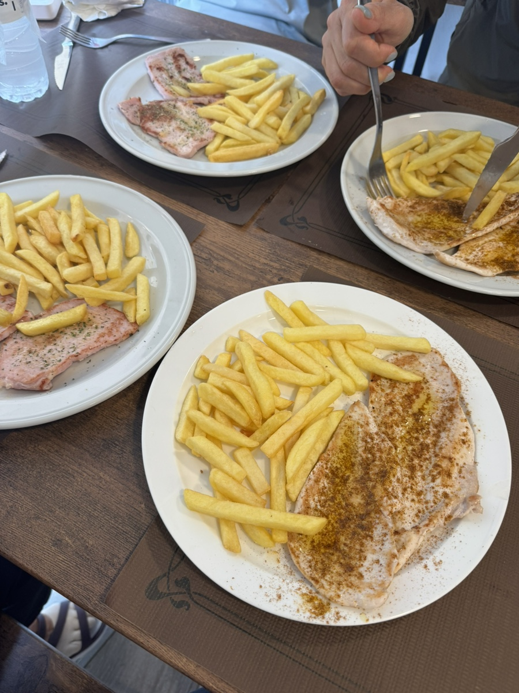
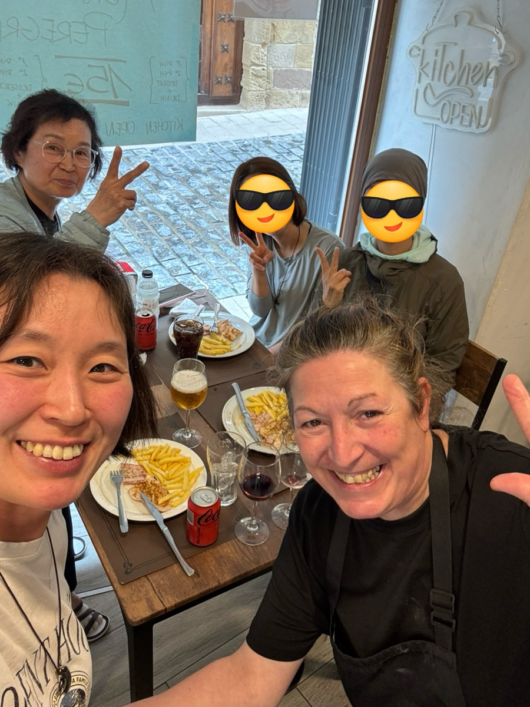

비아나에서 나바레떼로 이동하는 날.

매일 보는 풍경이 이제 익숙한 듯 하면서 또 여전히 감동적이기도 하고 그렇다.

어마어마하게 넓은 포도밭. 와인 마시고 싶다.

비아나에서 조금만 더 걸어가면 죄금 큰 도시인 로그로뇨가 나온다. 거기서 묵는 사람들도 많은데 그러려면 하루에 꽤 많은 거리를 걸어야 하므로 나는 스킵했다.

지나치면서도 딱히 마음에 확 들어오는 동네는 아니었다. 확실히 도시라 필요한건 도처에 깔려있긴 했다.
로그로뇨를 지나치면 그때부터 공원 길이 나온다. 지금까지 걸은 중 가장 쾌적하면서 평탄한 길이었다. 동네 노인분들도 다들 나오셔서 걷기를 즐기셨다.
우리를 지나치시면서 "부엔 까미노(좋은 까미노길 되시길)"을 잊지 않고 외친다. 따뜻한 미소는 덤으로.

드디어 저 멀리 오늘의 종착지인 나바레떼가 보인다.
순례길을 걷다보면 끝나지 않을 것 같은 지루한 길 위에 마법처럼 마을을 발견할 때가 가장 감동적인 순간이다. 항상 성당 종탑이 제일 먼저 우리를 반기고 그 뒤로 솟아난 집 지붕들이 눈에 들어온다. 보기만 해도 절로 온몸이 따수워지고 눈이 감기는 광경이다. 아, 집에 왔구나. 처음 온 동네인데도 불구하고 나는 그곳을 집이라 부른다.

나바레떼에 도착하자마자 우리를 반겨주는건 다름아닌 폭우였다.

숙소에 짐을 풀고 나면 곧장 씻고 빨래를 한다. 동양인들은 대부분 일사천리로 진행해서 종종 외국인 친구들이 벌써 씻었냐고 신기해했다.

다 씻은 한국인 여성 친구들 넷이 다시 뭉쳤다.
성당에 가보니 1유로를 넣으면 불이 켜진대서 한번 넣어봤다. 금빛이 휘황찬란한 것이 1유로가 아깝지 않은 장관이었다. 근데 저녁미사를 가니 더 화려하게 불을 켜주더라.

이제는 가족같은 데레사 언니와 써니언니.
넷이 모여 순례자 메뉴를 먹었다. 원래 가려던 맛집이 일찍 닫아 성당 바로 옆 식당에 왔는데, 너무 맛있었다!

메뉴 주문 받는데 주인 분이 자꾸 헷갈리게 하는 탓에 꽤나 진탐을 뺐다.. 나중에 주인 아주머니가 미안하다며 몇 번이나 나한테 와서 애교를 부리셨다. 아주머니가 너무 미안해하셔서 내가 다 무안할 정도였다. 그래서 같은 알베에 묵은 사람들한테 다 여기 레스토랑 추천해줬다. 마지막으로 기념 사진도 남겼다.

이제는 엄마와 단둘이 지내는 것보다 다같이 어울리는 시간들이 더 익숙하다. 그래서 언젠가 마주할 이별에 벌써부터 고개가 떨궈진다.
