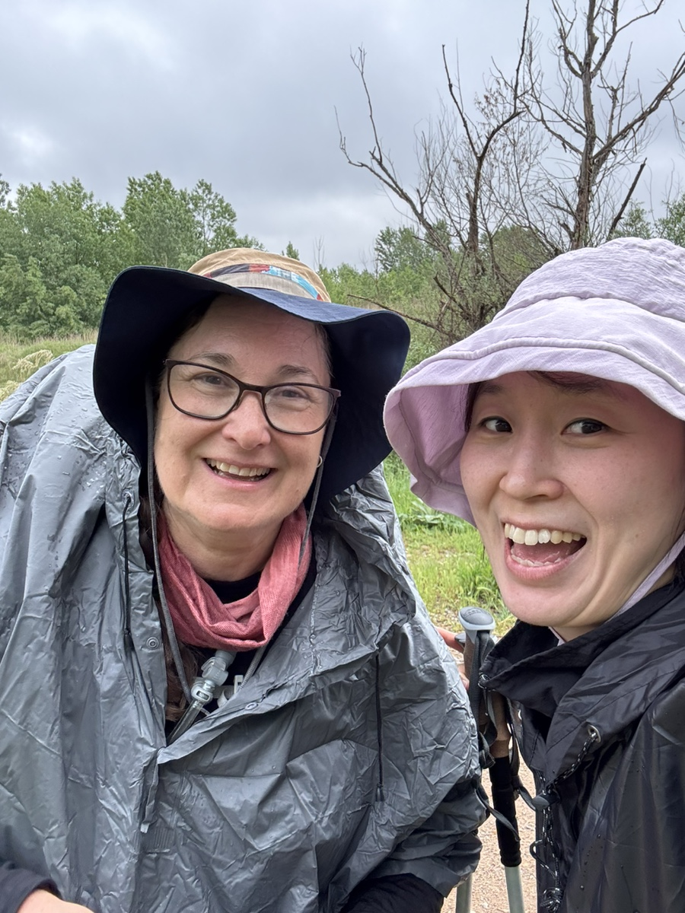
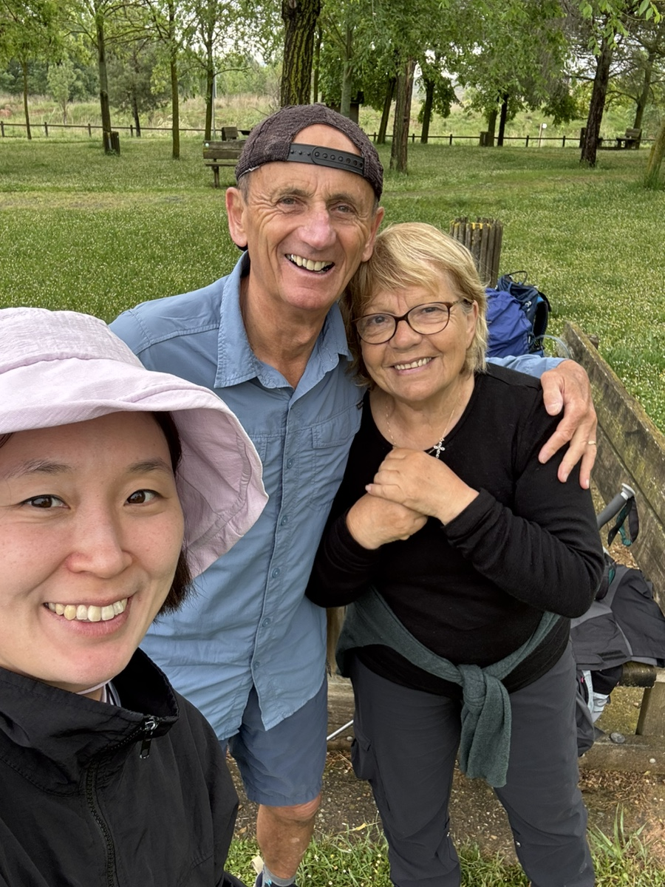
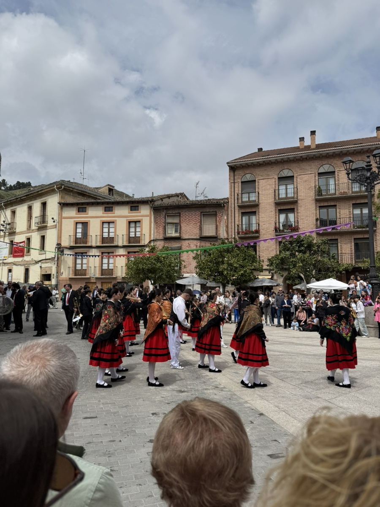
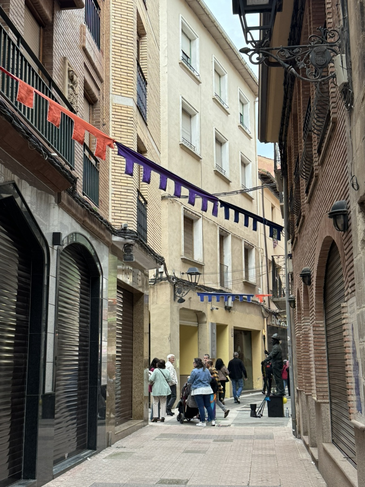
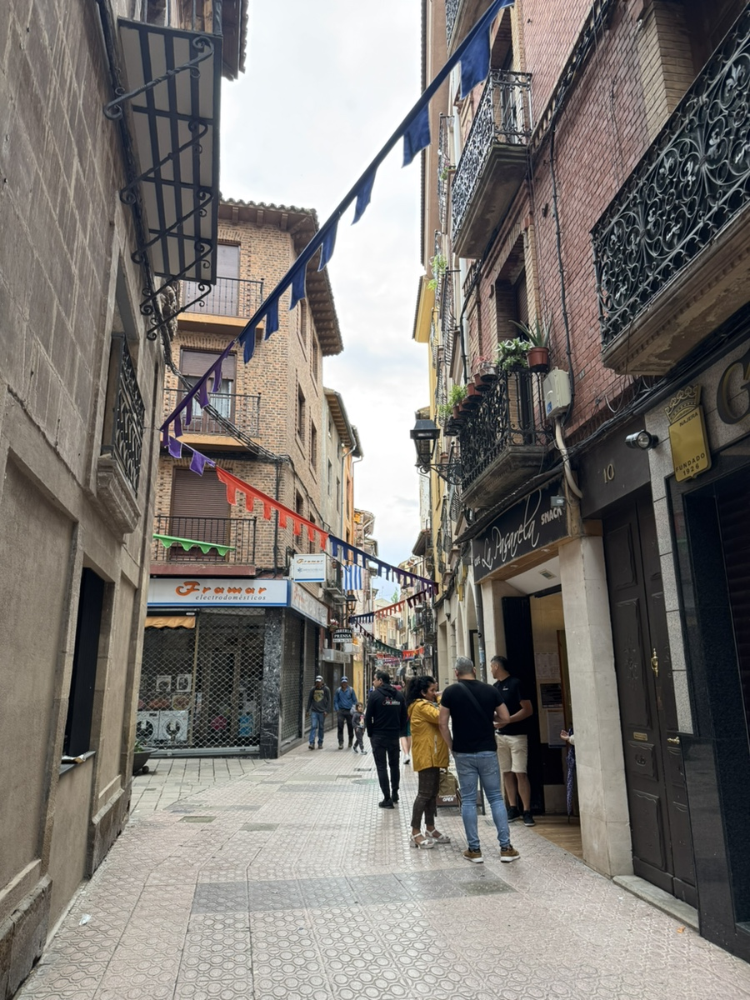
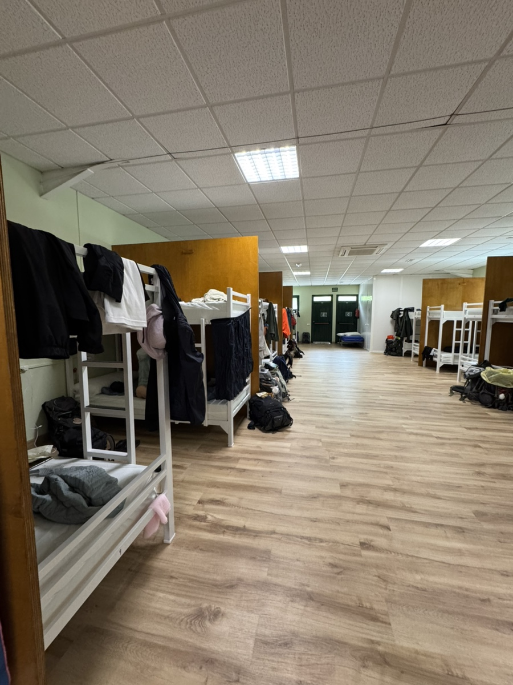
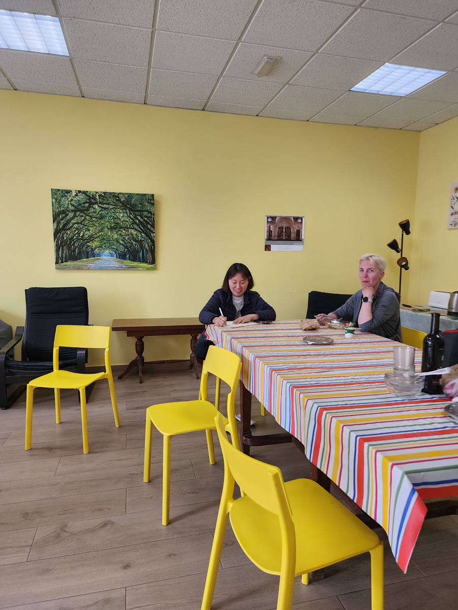

나바레떼에서 나헤라로 가는 날.
지금까지 다니면서 우연히 마주쳤던 인연들을 길에서 또 만났다. 가는 길과 목적지가 제각각 달라서, 이 길을 벗어나면 다시 못 볼 인연들이었다.

스톡홀름에서 온 이락카. 프랑스에서 오신 부부.
다들 내 말동무가 되어주어 길고 지난한 길들이 외롭지 않았다. 불란서 어머님 아버님은 특히 나의 5세 수준의 불어를 귀여워라 해주셨는데.. 이메일 주소라도 받아둘걸 하고 지금도 아쉬워하는 중이다.

나헤라 가는 중에는 비가 오다 안오다를 반복하는 바람에 우비를 썼다가 또 벗어서 접어 넣었다가 또 다시 꺼내 입었다가를 반복했다.

그렇게 마침내 도착한 나헤라. 마을에는 축제가 한창이었다. 무슨 축제인지는 모르겠다.

나헤라 공립 알베에서 묵었는데, 침대 간 간격이 널찍하고 내부 공간이 넓어서 참 좋았다. 샤워실이 딱 두개 뿐이라 아쉬웠지만 여러모로 만족스러웠던 공립.

남편은 이 사진을 보고 무척 놀랐다. 내가 호화로운 호텔방 같은데서 묵으며 순례길을 걷는줄 알았나..?

라트비아에서 온 이베르타.
이제 쉰 살이라는데 우리는 금방 친구가 됐다. 유머코드도 잘 맞았고 대화 주제도 흥미로워 시간가는 줄 모르게 수다를 떨었다. 라트비아 주민들이 사는 모습, 러시아 근방 국가에 살면서 느끼는 것들을 직접 들으니 놀라웠다. 내가 일기를 쓰고 있으니 한글을 보며 자기 눈에는 고대 룬문자 같이 느껴져서 놀랍다고 했다.
