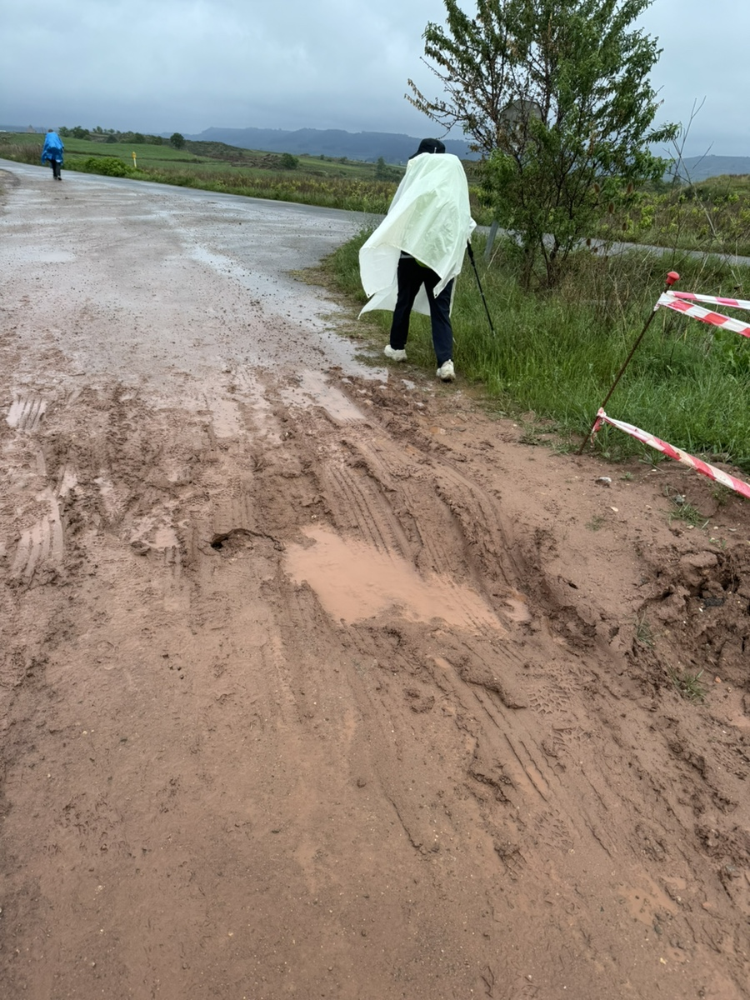
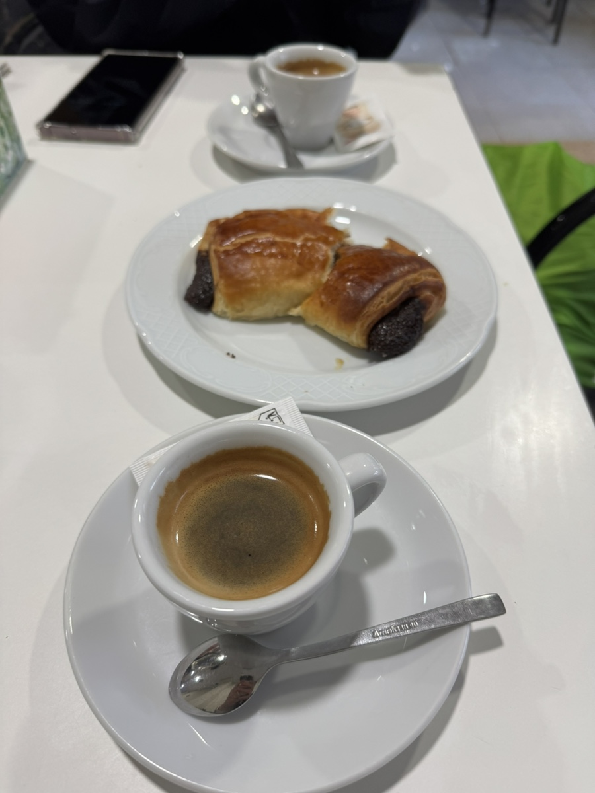
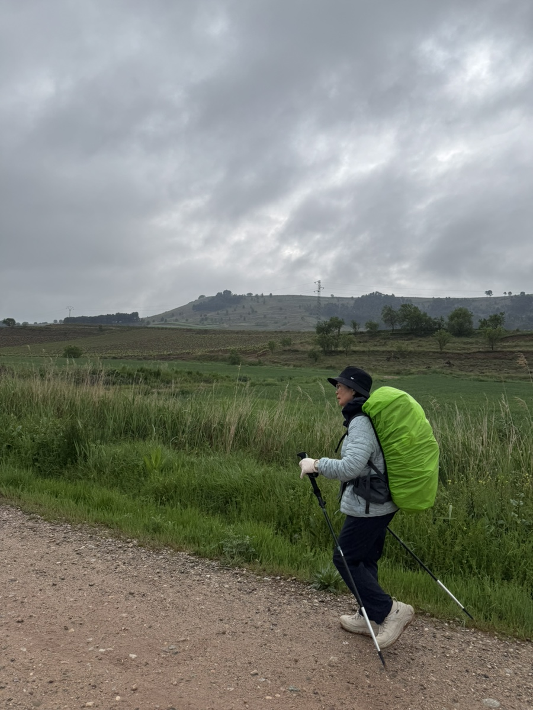
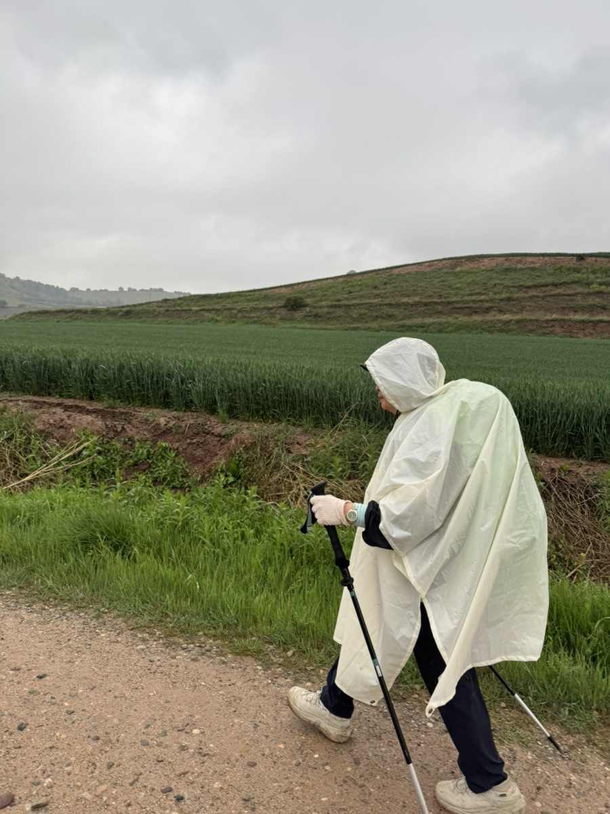
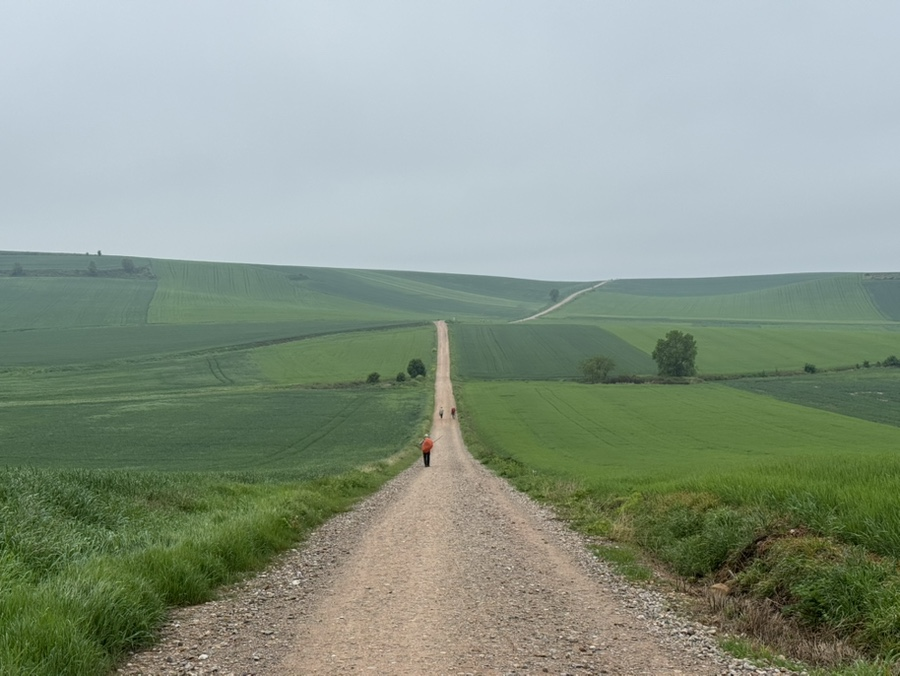
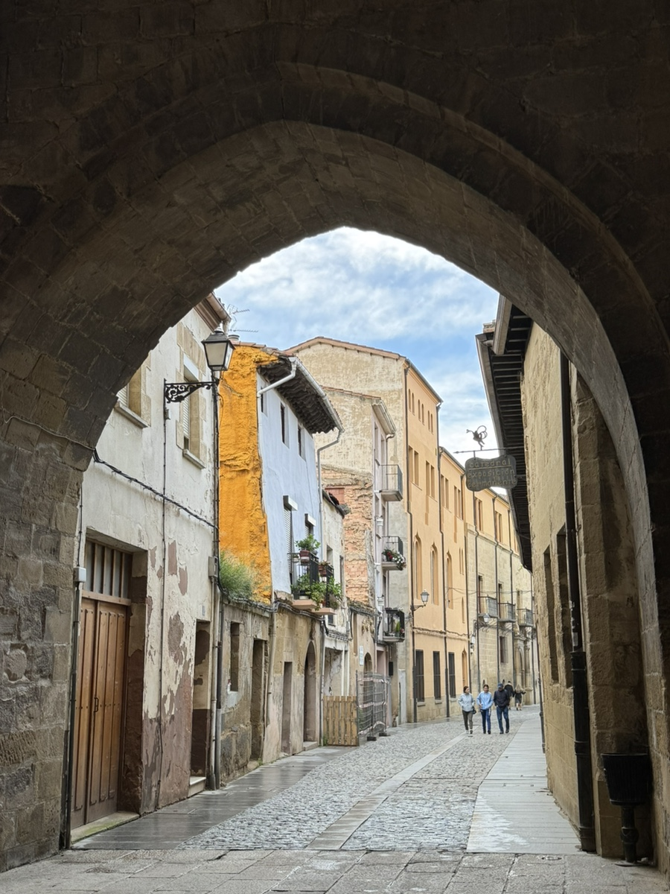

나헤라에서 산토도밍고데라칼사다로 이동하는 날.
써니언니와 떼레사 언니는 7킬로 더 간다고 하여 오늘부터는 엄마와 나, 단둘이다.
원래도 단둘이었지만. 어쩐지 허전한 기분이 든다.

계속 비가 내린다.비가 오면 거추장스러운 우비를 꺼내입는 것도 고역인데, 이런 물웅덩이와 질퍽해진 진흙길을 걷는게 가장 큰 고통이다. 피할 데가 없어 그대로 진흙을 밟으면 신발에 온통 진흙이 엉겨붙어 묵직해진 신발을 들어올려야 한다.

날씨는 어찌나 변덕스러운지 우비를 꺼내입으면 곰새 비가 그치고, 또 벗어서 가방에 넣으면 비가 쏟아진다.

아침에는 숙소에서 꼭 바나나와 요거트, 삶은 계란 등을 먹고 출발하는데, 요상하게 5킬로 정도 걸으면 배에서 꼬르륵 소리가 난다.
마침 그즈음이면 다음 마을이 보인다. 화장실도 갈겸 처음 보이는 바bar에 들어간다.
오줌 누이는 비용으로 커피와 초코빵을 시켜먹는다. 쉬가 또 마려우면 낭패니까 커피는 에스프레소로.

비가 오다 안오다 반복되는 하루..

멀리서 바라보면 굽이굽이 이어진 길이 참 신기하다. 걸으면 올라가는지 내려가는지 감도 안온다.

산토도밍고는 공립에서 묵었다.
깨끗하고 주방도 넓고 샤워실도 넉넉해서 부족함없이 지냈다. 같은 방에 한국인들로만 넣어줘서 좋기도 싫기도? 했다.
