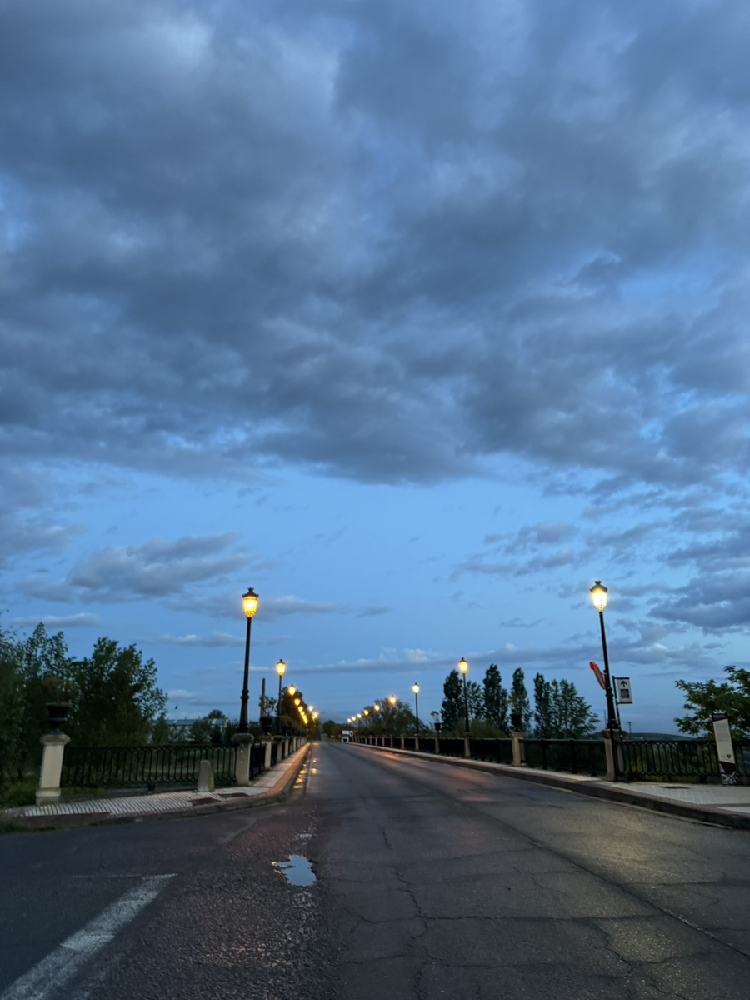
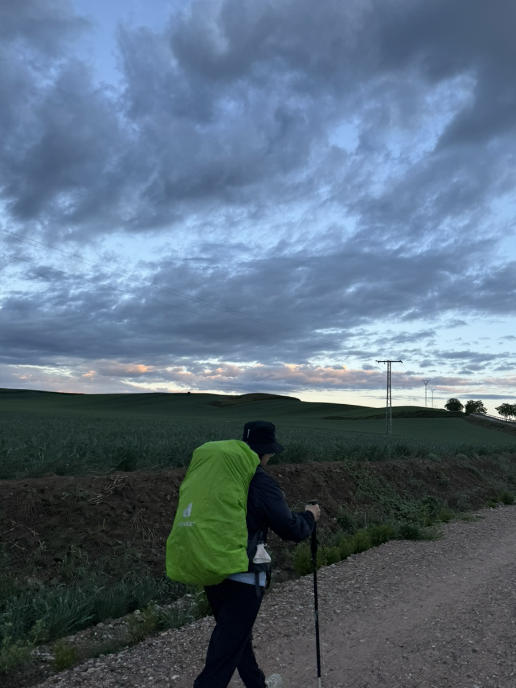
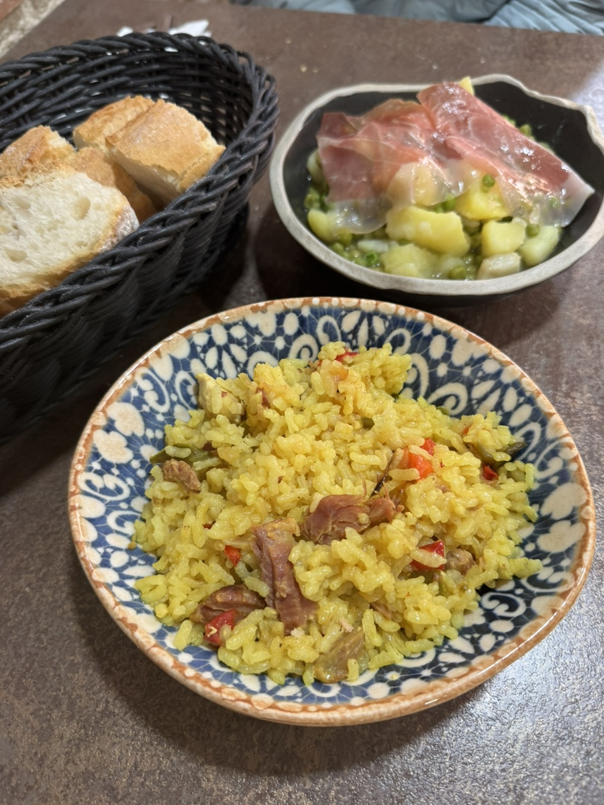
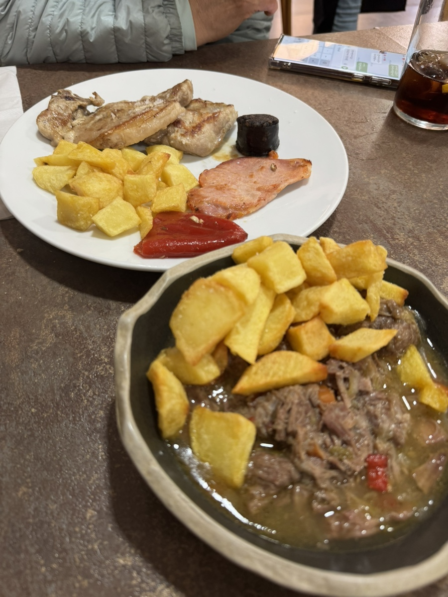
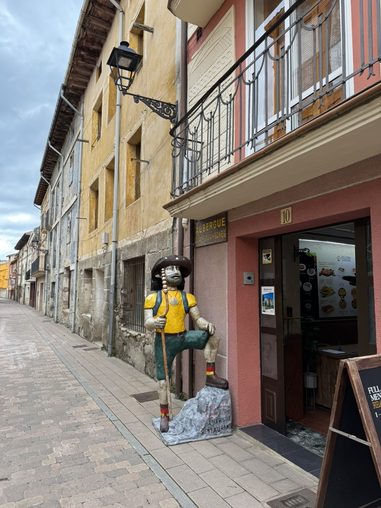
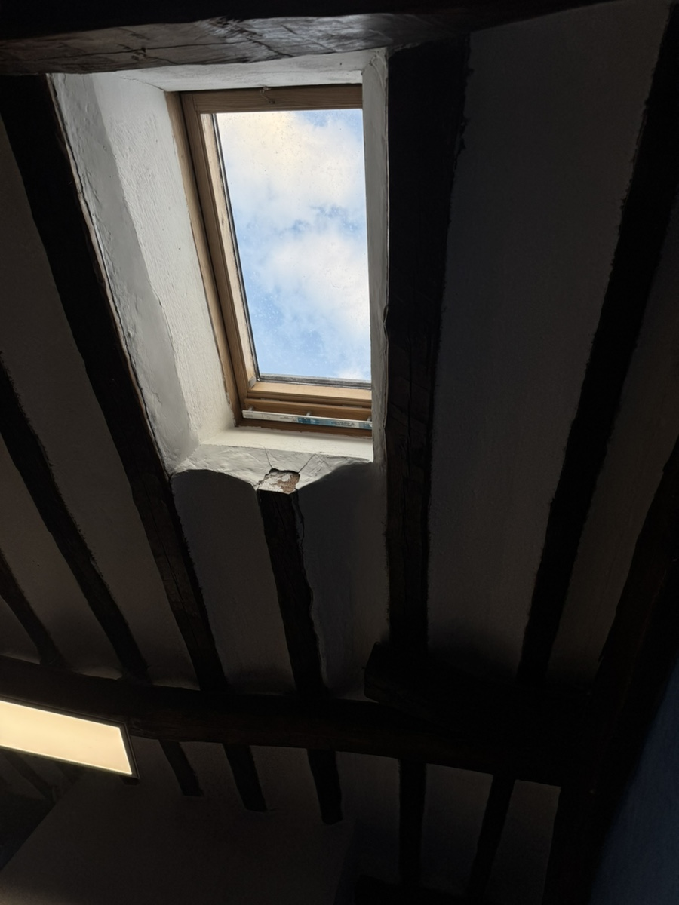

산토도밍고에서 벨로라도로 이동하는 날.

묵을 때는 몰랐는데 떠날 때 보니까 참 아름다웠던 마을 산토도밍고. 지금 생각해보니 꽤 큰 도시였다..

비가 올까봐 잔뜩 쫄아서 나왔는데 막상 걸을 때는 비가거의 오지 않았던 하루.

1시가 좀 안 되어 벨로라도에 도착했는데,
숙소 오픈 시간이 1시반이어서 죄금 기다려야 했다.
땀도 흠뻑 나있었고 진이 다 빠져있는 상태에서 30분을 기다리는게 꽤 괴로웠다..

씻고 나와 먹은 순례자 메뉴.
후기에 닭곰탕 맛이 나는 스프가 나온대서 달려갔는데 이제 그 메뉴는 없었다. 아쉬운대로 적당한 순례자 메뉴를 골라 먹었다.

우리가 묵던 숙소 레스토랑이 폭립 맛집이랬는데 그걸 포기하고 닭곰탕을 선택했건만..
점심은 항상 애매한 3시쯤 먹게 되어서 저녁은 주로 간단하게 샐러드나 빵으로 때운다.

숙소에 들어와 멍하니 천장에 뚫린 창밖을 보고 있는데, 방에 일본인 여성과 인도인 남성이 들어왔다.
독특한 커플이다 생각하고 일어나 인사를 건넸다. 자세히보니 아저씨는 전날 산토도밍고에서 내가 길을 물어본 분이었다. 자기도 여기 모른다며 손사래를 치고 지나치던 기억이 났다. 내가 전날 실례했다며 사과했더니 깔깔 웃으며 괜찮다고 하셨다. 그렇게 자연스럽게 또 스몰토크가 이어졌다.
두 분은 일본에서 만나 결혼하고 호주로 이주했다. 딸이 벌써 27살이라고. 인상이 좋고 영어도 수준급이셨다. 아주머니 이름은 토모코. 토모코의 은퇴를 기념하며 떠난 순례길이라고 했다. 조심스럽게 전에 하던 일을 여쭈니 시스템 개발을 하셨다고 한다.
몇마디 안 나눴는데 몇 년을 알고 지낸 사이처럼 가깝게 느껴졌다. 벨로라도는 정 붙일 곳 없는 삭막한 동네라고 느껴졌었는데, 토모코 상과 같은 방을 쓸 수 있어서 안심이 됐다. 역시 나는 금사빠. 아이시떼루 토모코 상..
