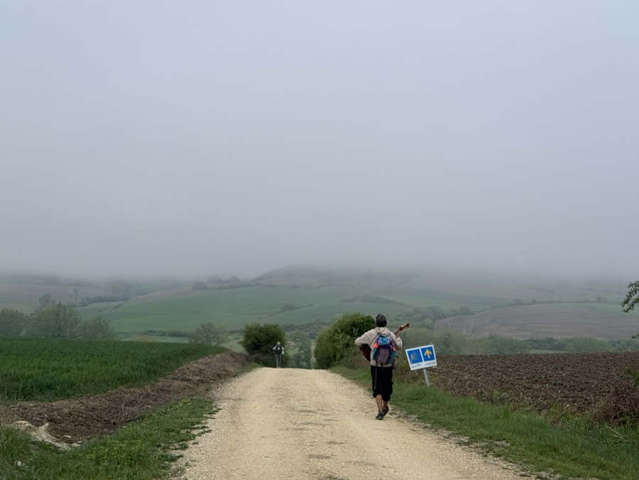
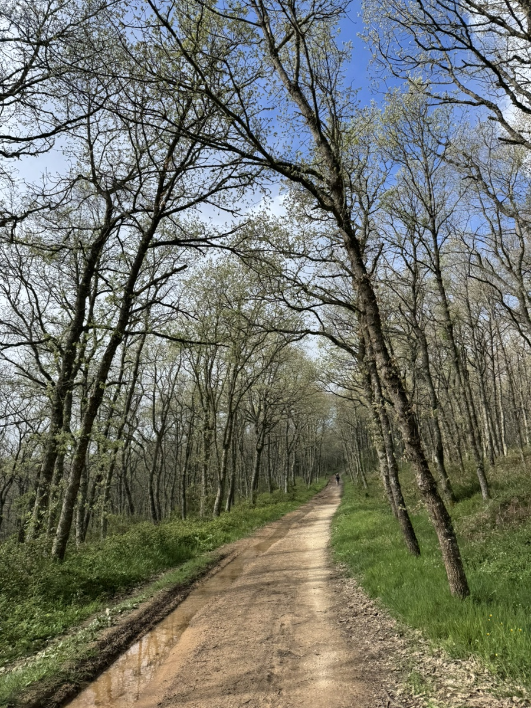
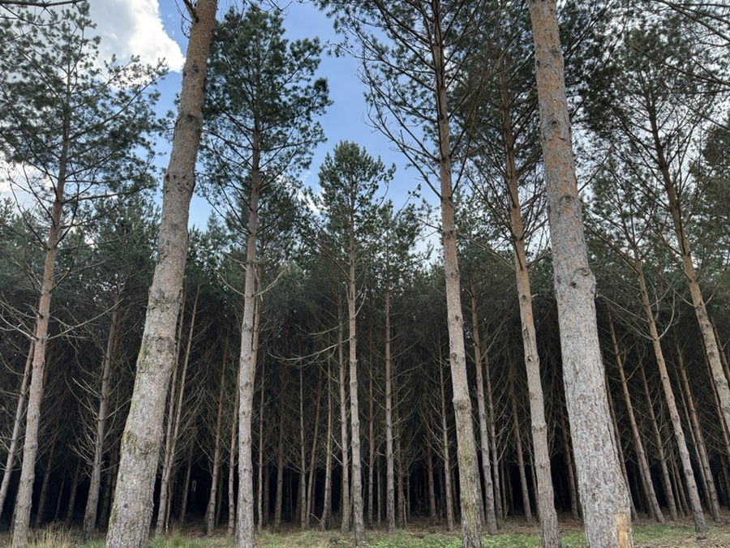
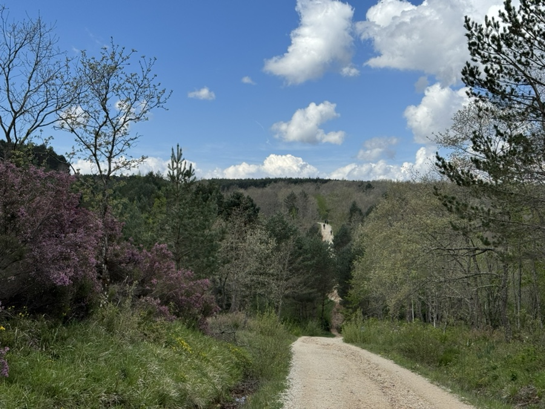
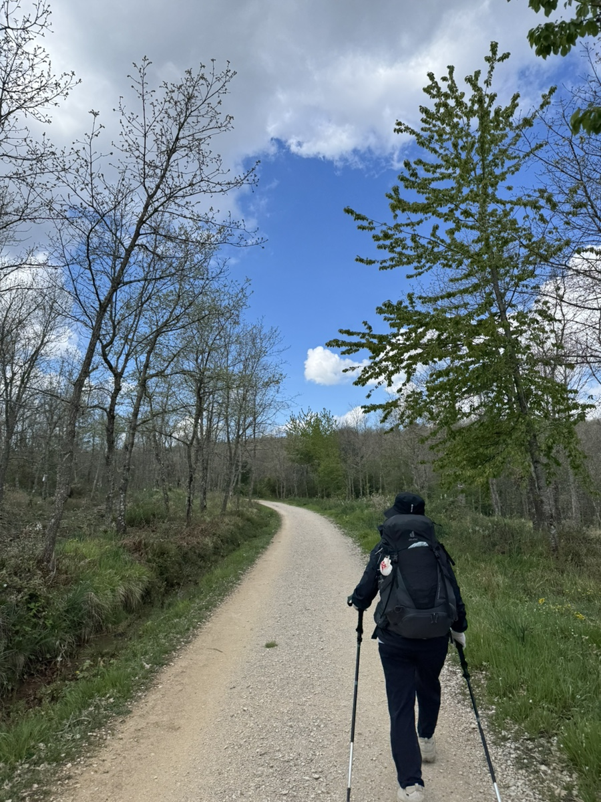
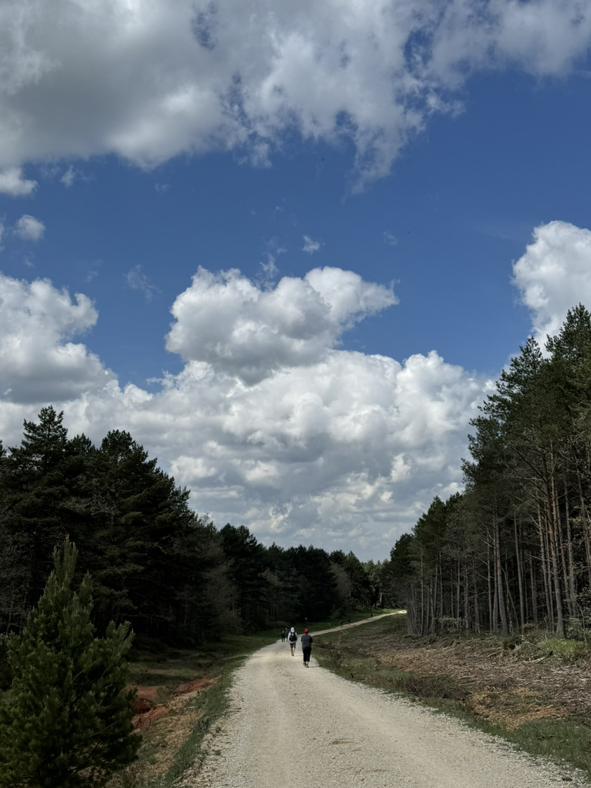
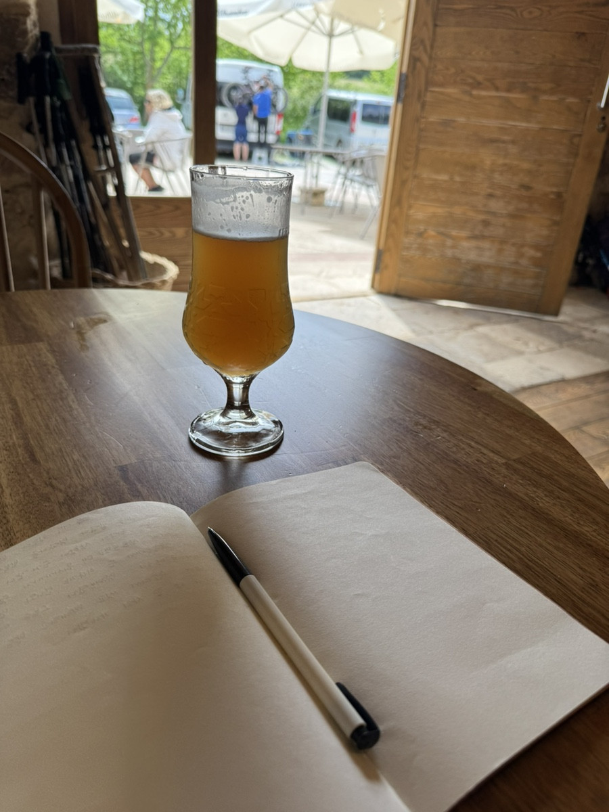
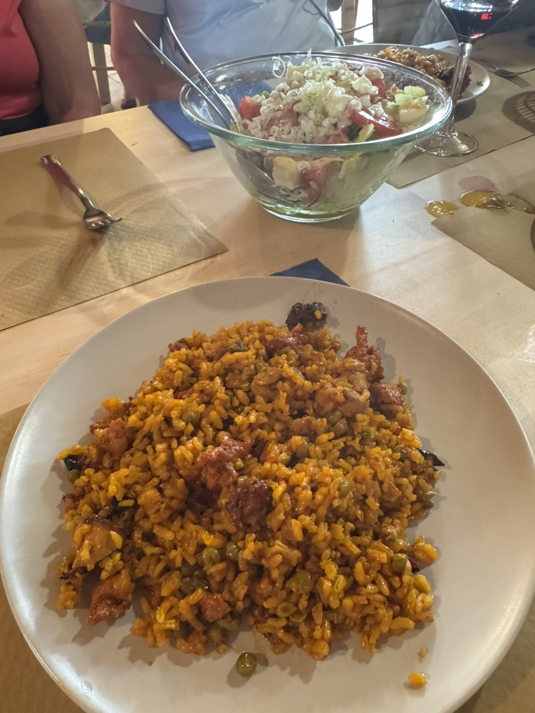

벨로라도에서 산후안 데 오르테가로 이동하는 날.

이 친구랑은 꽤 오랫동안 같이 걷고 있다. 로스 아르코스에서도 본것 같은데.. 처음엔 동네 주민인가했는데 매번 알베르게 앞에서 마주친다. 자신을 뮤지션이고 마사이 족 출신이라고 했는데.. 어디까지가 진실인지는 모르겠다. 이날은 삘이 제대로 꽂혔는지 내내 기타치고 노래를 불러줬다. 덕분에 힘내서 걸었다. 엄지를 치켜 보이며 그를 지나쳤다.

산후안데 오르테가 가는 길은 굉장히 가파른 오르막 길이었다. 나는 다행히 숙소를 미리 예약해둬서 다행이었는데 다른 순례자들은 숙소에 자리도 없고 동네가 애매하여 한 마을을 더 넘어간다고 했다. 혹은 이맘때쯤부터 부상자와 감기 환자가 늘어, 그런 사람들은 버스를 타고 부르고스로 이동한다고 했다.

계속 이어지는 급경사를 오르는데, 머리가 새하얗게 새어 있는 할머니 할아버지들도 자기 몸뚱이만한 배낭을 짊어지고 혼자 묵묵히 걸어오르신다.

중간에 멈춰 서서 쉬고 있는데 한 프랑스 할머니와 마주쳤다. 어디까지 가시냐 여쭤보니, 산후안 이후에 마을 하나를 더 넘어 가신다 했다. 내가 헤엑 하고 놀라자,
pas de problem! (문제 없어!) 하고 외치셨다.

오르막길이 어느정도 끝나고 난 뒤에도 계속 산 길이 이어졌다. 나무가 굉장히 빽빽해서 약간 무서울 정도였다.

롤러코스터처럼 급경사 길은 멀리서 보면 신기하고 가까이 하기는 싫고 속이 울렁거린다..

그래도 잘 걷는 우리 엄마. 대견해~
드디어 숙소에 도착해 체크인을 하는데, 먼저 와있던 써니 언니와 떼레사 언니를 만났다. 눈물겨운 상봉이었다.

토모코 상도 같은 숙소를 예약해서 우리랑 비슷하게 도착했다. 바로 옆 침대를 쓰게 됐다. 토모코 상이랑 같이 빨래 돌리고 이런저런 수다를 떨다가, 1층 바로 내려와 홀로 레몬 맥주를 들이키며 일기를 썼다.

대망의 저녁 식사 시간. 엄마의 음력 생일날이라, 미리 생일초를 준비했는데 케익이 없어 이도저도 안되는 상황이었다. 마침 커뮤니티 디너의 디저트가 치즈케익이었고, 직원에게 생일 초를 스윽 들이밀며 어떻게 안되겠냐고 물으니 생일자가 누구냐 물었다.
나는 엄마 몰래 엄마 등 뒤에 서서 손가락으로 가리켰다. 직원은 의미심장한 표정으로 고개를 끄덕였다.

잠시후 식사가 시작되고, 메인 이후에 디저트가 나오는 타이밍이었다. 직원은 생일초에 불을 붙여 엄마에게 다가갔다. 나는 큰 소리로 생일축하노래를 불렀고, 영문도 모르는 같은 테이블의 사람들도 따라 불러주었다. 초면의 외국인들도 엄마에게 다가가 따뜻하게 안아주며 생일을 축하한다고 말했다.
그렇게 엄마의 글로벌한 생파가 지나갔다. 대문자 T인 엄마가 진심으로 감동받은 듯 해서 뿌듯한 하루였다.
